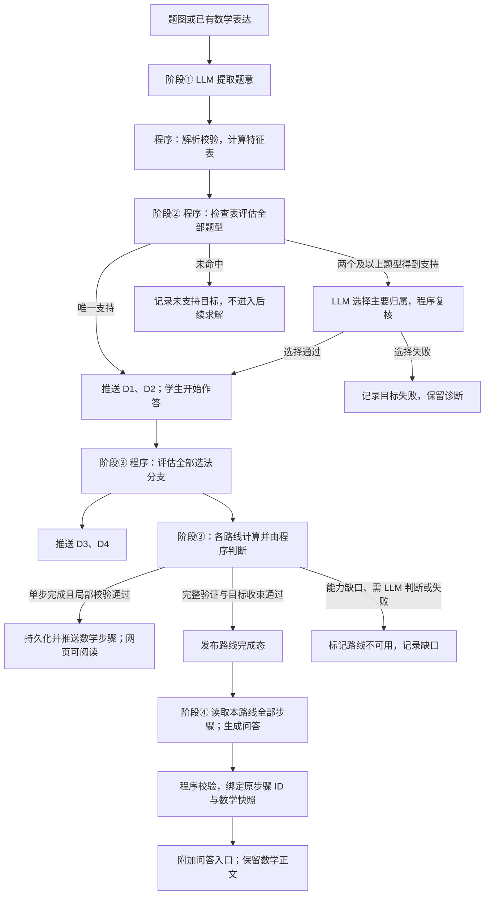
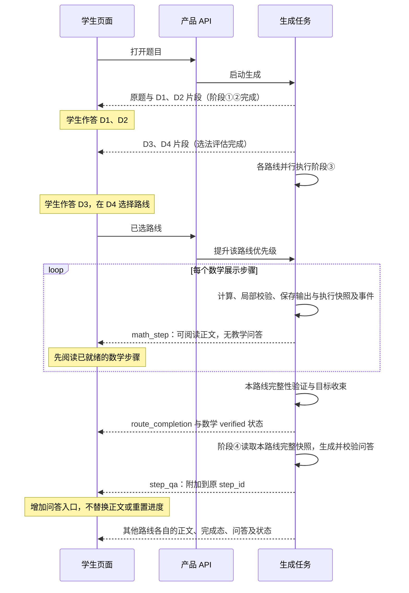

# 基于四阶段的交互课程生成设计

> 状态：阶段①②已实现，阶段③④待实施。更新日期：2026-10-19。
> 目标：从题图或已有数学表达出发，生成与恒成立 Q01 图谱 Demo 同类的可交互网页；阶段①②完成后即可展示，阶段③逐步推送可阅读的数学过程，单条路线验证完成后由阶段④补充各步教学问答。
> 四个阶段：① LLM 提取题意，程序计算特征表；② 程序用特征检查表判断题型，两个及以上题型得到支持时由 LLM 选择主要归属；③ 方法驱动器计算、校验并逐步发布数学步骤，本期判断节点全部由程序判定；④ 程序从完整已验证路线推导可核验的问答结构，LLM 撰写学生可能的问题、提示与 AI 反馈，按原步骤 ID 附加。
> 课程原稿沿用 Demo 原稿格式（`site/data/graph-walk/*.source.json`），人工 Demo 原稿即首题金标。各阶段冻结输出作为下一阶段的测试输入；调用 LLM 的阶段另保留真实调用记录，阶段③本期零 LLM。

## 1. 目标与范围

生成的网页支持：读题并找出线索、判断题型、选法判断、分步选择或填空、错答反馈、通过后的推导和图形展示，以及图谱同步显示实际使用的方法、技能和知识依据；支持后退、换路线和完成后的路线比较。

学生打开题目后，只需等待阶段①②完成即可开始作答。阶段③每完成一个有意义的数学步骤，先通过局部校验并持久化，再推送网页；无需等待整条路线计算完成或阶段④。阶段③发布的正文已有标题、数学表达、条件与依据，学生可以阅读。整条路线的完整性验证与目标收束通过后，才发布路线完成态并启动该路线的阶段④；阶段④按原步骤 ID 补充问答，不重新编排正文。局部步骤校验与整条路线验证分别标注，不能提前宣称整题答案已验证。

页面复用 `/1/`、`/2/` 的交互组件和 `site/assets/graph-walk/` 的 Demo 运行时。按需导师与学习记录是后续接线。

**首轮范围：**

- 题目：恒成立专题 Q01–Q09。九题均有人工课程可对照，覆盖全实数恒成立、二次项系数退化（Q02、Q03）、开区间存在成立（Q05）、除以负数（Q06）、更换主元（Q08、Q09）。
- 另加两道多问题 Q10、Q11。阶段①输出小问树并按目标计算特征，阶段②按小问判型；这两题的小问彼此独立，前问结论供后问使用留待后续扩展。
- 补入题 13 参数最小值的真实学生上传录制，阶段③验证从完整可行集收束到最值及不存在情形；与前述 22 份验收录制分开计数。
- 不实现阶段③到阶段②的回流重判。
- 不覆盖正式题页，生成结果使用独立入口。

## 2. 设计原则

1. **程序能判定的不交给 LLM。** 量词、次数、系数是否含参、能否分离参数、符号是否确定，都由程序计算。LLM 处理的是程序不能判定或需要教学表达的部分。
2. **结论三态。** 检查返回“满足、不满足、未知”，未知须说明原因（题意缺失、待计算、含参待分支、缺少检查能力）。模型置信度不能代替数学确认，未知不能当作不满足。
3. **保留候选及判断依据。** 不符合的题型、不适用的方法连同依据一起保存，作为教学问答和“为什么不对”的反馈依据。数学适用性、推荐顺序与路线支持状态分别记录；可用但不优先、尚未实现的候选不能标为数学错误。
4. **数学来自已验证结果。** 课程中的公式、数值、选项正误与反馈依据都追溯到阶段③的执行记录或程序检查。
5. **自然语言不作检索键。** 题型和知识检索只依据结构化题意与特征，不使用名称、别名、描述或文本向量相似度。
6. **已展示不改写。** 数学片段一经发布即冻结；阶段④只附加问答，不改步骤顺序、拆并步骤、替换公式或正文。更正只进入新的课程版本。
7. **一份原稿，多个使用端。** 页面、教师配置、图谱同步、AI 回放都从同一份课程原稿生成。

## 3. 四阶段总览

| 阶段 | 程序 | LLM | 输出 | 学生端可用的部分 |
| --- | --- | --- | --- | --- |
| ① 题意与特征 | 解析、校验题意；计算特征表 | 转录原题、提取题意（沿用现有记法）；必要时补充隐藏结构猜想 | 原题转录、题意、特征表 | 原题 |
| ② 题型判断 | 用检查表评估全部题型，保留排除依据 | 两个及以上题型得到支持时选择主要归属，未知不能由 LLM 直接确认 | 各题型结论及依据 | D2 判断题型 |
| ③ 选法、求解与数学步骤发布 | 评估全部选法分支；方法驱动器调用能力函数，局部校验、持久化并逐步发布；完成路线验证与目标收束 | 本期零调用；需要启发式 LLM 判断的节点报告能力缺口，后续支持 | D3、D4、稳定步骤 ID 的数学片段、完整轨迹与路线完成态 | D3、D4、逐步解题正文与最终完成态 |
| ④ 教学问答补充 | 从完整已验证路线推导问答结构、常见错误与核对依据，校验后绑定原步骤 | 撰写学生可能的问题、引导问题、提示与 AI 反馈 | 附着于原步骤 ID 的问答片段 | 问答就绪后增加对应入口，正文可先阅读 |



## 4. 阶段①：题意与特征表

### 4.1 题意

LLM 从题图提取原题文字、数学定义、条件、目标及不确定项，沿用现有 `problem-math-notation/v1` 记法和 `original_text`、`root` 结构。本阶段不输入题型目录，不输出题型归属。

Q01 的题意已有人工整理稿 `site/data/math-notation-v1/quadratic-always/q01.json`：

```json
{
  "root": {
    "facts": ["a∈ℝ", "∀x∈ℝ: -x^2+2*x+3 ≤ a^2-3*a"],
    "goals": [{"kind": "find_range", "symbol": "a"}]
  }
}
```

解析器已支持 `∀`、`∃` 量词。LLM 只负责转录和题意两件事，**不标注出处、不声明约定**。`original_text` 只供展示，验收时忽略标点、空白和公式排版差异。D1 需要的原题片段由阶段②的程序定位（见 5.3），不进入本阶段的 LLM 契约。

输入已有合格题意时直接校验复用，不再识图。

### 4.2 特征表

线索不再由 LLM 另写一份，而是由程序从解析后的题意**计算**得到，称为特征表。特征由已登记的特征提取函数产生，每个函数声明：

| 内容 | 要求 |
| --- | --- |
| 特征 ID 与输出类型 | 稳定 ID；输出为枚举、表达式或布尔值，或带原因的未知 |
| 计算依据 | 读取哪些事实或目标；需要的代数计算复用现有受限表达式解析和 SymPy 能力 |
| 前提与分支 | 例如系数含参时，返回“非零／为零”两个分支条件，而不是单一结论 |
| 学生措辞模板 | 用于 D1–D3 的证据展示，例如“$x$ 的取值范围：{domain}” |
| 关联知识 | 特征对应的公共知识点或条目，例如 `quantifier` 关联 `quantifiers#universal`；D1 的片段到知识点映射由此得到 |
| 依据 | 产生该特征的题意条目（`source_refs`，指向 `root` 中的事实或目标） |

检查分为阶段①的结构特征与阶段③的方法前提，两者按各自契约记录，只复用适用的纯代数部件：

- **结构特征**：在阶段①计算，只描述题目结构，与具体方法无关，供阶段②判断题型及 D1 使用。包括量词、变量角色、目标、定义域、关系严格性、规范关系、关于各变量的次数、系数及其是否含参、给出范围的变量是否为主元。
- **方法前提检查**：在阶段③评估选法分支和执行方法时调用，属于方法的一部分。包括能否分离参数（`param_separable`）、除式在定义域上的符号（`divisor_sign`）、首项系数为零时的逐级降次分支（`degenerate_branches`）。阶段①不计算这些检查，避免与阶段③的能力形成两份实现。

题目未逐字写出的量词内容按两条规则补全，写在提取提示词和表达目录中，由 LLM 直接写进题意，不另行声明：未限定自变量范围的实系数多项式不等式按实数域理解；原题只说“恒成立”而未指明对哪个变量时，取不等式中除待求量以外唯一的自由变量为量词变量，不唯一时报告待确认。补全是否正确由题意语义验收和原图复核判断。将来页面需要区分“原文写明”与“默认补全”时，由程序比对原文后标注，不再由 LLM 承担。

Q01 的结构特征：

| 特征 | 值 | 依据 |
| --- | --- | --- |
| `quantifier` | ∀，作用于 $x$，范围 $\mathbb R$ | 事实 2 |
| `goal` | 求参数 $a$ 的取值范围 | 目标 |
| `bound_vars` / `free_vars` | $x$ / $a$ | 量词绑定 |
| `normal_form` | $x^2-2x+a^2-3a-3\ge0$ | 移项，规定为“关于量词变量的多项式 $\ge0$”形式 |
| `degree_in_bound` | 2 | `normal_form` 关于 $x$ |
| `leading_coeff_in_bound` | $1$，不含参数，非零 | `normal_form` 关于 $x$ |
| `domain_kind` | 全体实数 | `quantifier` |
| `range_var_is_principal` | 是：给出范围的 $x$ 是二次式的主元 | `quantifier` 与 `degree_in_bound` |

LLM 只在一种情况下补充特征：隐藏结构程序算不出来，例如基本不等式 Q30 的“条件可配成 $(a-1)(2b-1)=4$”。这类补充以数学表达式记录为待验证猜想，可以用于召回，但不能作为检查已满足的证据。

### 4.3 表达式处理约束

以下约束对特征提取和后续检查都适用：

- 量词种类与顺序、区间开闭、严格与非严格关系必须保留。
- 约分保留非零条件，例如 $(x^2-1)/(x-1)$ 改写为 $x+1$ 后仍有 $x\ne1$。
- 次数须注明相对于哪个变量；首项系数含参时保留退化分支。
- 变量角色由量词和目标绑定，不能固定认为 $x$ 是变化变量、$a$ 是参数。
- 解析失败或不支持的算子返回未解析，交回提取修复，不以自然语言混入特征。

### 4.4 scope

数据结构按 scope 组织：根 scope 保存公共题设，小问 scope 保存本问目标和局部条件，并通过引用继承。阶段①已实现：同名字母按定义、量词和 scope 绑定身份；并列小问的局部条件不互通；特征按目标计算，`target_ref` 指向所属小问的目标。后续扩展前后问依赖时，前问结论须经阶段③验证后才能带来源提供给后问；本期不实现该依赖，阶段①不代入前问答案。

### 4.5 验收

题意与原题语义一致，转录的文字和公式没有遗漏或改写；结构特征与人工核对一致；未知特征都有原因；记录每次调用与整个阶段的耗时。题型是否判对由阶段②验收，方法前提检查由阶段③验收。

## 5. 阶段②：特征检查表判断题型

入口读取阶段①的 `graph-stage-one-result/v2`，检查结果契约、非空 `candidate` 的提取契约及数学合法性，统一要求 `statuses.extraction=reviewed_candidate`，`statuses.source_reviewed`、`statuses.features` 为 `true`。准入分两路：`acceptance` 另要求 `statuses.evaluation/passed=true`；`student_upload` 要求 `statuses.admission=student_upload`，按提取、原图复核和特征校验准入，不补造金标评测结果。阶段②在 `options.admission` 记录策略，供阶段③继承。输入不合格时返回 `input_error` 和诊断，不判型、不调用 LLM、不生成学生 D1/D2。

特征自身为 `unknown` 是合法结果，不等于 `statuses.features=false`，不阻断整个输入；它只让依赖该特征的检查保持未知。`human_review=pending` 也不阻断本阶段。判型以 `target_ref` 为单位，各目标分别处理，兄弟小问的特征不混用。

### 5.1 题型识别契约

在公共题型节点旁增加机器可读的识别契约，保留同一题型 ID。题型识别定义为**特征检查的组合**，不做表达式模式合一。

| 内容 | 要求 |
| --- | --- |
| 匹配分支 | 同一题型可有多套成立条件，任一分支通过即可支持归属。例如恒成立题型分“量词变量的二次式”和“更换主元”两支 |
| 必要条件 | 每个分支列出特征检查，全部满足才支持归属 |
| 排除条件 | 列出冲突特征，并引用相应的易混题型 ID；排除条件未知时保留候选 |
| 学生线索对应 | 每个检查对应题型节点 `features` 中的一条学生线索，用于 D2 的证据展示和图谱联动 |
| 计算依赖 | 检查需要的特征或已验证性质 |

识别契约区分题型定义与方法提示。例如“通常转化为最值”是选法线索，不能用来确认题型。

Q01 相关的契约示意：

| 题型 | 分支 | 必要条件 | 排除条件 |
| --- | --- | --- | --- |
| `type-quantified-quadratic` | 量词变量的二次式 | `quantifier` 为 ∀ 或 ∃；`goal` 求单个自由变量的范围、最小值或最大值；`degree_in_bound` ≤ 2，等于 2 或含参可为 2 | — |
| `type-quantified-quadratic` | 更换主元 | 同上量词与目标；关于目标变量为二次；关于量词变量至多一次 | — |
| `type-parameter-quadratic-solve` | — | `goal` 求某变量的解集；系数含参 | `quantifier` 存在 |
| `type-amgm-quantified` | — | `quantifier` 存在；存在经验证的和积结构，满足基本不等式的适用条件，可用于判断所需界 | —；二次结构不排除这一归属 |

二次函数性质可直接求界只影响主要归属与方法推荐，不能排除基本不等式思路。Q01 可写为 $3+x(2-x)$：当 $0<x<2$ 时，$x+(2-x)=2$，由基本不等式得 $x(2-x)\le1$，在 $x=1$ 取等；其余范围乘积不大于 $0$，因此全实数上的最大值为 $4$。这支持基本不等式题型归属，与首轮是否提供该方法的交互路线无关。和积变形、适用前提或所需范围的论证尚未验证时，相关检查返回未知。

阶段②的识别契约可以声明按需验证调用，用于确认结构特征尚不能直接证明的题型条件。例如基本不等式候选调用共用的恒等变形、适用前提和界验证能力，保存输入、前提与证据后再更新检查结果；不要求阶段①预先求解。验证能力与阶段③共用实现，但阶段②只验证本次归属所需的性质，不生成完整方法轨迹。缺少构造或验证能力时保留 unknown，不能由 LLM 直接确认；Q01 的阶段②验收须补齐这一验证调用。

### 5.2 判定

程序的定位是**帮助 LLM 缩小判断范围**：能唯一命中就直接确认；命中多个就交给 LLM；一个都没命中就不硬猜。

1. 程序对每个题型、每个分支评估全部检查，得到三态结果（支持 / 冲突 / 未知）。
2. 某分支必要条件全部满足、排除条件全部不成立时，该题型得到支持；必要条件不满足或排除条件成立时，该分支冲突；只有全部分支都冲突，才排除该题型。
3. **恰好一个题型得到支持**：程序确认主要归属，不调用 LLM。
4. **两个及以上题型得到支持（一律）**：把检查报告和候选列表交给 LLM，请它选定主要归属并引用检查依据。LLM 只能在得到支持的题型中选择，不能覆盖已经冲突的必要条件，也不能引入报告之外的题型。
5. **没有任何题型得到支持**（全部冲突，或仅有未知）：不调用 LLM。对学生端明确反馈「当前暂不支持该题型」；把题意、特征、检查报告写入本地待处理记录，供后台查看和补契约 / 节点。与前端打通后再迁入数据库。

多命中时，若 LLM 调用失败或返回的选择、检查引用无法通过校验，该目标输出 `selection_failed`，`primary`、`primary_source` 均为 `null`，保留调用与校验诊断，不生成该目标的学生 D1/D2。已有支持候选不能因选择失败变成 `unsupported`；其他目标继续独立处理。

题型规模较小时直接遍历全部契约。规模扩大后可以按特征建立倒排索引，不需要表达式子树索引。知识点反向关系（“涉及”）只用于 D1 的图谱展示和候选扩展，归属仍以检查结果为准。

### 5.3 输出

输出包括全部被评估题型的结论、分支、逐项检查结果和依据，**不只输出选中的题型**；并标明主要归属来自程序确认还是 LLM 选择。未命中时输出为空归属，并附带待处理记录路径。

各目标都完成归属确认或未命中处理时，全题 `status=completed`；部分目标为 `selection_failed`、其余目标完成处理时为 `partial`；全部目标选择失败时为 `failed`。入口不合格单独返回 `input_error`，不伪造各目标的未命中结论。

在归属已确定（程序或 LLM）时，程序直接生成课程原稿的 D1、D2 片段，不需要额外 LLM：

- D1：在该目标所属小问及共用题干的 `original_text` 中，先做 TeX 显示归一并保留归一字符到原文偏移的映射，再切分公式候选与叙述片段；不依赖公式带有 `$…$`。按题面符号上下文处理隐式乘法、别名与函数，再与该目标特征值比较；量词与目标措辞（任意、所有、恒成立、存在、有解、取值范围）按词表匹配。片段记录实际匹配的 `matched_feature_ids` 和据此触发的 `knowledge_rule_ids`，只挂这些规则点亮的知识。`source_refs` 仅用于回查题意来源，不能把同一事实下其他特征的知识扩散到该片段，例如“任意”不能因为和二次式同属一条事实就挂上二次不等式定义。定位不到的线索不提供点选，不影响其他片段；干扰片段取自不对应任何特征的原题片段。
- D2：候选为全部得到支持的题型，加上这些题型的 `confuse` 中本轮已经判定冲突的易混题型；`unknown` 只保留在报告中，不进入学生选项。错误候选的反馈由 `confuse.text` 与已证实冲突的学生措辞组成。得到支持但不是主要归属的题型须说明其替代思路，不得作为数学错误候选。

未命中时不出 D2 判型题，只展示暂不支持与记录状态。

### 5.4 验收

Q01–Q09 在结构上唯一命中恒成立题型时由程序确认，不调用 LLM；经验证的基本不等式若同时得到支持，则进入「多命中 → LLM 选定」路径，LLM 仍应选恒成立为主要归属。未命中样例须落本地待处理记录且不调用 LLM。LLM 调用只出现在多命中题目上。

另覆盖入口不合格、合法未知特征、人工待核对及多命中选择失败：检查 `input_error`、`selection_failed` 与全题汇总状态，确认失败目标不冒充未命中、不阻断其他目标。D1 同时测试有无 TeX 定界符、归一后回到原文的高亮偏移，以及同一 `source_refs` 下不同片段的知识隔离；D2 确认未验证的基本不等式候选只留在报告中。

## 6. 阶段③：选法与方法驱动求解

本阶段待实施，具体契约、批次与验收见[阶段③实施计划](graph-guided-stage-three-implementation-plan.md)。本期覆盖确定性程序判断，不调用 LLM；阶段①提取、阶段②多命中选择和阶段④教学问答使用 LLM。阶段③实施范围包含数学步骤发布、持久事件接口与网页增量接线，不以整条路线结束后才拉取结果代替逐步交付。

### 6.1 选法：评估全部分支

阶段③入口沿题型取得选法规则，**对全部分支计算适用性**，包括最终不执行的分支。每个目标同时绑定本作用域及祖先的全部可见事实、定义和变量约束；结构特征用于选法，不能替代完整题设。额外参数限制须参与可行集求交与独立校验，不能处理时报告能力缺口。例如 $a<1$ 且 $\forall x\in\mathbb R:x^2+a\ge0$ 的可行集为 $[0,1)$，不能只计算量词关系得到 $[0,+\infty)$。Q01 的选法结果：

| 分支 | 适用性检查 | 推荐状态 | 首轮路线支持 | 依据特征 |
| --- | --- | --- | --- | --- |
| 判别式法 | 可用 | 优先 | 生成 | `quantifier`=∀，`domain_kind`=全体实数，`leading_coeff_in_bound` 非零 |
| 分离参数法 | 可用 | 可选 | 生成 | 方法前提检查 `param_separable`：$f(x)\le h(a)$，不需要除法 |
| 区间最值法 | 可用 | 不优先（`superseded`） | 不生成独立路线 | $\mathbb R$ 也是区间；本题用判别式更直接 |
| 更换主元法 | 本选法分支未触发（`not_triggered`） | — | 不生成 | `range_var_is_principal` |

这一结果直接生成 D3（选法判断）和 D4（选择方法）片段。D3 分别展示适用性与推荐理由，区间最值法沿用 Demo 的“数学可行但不优先”结论；D4 另行展示路线支持状态。推荐顺序和路线是否实现均不能改写数学适用性，未触发某条选法规则也不等于证明该方法在数学上不可行。

### 6.2 外层方法驱动器

在 `graph_lesson/stage_three` 新建方法驱动器和能力函数，只复用 `math_kernel`、`notation_semantics` 中适用的纯代数部件，不依赖现有 `solver/runtime` 的执行控制流：

- 驱动器持有方法实例、当前步骤、分支条件、输入输出绑定和子方法调用栈。
- 每到一个计算步骤，驱动器调用执行契约绑定的能力函数，局部校验后将输出、运算依据、上下文增量、执行快照与步骤事件一起持久化，再继续推进。独立事件服务负责推送，求解不等待浏览器；局部校验失败的步骤不发布学生正文。
- 到达判断节点时，驱动器先完成节点依赖的计算，再由程序选择分支；不能判定或声明需要 LLM 的节点，本期报告能力缺口（见 6.4）。
- 子方法调用由驱动器压栈执行，返回后回到父方法的规定位置。

方法执行契约需要补充：入口、输入角色、步骤及输出绑定、后继关系、判断节点、子方法调用、完成条件，以及失败时的退出位置。公共方法现有的 `steps/calls/when` 是教学文字，须映射为可执行契约；同一步骤内的多个 `calls` 可能是条件调用，不能一律编译为顺序执行。

上下文由通用驱动器按契约引用传递：原题及完整可见约束只读，路线和分类分支各有局部绑定，计算输出携带来源。契约须声明每步读取的角色和先前输出，禁止读取尚未产生的结果或兄弟分支的局部值。方法配置描述通用的数学过程，不能按题号、固定变量字母、原式全文或固定输入位置选择路径；同类题换变量、系数、区间或增加约束时，应复用同一驱动器。

### 6.3 能力清单

阶段③的主要成本是补齐能力。恒成立四种方法用到的能力都是确定性算法，基于 SymPy 实现。Q01 两条路线需要：

| 能力 | 输入 → 输出 | 用于 |
| --- | --- | --- |
| 移项整理 | 关系 → 与 $0$ 比较的等价多项式及严格性；以方向归一残差校验：$L\ge R$ 取 $L-R$，$L\le R$ 取 $R-L$，严格关系另保留严格性 | 各方法 |
| 二次式恒正条件 | ∀、全实数、开口、不等号 → 判别式条件；首项系数含参时给出退化分支 | 判别式法 |
| 量词策略与条件收束 | 先按量词和比较方向选取上确界／下确界策略；值域及端点可达性计算完成后，再将策略应用为参数条件 | 分离参数法、区间最值法、更换主元法 |
| 二次函数区间最值 | 函数、区间 → 最值、取到点、可达性；附配方形式供教学 | 分离参数法 |
| 解一元二次不等式 | 不等式、变量 → 解集 | 两条路线 |
| 完整目标收束 | 各方法可行集与全部可见约束求交 → 按 `find_range`／`find_minimum`／`find_maximum` 返回集合或所求极值及存在性 | 各路线 |
| 端点检验 | 原条件、端点 → 每个端点保留或排除 | 两条路线 |

实现前核对现有基本不等式能力中可复用的部分，例如 `bound_univariate_quadratic`。Q02–Q09 另需一次函数区间最值、对勾函数区间最值、分类合并等能力，推广时补齐。

第 4.2 节的方法前提检查（`param_separable`、`divisor_sign`、`degenerate_branches`）也在本阶段实现，与上述能力共用代数基础；选法分支评估和方法执行调用同一实现。

归一化后必须按新的比较方向选取界，不能保留原关系的最值方向或用首项系数决定是否擅自乘负数。闭区间上的一次式按端点消去量词时，∀ 对两个端点条件取 AND（解集交），∃ 取 OR（解集并）；开区间还须检查边界可达性。判别式“恒成立”分支只由 ∀ 触发，∃ 使用独立的存在性规则，不能套用恒成立条件。

可行集只是极值目标的中间结果。求最小值／最大值还须判定端点是否属于可行集，区分取得极值、无界、界取不到及可行集为空；只有上确界／下确界不能写成最大值／最小值。例如题 13 的可行集 $a\in[-\frac52,+\infty)$，按 `find_minimum(a)` 收束后的答案为 $-\frac52$。

### 6.4 判断节点：程序判定与 LLM 判定

| 判断 | 示例 | 由谁判定 |
| --- | --- | --- |
| 退化分支 | Q02 的 $k=0$、Q03 的 $a=\pm1$ | 程序 |
| 系数符号分类 | Q09 中 $x^2-x$ 的正、负、零 | 程序 |
| 除数符号 | Q04 除以 $x>0$、Q06 除以 $x<0$ | 程序 |
| 区间求值技能选择 | 按函数类型选择二次、一次或对勾函数求值技能 | 程序 |
| 变形构造 | 基本不等式中的配凑、换元、乘“1” | 后续由 LLM 提出、程序验证；本期为能力缺口 |

**本期阶段③全部判断节点由程序完成，语义调用与网络尝试均为 0。** 程序无法判定的节点报告 `capability_gap`；声明需要 LLM 的节点报告 `llm_judgment_unavailable`。后续扩展启发式构造时，LLM 上下文才包含方法版本与节点、绑定对象、当前分支条件、依赖计算结果和允许选项；返回选项 ID、依据引用和参数绑定，或明确未确认，并由程序核对选择范围、参数类型和数学前提。

### 6.5 路线与轨迹

每种入选方法形成独立路线，可以并行执行。原题为共享只读输入，中间结果不能跨路线混用；方法内的分类讨论分支属于同一路线。

每条路线使用本阶段自有轨迹契约，保存每一步的方法步骤、实际调用的能力与公共技能、输入输出、分支条件、判断输入与选择、依据条目；失败时保留已完成前缀。跳过的准备步骤和未选择的候选不计入实际路径，但保留“候选调用”记录供图谱展示。本期不生成或依赖 ExplanationSnapshot，只预留字段映射，供将来接入。

公共技能 ID 与内部能力 ID 分别保留，由显式映射表关联；一个公共技能可以对应多个能力。

数学步骤的展示边界由阶段③的方法执行契约和通用展示规则确定。每个有意义的数学步骤至少输出稳定 `step_id`、顺序与轨迹来源、标题、前后数学表达、适用条件、依据，以及程序模板生成的基本说明，例如“由于 $x>0$，两边同除以 $x$”。一个能力内若含多个需要实时展示的数学推导，本期拆成显式可恢复子调用，在每个发布边界同时保存下一子调用位置与绑定；不能在仅有整次调用恢复点的能力内部直接发布。SymPy 内部函数调用不机械转成网页步骤。计算与展示步骤可以按声明映射，发布前必须满足该展示步骤的全部依赖，不能由阶段④事后拆分、合并或重排。

单步局部检查通过后即可发布 `math_step`，标记 `local_check=passed`，不等同于整条路线的 `verified`。完整验证及目标收束通过后，发布 `route_completion` 并启动该路线的教学问答补充；其他路线仍在计算或失败均不阻塞。数学步骤、完整轨迹和问答补充分别保存，阶段④不能写回数学正文。

完成态与问答交接还须确认当前已验证路线之间结果一致；下文的“路线通过后发布／交接”均包含这一门槛。尚未完成的路线不等待；第一条已验证路线可以先交付。已知冲突或 `route_consistency_undecidable` 均不能发布答案／启动问答。若后来出现这些情况，追加 `lesson.goal_status` 将该目标标为 `conflict` 或 `no_verified_route` 并附原因，停止使用旧完成态和问答，保留各路线原有验证证据。

路线只有在逐步后置检查和独立数学验证均通过后才能标为 `verified`。独立验证须以完整可见题设为依据，通过覆盖全部参数域的完备分区（含退化点、边界与无界区间）或等价集合证明确认可行集，再核对目标收束；分区的覆盖性及每区间结论恒定性必须有依据。有限点抽查仅用于证伪，不能单独支持 `verified`；无法完成证明时保留为能力缺口。多路线一致性是附加检查，不能代替独立验证。

### 6.6 失败与缺口

分别报告“未收录题型”“方法可用但能力尚不支持”“数学校验失败”“执行错误”。方法前提被否定或结果为空集是正常数学结果，不按执行失败处理。能力缺口不影响 D3 中该方法“可用”的数学结论；在 D4 中，该路线标注“详细步骤暂不支持”。

### 6.7 验收

本期全部阶段③测试零 LLM。Q01 两条路线全部验证通过，结论为 $a\le-1$ 或 $a\ge4$ 且两端可取；轨迹中的调用位置和依据与 Demo 人工原稿一致；Q01–Q09 的选法结论与人工原稿一致。Q01 的区间最值法须保留“可用但不优先”，不生成独立路线不影响这一数学结论。另覆盖额外可见限制、关系方向等价改写、∀／∃ 端点合并差异、题 13 的极值收束与极值不存在边界，以及无法完成独立证明时不标 `verified`。

增量验收必须人为暂停后续计算，确认最终步骤和阶段④尚未完成时，网页已经收到并展示前面的数学步骤。覆盖步骤 ID 稳定、局部与整体验证状态区分、先持久化后通知、断线补发与去重、进程重启恢复、轮询与推送结果一致，以及变量／系数／区间变式不新增题号特例。

## 7. 阶段④：为已验证步骤补充教学问答

### 7.1 输入与启动条件

每条路线独立启动阶段④：阶段③已完成该路线的全部计算、完整性验证与目标收束，数学状态为 `verified`，并通过与当前其他已验证路线的一致性检查。输入为完整、冻结的路线快照及其全部 `math_step`，包含原题、分支条件、计算结果、依据和最终答案。阶段④可以同时看到整条路线，以保证各步的问答连贯，但不必等待其他路线完成。

阶段③已经生成学生可阅读的正文和稳定步骤结构。阶段④的输出只按原 `step_id` 附加，不修改步骤标题、顺序、公式、结果或正文，不合并、拆分或新增解题步骤。数学执行步骤到网页步骤的映射由阶段③完成。

### 7.2 问答结构与常见错误

程序按注册表为各步推导可核验的补充结构，LLM 撰写文字。每步可以包含多个学生可能的追问、引导问题、提示、常见错误及对应 AI 反馈，不要求每步机械生成一道选择题。

| 步骤依据 | 可附加的教学内容 | 程序负责的部分 |
| --- | --- | --- |
| 判断节点的候选与结论 | “为什么选这一分支”，可选 choice 或 checklist | 候选身份、支持／冲突证据；可用但不优先或路线未支持另行说明 |
| 表达式变形与计算 | “这一步怎么算”，可选填空与分层提示 | 正确结果、关键中间量、错填的展开核对与 `attempt_calculations` |
| 条件转化 | “为什么不等号反向／要取这个界” | 量词策略、除数符号、严格性与适用条件；图像组件参数从已验证结果绑定 |
| 端点与分类分支 | “这个端点为什么能取／不能取” | 代回结果、分支范围、覆盖与合并依据 |
| 目标收束 | “为什么求出的范围还不是最终答案” | 目标种类、可行集、极值存在性与已验证最终答案 |

常见错误目录登记在公共技能旁，例如不等号方向反了、端点开闭弄错、量词所需上界与下界混淆。若补充问答使用错误选项，程序从目录构造候选，并确认在本题条件下确实不成立；其他有效解法不能作为错误选项。LLM 不能凭措辞把未知、能力缺口或不优先的方法判错。

### 7.3 LLM 的职责与输出

LLM 读取完整路线及程序给出的问答结构，撰写学生可能的问题、引导问题、提示、常见错误说明和对应反馈。可按整条路线调用，也可在完整路线已就绪的前提下按步骤分批调用；批次不是新的数学步骤，全部返回值都绑定已有 `step_id`。

问答可以先完成全部步骤后统一发布，也可以逐个通过校验后追加；两种情况下都必须等本路线阶段③验证完成后才开始生成。网页在收到 `step_qa` 后增加问答入口，不替换已显示正文，不重置学生进度，不要求已经阅读或完成的步骤重新作答。补充练习由学生主动进入，不作为既有数学步骤的新增通关条件。

这里的“AI 反馈”是针对预设问题或可核验作答生成的内容。任意自由输入的在线导师对话、对话记忆和实时追问服务仍属后续接线，不把预生成问答等同于无限实时聊天。

### 7.4 校验与独立状态

每份问答绑定 `math_step_sha256` 与 `verified_route_sha256`。程序校验步骤存在、数学快照匹配、公式与数值及选项正误有依据、组件参数合法；无法自动核验的新增数学断言进入审查，不直接发布。禁止通过问答补丁写入数学正文或改变步骤结构。

数学产物与问答产物、数学路线状态与问答生成状态独立保存。数学路线已经 `verified` 后，阶段④超时或失败只使问答标为 `partial` 或 `failed`，不把数学路线改为失败，不撤销可阅读的解答。有限重试与模板降级见第 9.5 节。

### 7.5 验收

以 Q01 人工课程检查教学意图、问题覆盖、依据、错误选项与反馈，不要求 LLM 重现人工正文的拆并方式。数学步骤覆盖及调用位置在阶段③验收；阶段④额外验证：生成前后数学片段哈希不变，问答附着正确步骤与路线快照，未验证路线不能启动，其他路线未就绪不阻塞本路线，问答失败不破坏已验证解答。真实 LLM 集成测试记录完整输入输出；AI 多次作答检查可选练习的歧义（第 10.3 节），人工审阅问题与反馈的可读性。

## 8. 课程原稿

课程原稿沿用 Demo 原稿格式 `site/data/graph-walk/*.source.json`（`intro`、`routes`、`completion`），扩展以下内容：

- 每个结论和步骤标注来源：`computed`（程序）、`llm`（LLM 产出并经校验）、`authored`（人工）。
- 数学片段采用拟新增的 `graph-math-step/v1` 契约，保存 `step_id`、来源、正文、`local_check=passed` 与内容哈希；步骤 ID 在目标命名空间内由方法实例路径、分类分支和展示单元稳定生成，同一运行恢复时复用。
- 每个片段带片段 ID、`lesson_version`、`run_id`、`target_ref`、`route_id`、所属阶段和内容哈希；不属于具体路线的原题与 D1–D4 片段允许 `route_id=null`，整题级片段才允许 `target_ref=null`。`math_step`、`step_qa` 带对应 `step_id`，路线级完成态的 `step_id=null`。问答另带 `math_step_sha256`、`verified_route_sha256`；挂接、状态更新、幂等交接及去重键均保留 `target_ref`，避免不同小问使用同一路线名时串线，也不能混入另一轮计算的内容。
- 数学正文与问答补充分开保存与编译，各自记录待生成、就绪或失败。阶段④缺失不影响数学 bundle 完整可读。
- 完成态由阶段③在完整路线验证及目标收束后生成，带路线快照哈希；通用模板不依赖题页手写的 `<template>`。路线比较由各路线完成态与独立数学状态推导。

人工 Demo 原稿是 Q01 的金标：题型与选法结论、调用位置、依据条目应一致。数学展示步骤按阶段③契约映射到人工步骤比较，问答按教学意图比较；措辞允许不同，不能要求阶段④重排已发布的数学步骤来匹配原稿。

从原稿生成的产物：

| 产物 | 用途 |
| --- | --- |
| 页面数据（bundle） | Demo 运行时消费，支持逐步加载数学正文及稍后附加问答 |
| 教师 JSON | 题目、路线、问题与判定契约的投影，供导师使用 |
| 图谱同步配置 | 由阶段③轨迹调用和数学展示步骤映射生成，问答可引用已有依据 |
| AI 回放 | 问答就绪后由作答者检查可选练习，绑定课程版本与问答快照 |

## 9. 与学生同步解题（渐进交付）

### 9.1 依赖关系

数学阅读进度与问答补充进度分开维护；前面的内容不等待后面的阶段：

| 学生端 | 依赖 | 是否需要 LLM |
| --- | --- | --- |
| 原题 | ① | 识图提取 |
| D1 找线索 | ① 原题转录、特征表；② 程序片段定位 | 否 |
| D2 判断题型 | ② | 两个及以上题型得到支持时 |
| D3 选法判断、D4 选择方法 | ③ 选法分支评估 | 否 |
| 方法步骤正文 | ③ 当前展示步骤的全部依赖就绪，局部检查通过并持久化 | 否；无需等待整条路线或④ |
| 当前路线完成态 | ③ 本路线完整性验证、目标收束及完成态片段；界面按模式和学生进度展示 | 否；不等待④或其他路线 |
| 各步教学问答 | 本路线已 `verified`；④读取完整路线，问答通过校验且绑定原数学快照 | 正常需要；失败可用经同样校验的模板或保留无问答状态 |
| 路线比较 | 已就绪的各路线完成态，以及其他路线的待生成、失败或未支持状态 | 复用已有产物，无须等待全部路线或额外调用 LLM |

D1–D4 的文字来自图谱内容（`features`、`confuse.text`、规则分支 `condition`）和特征的学生措辞模板，由程序生成。因此阶段①②完成后，D1、D2 即可展示；选法分支评估是纯程序计算，通常在学生完成 D2 之前就绪。

### 9.2 时间线



### 9.3 片段与只增不改

课程按片段交付：原题、D1、D2、D3、D4、各路线的 `math_step`、`route_completion`，以及稍后附加的 `step_qa`。每个片段是独立编译、独立校验的单元，带第 8 节的身份与快照字段。

- 片段只追加，不修改。阶段③确定的展示步骤顺序和内容在发布后冻结；问答是新的附加片段，不是正文补丁。
- 每步 `math_step` 局部校验后即可发布，最终答案的完成态必须等待路线完整验证。两种状态清晰区分，不能把局部通过误标为整题已验证。
- 页面按模式和进度展示已就绪内容；问答未就绪或失败均不阻塞阅读和既有步骤完成。
- 路线比较视图由已冻结的各路线完成态片段与独立的路线状态事件推导。后续路线就绪时追加其结果；待生成、失败或未支持的路线显示状态，不阻塞当前路线完成，也不改写已有路线的结论。
- 生成中途发现上游错误时，停止受影响路线追加并发布状态，保留调试轨迹；已发布内容通过状态标记不可作为有效解答，更正进入新的课程版本，不改写片段。后续路线揭示目标冲突时，追加目标冲突状态、停止相关问答及完成态使用，不能因为某条路线先完成就掩盖冲突。

### 9.4 调度

生成任务分别维护学生阅读／作答进度、各路线数学执行进度与问答补充进度。调度规则：

1. 阶段②完成并通过选法评估后，按资源上限启动数学适用且本期支持的路线；每条路线独立发布已经局部校验的数学步骤。
2. 一条路线完整验证与目标收束通过就发布该路线完成态，并将它的完整快照交给阶段④；不等待其他路线。没有完整验证结果时不能提前生成正式教学问答。
3. 阶段④优先处理学生已选择的已验证路线，其次是推荐路线，再按剩余预算处理其他路线。正在进行的其他路线调用无需中断，后续任务按新优先级调度。
4. 数学执行不等待问答、客户端接收确认或学生作答。问答无需领先学生若干步；后到的问答只补充入口，不改变既有阅读与完成状态。

### 9.5 等待与降级

- 学生到达尚未就绪的数学步骤时，显示“正在计算下一步”；问答尚未就绪时正文正常可读，问答区域可显示“问答准备中”或暂不显示入口，不用整页等待。
- 某条路线在阶段③失败或能力缺口：若学生尚未到达 D4，该选项标注“详细步骤暂不支持”；若已选择，提示改走其他路线，并记录缺口。
- 阶段④超时、输出不合法或校验失败：按配置的单次超时和重试上限重试；仍失败时可使用程序模板生成问答，通过同样校验后交付并记录降级。没有合格模板或模板校验失败时将该问答标为失败，停止等待；其余步骤可以继续补充。
- 问答失败发送 `lesson.enrichment_status`，不发送数学路线失败，也不要求学生改走其他路线。已有问答可保留，汇总为 `partial`；全部问答失败则为 `failed`。正文和最终数学结论继续可用。
- 阶段③路线终止时发送 `lesson.route_status`，停止该路线后续求解及问答任务；其他路线继续。全部数学路线失败且已无可用完成态或可继续的路线时才发送 `lesson.failed`。若存在仍在运行或尚可尝试的路线，则保持对应状态，不误报全题失败。
- 题目已有合格课程版本时直接加载数学产物及已就绪问答；问答缺失可以单独补生成，不重新运行已验证的数学路线。

### 9.6 答案可见性

判定在本地完成，与现有题页一致。网络数据中出现预期答案是可接受的：只有开发者会查看请求，不针对普通学生做防护。因此片段就绪后立即推送，包括其他路线和完成态；已完成的课程版本可以整份加载。

可见性在界面层按模式控制：“看 AI 解题”随局部校验步骤就绪展示正文，最终答案完成态只在整条路线验证通过后展示；“自己做”按学生进度展示决策点和步骤，未到达的后续内容不渲染，图谱不点亮未到达的节点。问答就绪不自动弹出后续答案，也不新增强制作答门槛。AI 作答者的输入另有约束，只包含当前问题和允许的先前结果，不包含预期答案或后续内容（第 10.3 节）。

### 9.7 技术实现

- **任务与恢复**：沿用产品服务架构中的 RabbitMQ 与 Celery。路线级的阶段③④可拆为子任务并行执行。数学步骤提交时将输出、上下文增量、当前执行帧／调用栈／分支位置、片段与待发送事件一致保存；重启恢复从最后一次完整提交继续，恢复绑定与方法／能力版本，不以“已有一条完成日志”代替可执行快照。禁止重复发布同一步或跳过未提交计算。
- **事件**：沿用 WebSocket 持久事件与游标订阅。`lesson.chunk_ready` 的 `payload.kind` 包含 `math_step`、`step_qa`、`route_completion`，D1–D4 沿原片段协议；`lesson.route_status` 表达数学状态，`lesson.enrichment_status` 表达问答状态。每个事件带运行与版本身份、流内单调递增 `seq`，目标／路线消息带 `target_ref`，路线消息再带 `route_id`；片段带第 8 节的 ID 与哈希，路线级消息的 `step_id=null`。`solver.step_completed` 可用于调试原子计算，不替代学生数学片段。
- **目标状态**：`lesson.goal_status` 按 `target_ref` 同步目标状态和原因。完成态与问答任务登记时一致地核对目标发布门槛；后来出现冲突或一致性未知，追加目标不可用状态，取消待执行问答并拒绝在途任务的迟到发布。前端停止使用该目标旧完成态与问答，独立路线的验证记录保持不变，不影响其他小问。
- **先保存后推送**：计算提交后由独立事件发布器读取持久记录。浏览器断开不阻塞计算，也不撤销已提交步骤。发布可能重复，客户端按运行版本、事件序号与片段 ID 去重，并拒绝同一 ID 内容哈希冲突；问答必须匹配目标数学片段和已验证路线快照。
- **推送与轮询同源**：WebSocket 按游标补发，轮询接口按 `after_seq` 读取同一增量记录，不能只在整条路线结束后返回结果。重连或刷新先恢复快照及其对应游标，再补齐后续事件，避免遗漏或重复；返回数学及问答两类状态。学生选择路线通过现有连接或 API 回传，调度与数学执行状态分开。
- **编译**：现有 `tools/build-graph-walk-demo.mjs` 是整份构建。拆出单片段编译入口，服务端通过与 `tools/graph-walk-actor.mjs` 相同的 Node JSONL 桥调用，避免把编译器移植到 Python。
- **客户端**：`walk-state.mjs` 支持部分 bundle，数学步骤就绪状态、阅读／作答进度和问答就绪状态分别保存。数学片段到达后按界面模式开放阅读；问答按 `step_id` 附加，不重新计算既有通关条件、不重置回答。未收到对应数学片段的问答先缓存待依赖就绪，不能附到其他版本或相邻步骤。
- **存储**：片段按课程版本与运行持久化，数学正文、路线快照、问答及状态各自可追溯。已完成数学产物可以单独复用，问答可随后补全。

## 10. 验证与测试链

### 10.1 逐阶段的录制输入

测试链分三类，真实 LLM 测试只适用于实际调用模型的阶段：

1. **确定性测试**：输入为人工金标，测试本阶段的程序部分。
2. **LLM 集成测试**：阶段①、阶段②多命中选择及阶段④真实调用 LLM，按现有做法冻结请求、原始响应、解析结果和哈希，记录可离线重放；本期阶段③以禁止 provider 调用的测试确认零 LLM。
3. **下游测试**：同时使用上游的人工金标和上游的录制输出作为输入。两者结果不同时，可以区分是上游错误还是本阶段错误。

阶段①的录制题意是阶段②的输入，阶段②的录制判型结果是阶段③的输入；阶段③冻结的确定性结果、数学片段及完整已验证路线快照是阶段④的输入。阶段④录制同时保存问答所绑定的 `math_step_sha256` 与 `verified_route_sha256`，离线回放不得挂到修改后的数学内容上。

### 10.2 验证集

恒成立 Q01–Q09，加两道多问题 Q10、Q11。阶段①已补齐 11 题题意与特征金标，并保留每题两个真实录制样本；阶段②用这 22 份录制重验输入、按目标判型，另保留 Q01 双命中的真实文本选择录制。Q11（1）当前为有意保留的未支持目标。各阶段与人工课程（`/2/q01/`–`/2/q09/`）及 Q01 Demo 原稿对照。阶段③另接题 13 的真实录制题意，检验 `find_minimum` 的完整目标收束，并补充最大值、最值不存在及额外参数限制的确定性反例。

### 10.3 AI 作答与歧义检测

问答生成后，AI 作答者用 Demo 的回放协议检查各路线的可选练习，只收到当前问题和允许的先前结果；剔除题目预期答案、当前步骤正文中直接给出的答案及后续内容。同一课程运行多次：如果 AI 选择了数学上同样成立、但课程判为错误的选项，标记该问答有歧义并进入审查。AI 作答记录与生成记录分开保存，不能代替数学与教学内容核验。预设学生追问与 AI 反馈另做逐项依据核对，不假定每份问答都是一道作答题。

### 10.4 增量交付与失败隔离

- 暂停阶段③最后一步，断言此前局部校验通过的 `math_step` 已通过真实产品接口到达网页，且不依赖阶段④。
- 路线尚未完整验证时不发布 `route_completion`、不启动正式问答生成；一条路线通过后即启动自己的阶段④，无需等其他路线。
- 对比推送、游标轮询、断线补发和进程恢复的最终片段集；覆盖重复事件、迟到问答、错误版本／哈希、未提交步骤重试及执行快照恢复。
- 能力的第一个子调用已发布、后续子调用中断时，按已提交子调用位置恢复，步骤 ID、内容与事件不重复。
- 同题多个小问使用相同 `route_id` 时，步骤、路线状态和问答按 `target_ref` 隔离；同名步骤与幂等任务不能互相覆盖。
- 注入阶段④超时、无效输出、有限重试耗尽与模板失败，断言页面退出问答等待，数学正文、完成态和学生进度保持可用；问答失败不得触发 `lesson.route_status` 数学失败或 `lesson.failed`。
- 后续发现数学错误、目标冲突或一致性未知时，通过 `lesson.goal_status` 追加不可用状态并停止相关问答，拒绝迟到问答，保留冻结片段与独立路线校验用于调试，更正必须使用新版本。
- 生成问答前后比较每个数学片段的哈希、顺序、公式及进度；验证阶段④没有合并、拆分、重排步骤或增加既有步骤的强制通关条件。

## 11. 实施顺序

按阶段①到④依次实施，每一阶段完成后冻结其输出及适用的 LLM 集成测试记录，作为下一阶段的测试输入；阶段③冻结零 LLM 的确定性运行、增量数学片段、执行快照与验证记录。实施开始前先确定课程原稿的片段格式（第 8 节），阶段③实现时同时完成逐步事件与网页接线，不能推迟到阶段④完成后才提供可阅读的解题过程。

| 顺序 | 内容 | 产出 | 验收 |
| --- | --- | --- | --- |
| 1 | [阶段①：题意提取、特征提取函数注册表](graph-guided-stage-one-implementation-plan.md) | 已实现 Q01–Q11 题意金标、22 份录制题意与特征表；逐题真实 LLM 集成测试与人工调试报告 | 第 4.5 节及阶段①实施计划 |
| 2 | [阶段②：特征检查表判型，D1、D2 片段](graph-guided-stage-two-implementation-plan.md) | 已实现 Q01–Q11 按目标判型与片段；Q01 双命中真实 LLM 选择录制、未支持与失败材料 | 第 5.4 节；D1、D2 与 Demo 原稿一致 |
| 3 | [阶段③：选法分支评估、方法驱动器、数学步骤展示与增量接线；Q01 再扩展到 Q02–Q09 与题 13](graph-guided-stage-three-implementation-plan.md) | 待实施：D3、D4、逐步数学片段、持久事件／游标接口、可恢复执行快照、可阅读网页及完整目标答案 | 第 6.7、10.4 节及阶段③实施计划分批验收；阶段④尚未实现时即可逐步阅读 |
| 4 | 阶段④：问答注册表、常见错误目录、完整路线输入的 LLM 问答、独立片段编译与附加展示 | 待实施：绑定原步骤与路线快照的问答；Q01 再扩展到 Q02–Q09 与题 13 | 第 7.5、10.4 节；数学正文哈希不变，问答失败不阻塞阅读 |
| 5 | 联调与调度完善：路线优先级、版本复用、断线恢复、多路线与双模式 | 打开题目、逐步阅读到补充问答的完整链路 | 数学逐步同步、路线独立完成、问答独立失败，推送与轮询同源 |

第 5 步完善前四步的组合行为，不承担原本应在阶段③完成的逐步传输。之后再选一道基本不等式题，检验阶段③中 LLM 判断节点的情况。

渐进交付验收还须覆盖：其他路线待生成或失败时，当前路线仍可完成；路线比较能在后续结果就绪时补充；问答超时与校验失败触发有限重试或合格模板降级，最终失败退出问答等待但保留数学解答；后续目标冲突通过追加状态使旧完成态不可用，不能静默覆盖结论。

## 12. 参考与实现入口

- [Method Solver 当前架构](method-solver-architecture.md)：既有执行、校验与检查点的背景参考；阶段③不接入其执行控制流。
- [产品服务架构](product-service-architecture.md)：RabbitMQ、Celery、WebSocket 持久事件。
- [Q01 图谱 Demo 设计](graph-walk-demo-q01-design.md)、[维护说明](graph-walk-demo-q01.md)：原稿格式、构建、状态推导与回放协议。
- [交互题目公共运行时](interactive-lesson-shared-runtime-design.md)：practice 组件、课程配置与教师契约。
- [公共图谱本体设计](public-knowledge-graph-ontology-design.md)：题型、方法、技能与判断规则，多重归属与三值判断。
- `site/data/math-notation-v1/quadratic-always/q01.json`：Q01 题意金标。
- `site/data/graph-walk/quadratic-always-q01.source.json`：Q01 课程原稿金标。
- `site/data/knowledge-next/nodes/type-quantified-quadratic.json`、`rule-quadratic-method.json`、`method-*.json`：题型特征、选法规则与方法步骤的教学内容；阶段②识别契约已实现，阶段③选法与执行契约待补充。
- `server/shuxueshuo_server/problem_understanding/notation_parser.py`、`notation_normalization.py`、`algebra.py`：记法解析、规范化与受限代数计算。
- `server/shuxueshuo_server/graph_lesson/stage_three/`：拟新增的方法驱动器、能力函数、独立验证器、轨迹与数学步骤契约、执行快照及事件提交接口；仅复用 `math_kernel`、`notation_semantics` 中适用的纯代数部件。
- `tools/build-graph-walk-demo.mjs`、`tools/graph-walk-actor.mjs`、`site/assets/graph-walk/walk-state.mjs`：现有构建、Node 桥与状态推导，待拆出单片段编译与部分 bundle 支持。
