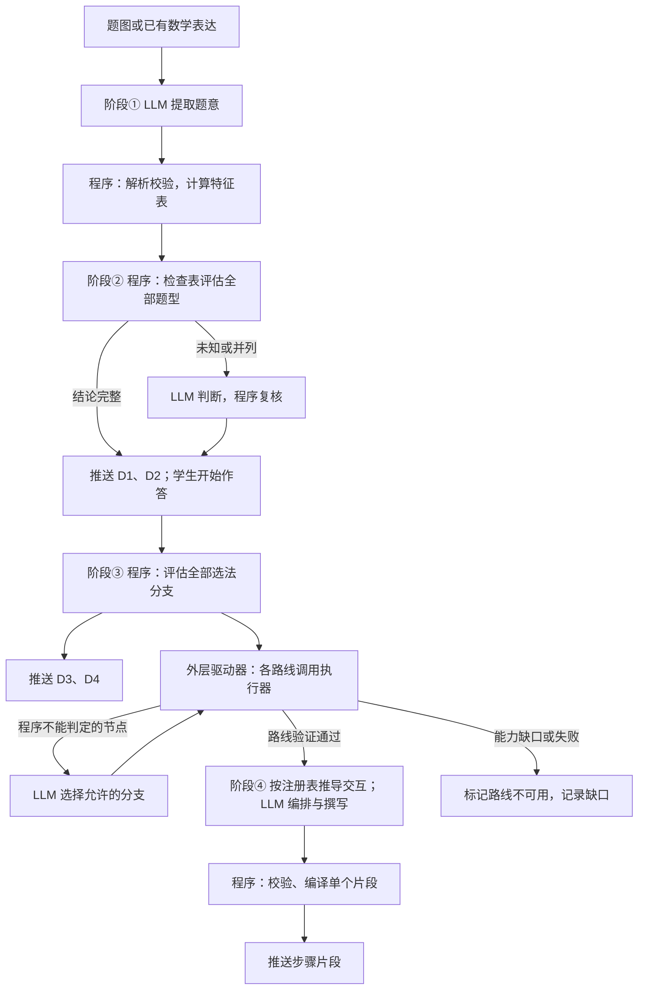
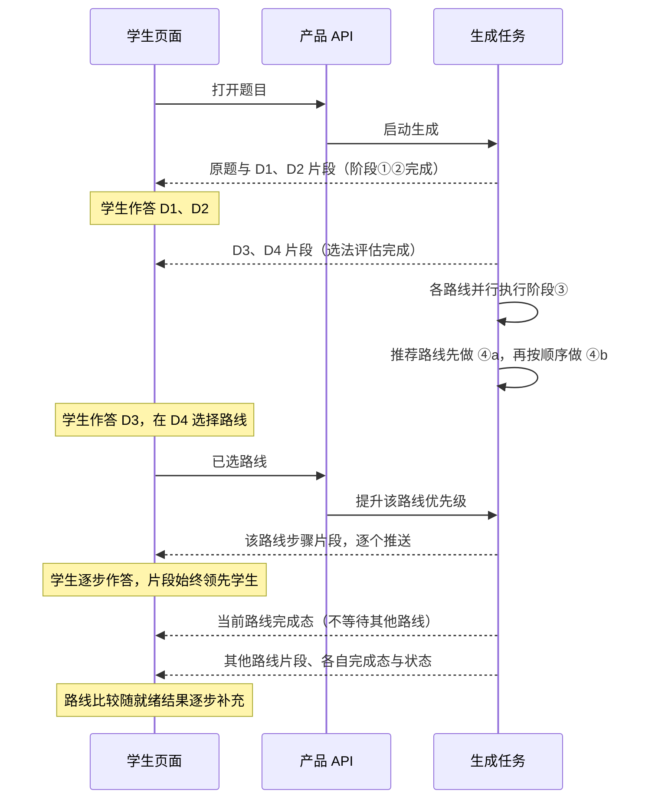

# 基于四阶段的交互课程生成设计

> 状态：讨论稿（修订版），待实施。更新日期：2026-10-16。
> 目标：从题图或已有数学表达出发，生成与恒成立 Q01 图谱 Demo 同类的可交互网页；阶段①②完成后即向学生展示，阶段③④在学生作答的同时继续生成。
> 四个阶段：① 提取题意，程序计算特征表；② 程序用特征检查表判断题型，LLM 只处理未知或并列；③ 外层方法驱动器调用现有执行器求解，LLM 只在程序不能判定的节点选择；④ 程序从已验证轨迹推导交互结构，LLM 编排步骤并撰写文字。
> 课程原稿沿用 Demo 原稿格式（`site/data/graph-walk/*.source.json`），人工 Demo 原稿即首题金标。实施按阶段①到④依次进行，每一阶段的真实 LLM 集成测试记录作为下一阶段的测试输入。

## 1. 目标与范围

生成的网页支持：读题并找出线索、判断题型、选法判断、分步选择或填空、错答反馈、通过后的推导和图形展示，以及图谱同步显示实际使用的方法、技能和知识依据；支持后退、换路线和完成后的路线比较。

学生打开题目后，只需等待阶段①②完成即可开始作答。阶段③④在后台继续执行，生成结果按片段推送到页面；学生走到某一步时，该步骤已经生成并通过校验。生成过程中不向学生展示未经验证的内容，已展示的内容不再改写。

页面复用 `/1/`、`/2/` 的交互组件和 `site/assets/graph-walk/` 的 Demo 运行时。按需导师与学习记录是后续接线。

**首轮范围：**

- 题目：恒成立专题 Q01–Q09。九题均有人工课程可对照，覆盖全实数恒成立、二次项系数退化（Q02、Q03）、开区间存在成立（Q05）、除以负数（Q06）、更换主元（Q08、Q09）。
- 另加两道多问题 Q10、Q11。阶段①输出小问树并按目标计算特征，阶段②按小问判型；前后问依赖（前问结论供后问使用）留到阶段③实现。
- 不实现阶段③到阶段②的回流重判。
- 不覆盖正式题页，生成结果使用独立入口。

## 2. 设计原则

1. **程序能判定的不交给 LLM。** 量词、次数、系数是否含参、能否分离参数、符号是否确定，都由程序计算。LLM 处理的是程序不能判定或需要教学表达的部分。
2. **结论三态。** 检查返回“满足、不满足、未知”，未知须说明原因（题意缺失、待计算、含参待分支、缺少检查能力）。模型置信度不能代替数学确认，未知不能当作不满足。
3. **保留候选及判断依据。** 不符合的题型、不适用的方法连同依据一起保存，作为阶段④干扰项和“为什么不对”的反馈依据。数学适用性、推荐顺序与路线支持状态分别记录；可用但不优先、尚未实现的候选不能标为数学错误。
4. **数学来自已验证结果。** 课程中的公式、数值、选项正误与反馈依据都追溯到阶段③的执行记录或程序检查。
5. **自然语言不作检索键。** 题型和知识检索只依据结构化题意与特征，不使用名称、别名、描述或文本向量相似度。
6. **已展示不改写。** 渐进交付中，片段一经推送给学生即冻结；更正只进入新的课程版本。
7. **一份原稿，多个使用端。** 页面、教师配置、图谱同步、AI 回放都从同一份课程原稿生成。

## 3. 四阶段总览

| 阶段 | 程序 | LLM | 输出 | 学生端可用的部分 |
| --- | --- | --- | --- | --- |
| ① 题意与特征 | 解析、校验题意；计算特征表 | 转录原题、提取题意（沿用现有记法）；必要时补充隐藏结构猜想 | 原题转录、题意、特征表 | 原题 |
| ② 题型判断 | 用检查表评估全部题型，保留排除依据 | 只处理未知或多个题型同时成立 | 各题型结论及依据 | D2 判断题型 |
| ③ 选法与求解 | 计算全部选法分支的适用性；外层驱动器调用执行器 | 只在程序不能判定的判断节点选择 | 分支结论、各路线已验证轨迹 | D3 选法判断、D4 选择方法 |
| ④ 课程生成 | 按交互注册表从轨迹推导交互结构、干扰项与错填核对；编译校验 | 编排教学步骤、撰写问题与反馈 | 各路线的教学步骤片段 | 方法步骤与完成态 |



## 4. 阶段①：题意与特征表

### 4.1 题意

LLM 从题图提取原题文字、数学定义、条件、目标及不确定项，沿用现有 `problem-math-notation/v1` 记法和 `original_text`、`root` 结构。本阶段不输入题型目录，不输出题型归属。

Q01 的题意已有人工整理稿 `site/data/math-notation-v1/quadratic-always/q01.json`：

```json
{
  "root": {
    "facts": ["a∈ℝ", "∀x∈ℝ: -x^2+2*x+3 ≤ a^2-3*a"],
    "goals": [{"kind": "find_range", "symbol": "a"}]
  }
}
```

解析器已支持 `∀`、`∃` 量词。LLM 只负责转录和题意两件事，**不标注出处、不声明约定**。`original_text` 只供展示，验收时忽略标点、空白和公式排版差异。D1 需要的原题片段由阶段②的程序定位（见 5.3），不进入本阶段的 LLM 契约。

输入已有合格题意时直接校验复用，不再识图。

### 4.2 特征表

线索不再由 LLM 另写一份，而是由程序从解析后的题意**计算**得到，称为特征表。特征由已登记的特征提取函数产生，每个函数声明：

| 内容 | 要求 |
| --- | --- |
| 特征 ID 与输出类型 | 稳定 ID；输出为枚举、表达式或布尔值，或带原因的未知 |
| 计算依据 | 读取哪些事实或目标；需要的代数计算复用现有受限表达式解析和 SymPy 能力 |
| 前提与分支 | 例如系数含参时，返回“非零／为零”两个分支条件，而不是单一结论 |
| 学生措辞模板 | 用于 D1–D3 的证据展示，例如“$x$ 的取值范围：{domain}” |
| 关联知识 | 特征对应的公共知识点或条目，例如 `quantifier` 关联 `quantifiers#universal`；D1 的片段到知识点映射由此得到 |
| 依据 | 产生该特征的题意条目（`source_refs`，指向 `root` 中的事实或目标） |

注册表中的检查分两类，共用同一套声明格式、记录格式和执行器，只是调用时机不同：

- **结构特征**：在阶段①计算，只描述题目结构，与具体方法无关，供阶段②判断题型及 D1 使用。包括量词、变量角色、目标、定义域、关系严格性、规范关系、关于各变量的次数、系数及其是否含参、给出范围的变量是否为主元。
- **方法前提检查**：在阶段③评估选法分支和执行方法时调用，属于方法的一部分。包括能否分离参数（`param_separable`）、除式在定义域上的符号（`divisor_sign`）、首项系数为零时的逐级降次分支（`degenerate_branches`）。阶段①不计算这些检查，避免与阶段③的能力形成两份实现。

题目未逐字写出的量词内容按两条规则补全，写在提取提示词和表达目录中，由 LLM 直接写进题意，不另行声明：未限定自变量范围的实系数多项式不等式按实数域理解；原题只说“恒成立”而未指明对哪个变量时，取不等式中除待求量以外唯一的自由变量为量词变量，不唯一时报告待确认。补全是否正确由题意语义验收和原图复核判断。将来页面需要区分“原文写明”与“默认补全”时，由程序比对原文后标注，不再由 LLM 承担。

Q01 的结构特征：

| 特征 | 值 | 依据 |
| --- | --- | --- |
| `quantifier` | ∀，作用于 $x$，范围 $\mathbb R$ | 事实 2 |
| `goal` | 求参数 $a$ 的取值范围 | 目标 |
| `bound_vars` / `free_vars` | $x$ / $a$ | 量词绑定 |
| `normal_form` | $x^2-2x+a^2-3a-3\ge0$ | 移项，规定为“关于量词变量的多项式 $\ge0$”形式 |
| `degree_in_bound` | 2 | `normal_form` 关于 $x$ |
| `leading_coeff_in_bound` | $1$，不含参数，非零 | `normal_form` 关于 $x$ |
| `domain_kind` | 全体实数 | `quantifier` |
| `range_var_is_principal` | 是：给出范围的 $x$ 是二次式的主元 | `quantifier` 与 `degree_in_bound` |

LLM 只在一种情况下补充特征：隐藏结构程序算不出来，例如基本不等式 Q30 的“条件可配成 $(a-1)(2b-1)=4$”。这类补充以数学表达式记录为待验证猜想，可以用于召回，但不能作为检查已满足的证据。

### 4.3 表达式处理约束

以下约束对特征提取和后续检查都适用：

- 量词种类与顺序、区间开闭、严格与非严格关系必须保留。
- 约分保留非零条件，例如 $(x^2-1)/(x-1)$ 改写为 $x+1$ 后仍有 $x\ne1$。
- 次数须注明相对于哪个变量；首项系数含参时保留退化分支。
- 变量角色由量词和目标绑定，不能固定认为 $x$ 是变化变量、$a$ 是参数。
- 解析失败或不支持的算子返回未解析，交回提取修复，不以自然语言混入特征。

### 4.4 scope

数据结构按 scope 组织：根 scope 保存公共题设，小问 scope 保存本问目标和局部条件，并通过引用继承。阶段①已实现：同名字母按定义、量词和 scope 绑定身份；并列小问的局部条件不互通；特征按目标计算，`target_ref` 指向所属小问的目标。前问结论经阶段③验证后才能带来源提供给后问，阶段①不代入前问答案。

### 4.5 验收

题意与原题语义一致，转录的文字和公式没有遗漏或改写；结构特征与人工核对一致；未知特征都有原因；记录每次调用与整个阶段的耗时。题型是否判对由阶段②验收，方法前提检查由阶段③验收。

## 5. 阶段②：特征检查表判断题型

### 5.1 题型识别契约

在公共题型节点旁增加机器可读的识别契约，保留同一题型 ID。题型识别定义为**特征检查的组合**，不做表达式模式合一。

| 内容 | 要求 |
| --- | --- |
| 匹配分支 | 同一题型可有多套成立条件，任一分支通过即可支持归属。例如恒成立题型分“量词变量的二次式”和“更换主元”两支 |
| 必要条件 | 每个分支列出特征检查，全部满足才支持归属 |
| 排除条件 | 列出冲突特征，并引用相应的易混题型 ID；排除条件未知时保留候选 |
| 学生线索对应 | 每个检查对应题型节点 `features` 中的一条学生线索，用于 D2 的证据展示和图谱联动 |
| 计算依赖 | 检查需要的特征或已验证性质 |

识别契约区分题型定义与方法提示。例如“通常转化为最值”是选法线索，不能用来确认题型。

Q01 相关的契约示意：

| 题型 | 分支 | 必要条件 | 排除条件 |
| --- | --- | --- | --- |
| `type-quantified-quadratic` | 量词变量的二次式 | `quantifier` 为 ∀ 或 ∃；`goal` 求自由变量的范围；`degree_in_bound` ≤ 2，等于 2 或含参可为 2 | — |
| `type-quantified-quadratic` | 更换主元 | 同上量词与目标；关于目标变量为二次；关于量词变量至多一次 | — |
| `type-parameter-quadratic-solve` | — | `goal` 求某变量的解集；系数含参 | `quantifier` 存在 |
| `type-amgm-quantified` | — | `quantifier` 存在；存在经验证的和积结构，满足基本不等式的适用条件，可用于判断所需界 | —；二次结构不排除这一归属 |

二次函数性质可直接求界只影响主要归属与方法推荐，不能排除基本不等式思路。Q01 可写为 $3+x(2-x)$：当 $0<x<2$ 时，$x+(2-x)=2$，由基本不等式得 $x(2-x)\le1$，在 $x=1$ 取等；其余范围乘积不大于 $0$，因此全实数上的最大值为 $4$。这支持基本不等式题型归属，与首轮是否提供该方法的交互路线无关。和积变形、适用前提或所需范围的论证尚未验证时，相关检查返回未知。

阶段②的识别契约可以声明按需验证调用，用于确认结构特征尚不能直接证明的题型条件。例如基本不等式候选调用共用的恒等变形、适用前提和界验证能力，保存输入、前提与证据后再更新检查结果；不要求阶段①预先求解。验证能力与阶段③共用实现，但阶段②只验证本次归属所需的性质，不生成完整方法轨迹。缺少构造或验证能力时保留 unknown，不能由 LLM 直接确认；Q01 的阶段②验收须补齐这一验证调用。

### 5.2 判定

程序的定位是**帮助 LLM 缩小判断范围**：能唯一命中就直接确认；命中多个就交给 LLM；一个都没命中就不硬猜。

1. 程序对每个题型、每个分支评估全部检查，得到三态结果（支持 / 冲突 / 未知）。
2. 某分支必要条件全部满足、排除条件全部不成立时，该题型得到支持；必要条件不满足或排除条件成立时，该分支冲突；只有全部分支都冲突，才排除该题型。
3. **恰好一个题型得到支持**：程序确认主要归属，不调用 LLM。
4. **两个及以上题型得到支持（一律）**：把检查报告和候选列表交给 LLM，请它选定主要归属并引用检查依据。LLM 只能在得到支持的题型中选择，不能覆盖已经冲突的必要条件，也不能引入报告之外的题型。
5. **没有任何题型得到支持**（全部冲突，或仅有未知）：不调用 LLM。对学生端明确反馈「当前暂不支持该题型」；把题意、特征、检查报告写入本地待处理记录，供后台查看和补契约 / 节点。与前端打通后再迁入数据库。

题型规模较小时直接遍历全部契约。规模扩大后可以按特征建立倒排索引，不需要表达式子树索引。知识点反向关系（“涉及”）只用于 D1 的图谱展示和候选扩展，归属仍以检查结果为准。

### 5.3 输出

输出包括全部被评估题型的结论、分支、逐项检查结果和依据，**不只输出选中的题型**；并标明主要归属来自程序确认还是 LLM 选择。未命中时输出为空归属，并附带待处理记录路径。

在归属已确定（程序或 LLM）时，程序直接生成课程原稿的 D1、D2 片段，不需要额外 LLM：

- D1：可点选的原题片段由程序在 `original_text` 上定位：每段 `$…$` 公式解析后与题意事实比对，量词与目标措辞（任意、所有、恒成立、存在、有解、取值范围）按词表匹配；定位不到的线索不提供点选，不影响其他片段。片段对应的知识点来自特征到知识点的登记；干扰片段取自不对应任何特征的原题片段。
- D2：候选为得到支持的题型，加上其 `confuse` 登记的易混题型；错误候选的反馈由 `confuse.text` 与冲突检查的学生措辞组成。得到支持但不是主要归属的题型须说明其替代思路，不得作为数学错误候选。

未命中时不出 D2 判型题，只展示暂不支持与记录状态。

### 5.4 验收

Q01–Q09 在结构上唯一命中恒成立题型时由程序确认，不调用 LLM；经验证的基本不等式若同时得到支持，则进入「多命中 → LLM 选定」路径，LLM 仍应选恒成立为主要归属。未命中样例须落本地待处理记录且不调用 LLM。LLM 调用只出现在多命中题目上。

## 6. 阶段③：选法与方法驱动求解

### 6.1 选法：评估全部分支

阶段③入口沿题型取得选法规则，**对全部分支计算适用性**，包括最终不执行的分支。Q01 的结果：

| 分支 | 适用性检查 | 推荐状态 | 首轮路线支持 | 依据特征 |
| --- | --- | --- | --- | --- |
| 判别式法 | 可用 | 优先 | 生成 | `domain_kind`=全体实数，`leading_coeff_in_bound` 非零 |
| 分离参数法 | 可用 | 可选 | 生成 | 方法前提检查 `param_separable`：$f(x)\le h(a)$，不需要除法 |
| 区间最值法 | 可用 | 不优先（`superseded`） | 不生成独立路线 | $\mathbb R$ 也是区间；本题用判别式更直接 |
| 更换主元法 | 本选法分支未触发（`not_triggered`） | — | 不生成 | `range_var_is_principal` |

这一结果直接生成 D3（选法判断）和 D4（选择方法）片段。D3 分别展示适用性与推荐理由，区间最值法沿用 Demo 的“数学可行但不优先”结论；D4 另行展示路线支持状态。推荐顺序和路线是否实现均不能改写数学适用性，未触发某条选法规则也不等于证明该方法在数学上不可行。

### 6.2 外层方法驱动器

不修改现有执行器的控制流，不在执行器内部实现暂停与恢复。新增一个外层方法驱动器：

- 驱动器持有方法实例、当前步骤、分支条件、输入输出绑定和子方法调用栈。
- 每到一个计算步骤，驱动器向现有执行器提交一个调用，或一段不含判断的子计划，复用现有事务执行、结果校验和检查点。
- 到达判断节点时，驱动器先完成节点依赖的计算，再判定：程序能判定的直接选择分支；不能判定的交给 LLM（见 6.4）。
- 子方法调用由驱动器压栈执行，返回后回到父方法的规定位置。

方法执行契约需要补充：入口、输入角色、步骤及输出绑定、后继关系、判断节点、子方法调用、完成条件，以及失败时的退出位置。公共方法现有的 `steps/calls/when` 是教学文字，须映射为可执行契约；同一步骤内的多个 `calls` 可能是条件调用，不能一律编译为顺序执行。

### 6.3 能力清单

阶段③的主要成本是补齐能力。恒成立四种方法用到的能力都是确定性算法，基于 SymPy 实现。Q01 两条路线需要：

| 能力 | 输入 → 输出 | 用于 |
| --- | --- | --- |
| 移项整理 | 关系、量词变量 → 关于量词变量的多项式 $\ge0$ 形式 | 判别式法 |
| 二次式恒正条件 | 全实数、开口、不等号 → 判别式条件；首项系数含参时给出退化分支 | 判别式法 |
| 量词转最值条件 | 量词、比较方向、函数、参数侧 → 最值条件及最值存在性要求 | 分离参数法 |
| 二次函数区间最值 | 函数、区间 → 最值、取到点、可达性；附配方形式供教学 | 分离参数法 |
| 解一元二次不等式 | 不等式、变量 → 解集 | 两条路线 |
| 端点检验 | 原条件、端点 → 每个端点保留或排除 | 两条路线 |

实现前核对现有基本不等式能力中可复用的部分，例如 `bound_univariate_quadratic`。Q02–Q09 另需一次函数区间最值、对勾函数区间最值、分类合并等能力，推广时补齐。

第 4.2 节的方法前提检查（`param_separable`、`divisor_sign`、`degenerate_branches`）也在本阶段实现，与上述能力共用代数基础；选法分支评估和方法执行调用同一实现。

### 6.4 判断节点：程序判定与 LLM 判定

| 判断 | 示例 | 由谁判定 |
| --- | --- | --- |
| 退化分支 | Q02 的 $k=0$、Q03 的 $a=\pm1$ | 程序 |
| 系数符号分类 | Q09 中 $x^2-x$ 的正、负、零 | 程序 |
| 除数符号 | Q04 除以 $x>0$、Q06 除以 $x<0$ | 程序 |
| 区间求值技能选择 | 按函数类型选择二次、一次或对勾函数求值技能 | 程序 |
| 变形构造 | 基本不等式中的配凑、换元、乘“1” | LLM 提出，程序验证 |

**Q01 在阶段③的设计目标是不调用 LLM。** LLM 判断节点集中在基本不等式这类需要启发式构造的方法中。提交给 LLM 的上下文包括方法版本与节点、绑定对象、当前分支条件、依赖的计算结果和允许的选项；返回选项 ID、依据引用和参数绑定，或明确的未确认。程序核对选择范围、参数类型和数学前提。

### 6.5 路线与轨迹

每种入选方法形成独立路线，可以并行执行。原题为共享只读输入，中间结果不能跨路线混用；方法内的分类讨论分支属于同一路线。

每条通过验证的路线保存轨迹：每一步的方法步骤、实际调用的能力与公共技能、输入输出、分支条件、判断输入与选择、依据条目。跳过的准备步骤和未选择的候选不计入实际路径，但保留“候选调用”记录供图谱展示。轨迹复用现有执行记录和 ExplanationSnapshot，增加关联字段，不新建平行事实体系。

公共技能 ID 与内部能力 ID 分别保留，由显式映射表关联；一个公共技能可以对应多个能力。

### 6.6 失败与缺口

分别报告“未收录题型”“方法可用但能力尚不支持”“数学校验失败”“执行错误”。方法前提被否定或结果为空集是正常数学结果，不按执行失败处理。能力缺口不影响 D3 中该方法“可用”的数学结论；在 D4 中，该路线标注“详细步骤暂不支持”。

### 6.7 验收

Q01 两条路线不调用 LLM、全部验证通过，结论为 $a\le-1$ 或 $a\ge4$ 且两端可取；轨迹中的调用位置和依据与 Demo 人工原稿一致；Q01–Q09 的选法结论与人工原稿一致。Q01 的区间最值法须保留“可用但不优先”，不生成独立路线不影响这一数学结论。

## 7. 阶段④：从轨迹生成课程步骤

### 7.1 交互注册表

交互结构由程序按注册表从轨迹推导，LLM 不自由设计交互。注册表以轨迹元素类型和能力为键：

| 轨迹元素 | 默认交互 | 程序生成的部分 |
| --- | --- | --- |
| 判断节点（候选与结论） | choice 或 checklist | 选项为全部候选，数学错误选项的反馈依据来自已证实冲突的记录；不优先或路线未支持另行说明 |
| 产出表达式的计算步骤 | fill | 填空位取结果中的关键常数；每种错填的展开核对由同一能力对候选输入重新计算，即自动生成现有页面手写的 `attempt_calculations` |
| 条件转化 | choice，配图像组件 | 按能力选择现有组件，例如二次式恒正条件对应 `quadraticGraph` 的相交、相切、穿过三种情形；组件参数由计算结果绑定 |
| 端点检验 | checklist | 每个端点的代回计算与结论 |
| 路线完成态 | 可视化加“完整推导” | 仅依赖本路线；推导行由能力输出的 ∵、∴ 关系生成，LLM 只润色措辞，不改动公式 |

### 7.2 常见错误目录

在技能节点登记常见错误，例如不等号方向反了、端点包含与否弄错、恒成立时最大值与最小值用反、判别式条件取严格与非严格弄错。choice 的错误选项按目录对正确结果做扰动，再由程序确认在本题条件下确实不成立；其他有效解法的结果不能作为错误选项。目录同时供错题本和掌握度评估复用。

### 7.3 LLM 的职责

阶段④分两类调用，以便渐进交付：

- **④a 路线编排**：每条路线编排一次。读取轨迹和注册表给出的默认步骤，决定教学步骤的合并与拆分（例如 `d_position` 与 `d_delta` 是否合并）、各步在允许范围内选用的模板。输出较小，程序校验后冻结该路线的步骤结构。超时或校验失败时按第 9.5 节有限重试，再尝试注册表的默认结构；只有结构通过校验后才能启动 ④b，否则终止该路线。
- **④b 步骤文字**：每个教学步骤一次，可在同一路线内并行。撰写问题、提示、错答反馈的措辞和完成态推导的润色。

数学步骤与教学步骤允许一对多、多对一，但每个教学步骤必须能追溯到轨迹。不能按每个图谱节点机械生成一道选择题。

### 7.4 校验

程序校验公式、数值、选项正误与轨迹一致，检查新出现的数学表达，确认组件参数合法。不能自动核验的反馈进入审查。校验通过的步骤编译为单个片段（第 9 节）。

### 7.5 验收

Q01 生成课程与人工页面逐步对照：步骤覆盖、调用与依据一致、错误选项均已验证；AI 多次作答没有检测到歧义（第 10.3 节）；人工审阅问题与反馈的可读性。④a、④b 的默认产物须通过同样的轨迹与组件校验；无法通过时进入路线失败状态，不保持无限等待。

## 8. 课程原稿

课程原稿沿用 Demo 原稿格式 `site/data/graph-walk/*.source.json`（`intro`、`routes`、`completion`），扩展以下内容：

- 每个结论和步骤标注来源：`computed`（程序）、`llm`（LLM 产出并经校验）、`authored`（人工）。
- 每个片段带片段 ID、所属阶段、依赖的上游产物版本和状态（待生成、就绪、失败）。
- 完成态按路线生成并带路线 ID，模板由注册表的通用模板生成，不依赖题页手写的 `<template>`；路线比较由各路线完成态与路线状态推导。

人工 Demo 原稿是 Q01 的金标：生成结果与之逐字段比较，题型与选法结论、调用位置、依据条目应一致，步骤措辞允许不同。

从原稿生成的产物：

| 产物 | 用途 |
| --- | --- |
| 页面数据（bundle） | Demo 运行时消费，支持渐进加载 |
| 教师 JSON | 题目、路线、问题与判定契约的投影，供导师使用 |
| 图谱同步配置 | 由轨迹调用和教学步骤映射生成 |
| AI 回放 | 课程生成后由作答者实际走一遍，绑定课程版本 |

## 9. 与学生同步解题（渐进交付）

### 9.1 依赖关系

学生作答的顺序与生成顺序一致，前面的交互只依赖前面的阶段：

| 学生端 | 依赖 | 是否需要 LLM |
| --- | --- | --- |
| 原题 | ① | 识图提取 |
| D1 找线索 | ① 原题转录、特征表；② 程序片段定位 | 否 |
| D2 判断题型 | ② | 仅未知或并列时 |
| D3 选法判断、D4 选择方法 | ③ 选法分支评估 | 否 |
| 方法步骤 | ③ 本路线轨迹、已校验并冻结的编排、该步骤文字 | ④ 正常需要，失败时可使用已校验的默认产物 |
| 当前路线完成态 | 本路线已验证轨迹与完成态片段；展示时还须学生完成本路线步骤 | ④ 正常需要，不等待其他路线 |
| 路线比较 | 已就绪的各路线完成态，以及其他路线的待生成、失败或未支持状态 | 复用已有产物，无须等待全部路线或额外调用 LLM |

D1–D4 的文字来自图谱内容（`features`、`confuse.text`、规则分支 `condition`）和特征的学生措辞模板，由程序生成。因此阶段①②完成后，D1、D2 即可展示；选法分支评估是纯程序计算，通常在学生完成 D2 之前就绪。

### 9.2 时间线



### 9.3 片段与只增不改

课程按片段交付：原题、D1、D2、D3、D4、各路线的步骤结构、各教学步骤、各路线完成态。每个片段是独立编译、独立校验的单元，带片段 ID 与版本。

- 片段只追加，不修改。路线编排由 ④a 或注册表默认结构产生，通过校验后冻结，之后只追加该路线的步骤片段。
- 片段推送前必须通过校验；页面只展示就绪且学生已经到达的片段。
- 路线比较视图由已冻结的各路线完成态片段与独立的路线状态事件推导。后续路线就绪时追加其结果；待生成、失败或未支持的路线显示状态，不阻塞当前路线完成，也不改写已有路线的结论。
- 生成中途发现上游错误时，本次课程停止追加相关片段并标记失败，更正进入新的课程版本，不改写学生已经看到的内容。

### 9.4 调度

生成任务同时维护两个位置：学生已经到达的位置，以及每条路线已生成到的位置。调度规则：

1. 阶段②完成后，立即并行启动数学适用且首轮支持生成的全部路线的阶段③，它们是纯程序计算，成本低。
2. 阶段④先处理推荐路线（支持生成的路线中，选法规则排序靠前的可用分支），先完成编排并校验冻结，再按步骤顺序做 ④b。
3. 学生在 D4 选定路线后，该路线升为最高优先级，正在进行的其他路线 ④b 调用不中断，但新调用让位。
4. 每条路线的 ④b 至少领先学生 2 步；学生在当前路线完成前，其他路线按剩余预算继续生成，供“换另一种方法”使用。

### 9.5 等待与降级

- 学生到达尚未就绪的步骤时，显示“正在准备下一步”。图谱面板可以显示生成任务正在计算的提示，但不点亮学生尚未到达的节点，不泄露后续方法步骤或结论。
- 某条路线在阶段③失败或能力缺口：若学生尚未到达 D4，该选项标注“详细步骤暂不支持”；若已选择，提示改走其他路线，并记录缺口。
- ④a 超时、输出不合法或校验失败：按配置的单次超时和重试上限重试；仍失败时，改用程序按注册表和已验证轨迹生成的默认步骤结构，不合并或拆分。默认结构通过校验后冻结，再启动 ④b，并在调试模式下标注降级；默认结构仍不合法时，终止该路线，不能继续等待 ④a。
- ④b 超时或校验失败：按配置的单次超时和重试上限重试；仍失败时使用注册表的默认问题文字（由程序按模板填写），通过同样校验后交付，并在调试模式下标注降级；默认文字仍未通过校验时终止该路线。
- 路线终止时发送 `lesson.route_status` 失败状态并停止该路线后续任务，页面退出等待并提示改走其他可用路线。单条路线失败不阻止其他路线完成；所有支持生成的路线均失败、已无可等待或继续的路线时，发送 `lesson.failed`，显示课程生成失败。
- 题目已有完整课程版本时直接加载，不重新生成。

### 9.6 答案可见性

判定在本地完成，与现有题页一致。网络数据中出现预期答案是可接受的：只有开发者会查看请求，不针对普通学生做防护。因此片段就绪后立即推送，包括其他路线和完成态；已完成的课程版本可以整份加载。

可见性只在界面层控制：学生尚未到达的决策点、步骤和完成态不渲染到页面（不只是隐藏），图谱不点亮未到达的节点。AI 作答者的输入另有约束，只包含当前问题和已通过的结果，不包含预期答案或后续内容（第 10.3 节）。

### 9.7 技术实现

- **任务**：沿用产品服务架构中的 RabbitMQ 与 Celery。一次课程生成为一个任务，阶段作为检查点提交；路线级的阶段③④可拆为子任务并行执行。
- **事件**：沿用架构中的 WebSocket 持久事件与游标订阅。事件类型包括 `lesson.chunk_ready`（片段 ID、版本、内容）、`lesson.route_status`、`lesson.failed`。投递可能重复，客户端按片段 ID 幂等处理。学生选路线通过同一连接回传给 API，由 API 调整任务优先级。
- **编译**：现有 `tools/build-graph-walk-demo.mjs` 是整份构建。拆出单片段编译入口，服务端通过与 `tools/graph-walk-actor.mjs` 相同的 Node JSONL 桥调用，避免把编译器移植到 Python。
- **客户端**：`walk-state.mjs` 支持部分 bundle：决策点与步骤带就绪状态，状态推导遇到未就绪片段时停在等待状态；片段到达后重新推导。这与现有“状态是已提交回答的纯函数”的设计一致。
- **存储**：片段按课程版本持久化。完成的课程版本可被后续学生直接复用。

## 10. 验证与测试链

### 10.1 逐阶段的录制输入

每个阶段有三类测试：

1. **确定性测试**：输入为人工金标，测试本阶段的程序部分。
2. **LLM 集成测试**：真实调用 LLM，按现有做法冻结请求、原始响应、解析结果和哈希，记录可离线重放。
3. **下游测试**：同时使用上游的人工金标和上游的录制输出作为输入。两者结果不同时，可以区分是上游错误还是本阶段错误。

阶段①的录制题意是阶段②的输入，阶段②的录制判型结果是阶段③的输入，依此类推。

### 10.2 验证集

恒成立 Q01–Q09。目前只有 Q01 有题意金标（`site/data/math-notation-v1/quadratic-always/q01.json`），实施阶段①时需先补齐其余八题的金标。各阶段与人工课程（`/2/q01/`–`/2/q09/`）及 Q01 Demo 原稿对照。

### 10.3 AI 作答与歧义检测

课程生成后，AI 作答者用 Demo 的回放协议走完全部路线，只收到当前问题和已通过的结果。同一课程运行多次：如果 AI 选择了数学上同样成立、但课程判为错误的选项，标记该步骤有歧义并进入审查。AI 作答记录与生成记录分开保存，不能代替数学与教学内容核验。

## 11. 实施顺序

按阶段①到④依次实施，每一阶段完成后冻结其 LLM 集成测试记录，作为下一阶段的测试输入。实施开始前先确定课程原稿的片段格式（第 8 节），使每个阶段的输出都能直接被下游和页面消费。

| 顺序 | 内容 | 产出 | 验收 |
| --- | --- | --- | --- |
| 1 | [阶段①：题意提取、特征提取函数注册表](graph-guided-stage-one-implementation-plan.md) | Q01–Q09 题意金标与录制题意、特征表；逐题真实 LLM 集成测试与人工调试报告 | 第 4.5 节及阶段①实施计划 |
| 2 | [阶段②：特征检查表判型，D1、D2 片段](graph-guided-stage-two-implementation-plan.md) | Q01–Q09 判型报告与片段，录制 LLM 判型（如有） | 第 5.4 节；D1、D2 与 Demo 原稿一致 |
| 3 | 阶段③：选法分支评估、外层驱动器、Q01 能力，再扩展到 Q02–Q09 | D3、D4 片段，各路线轨迹 | 第 6.7 节 |
| 4 | 阶段④：交互注册表、常见错误目录、④a 与 ④b、单片段编译 | Q01 完整生成课程，再扩展到 Q02–Q09 | 第 7.5 节 |
| 5 | 渐进交付：生成任务、片段事件、调度、客户端部分加载 | 打开题目到可作答的完整链路 | 阶段①②完成即可作答；正常网络下学生不在方法步骤处等待 |

第 5 步依赖前四步的产物，但片段格式从第 1 步起就按渐进交付设计，第 5 步主要是传输与调度。之后再选一道基本不等式题，检验阶段③中 LLM 判断节点的情况。

渐进交付验收还须覆盖：其他路线待生成或失败时，当前路线仍可完成；路线比较能在后续结果就绪时补充；④a 超时、结构校验失败分别触发有限重试和默认结构降级；默认产物校验仍失败时，路线进入终止状态，页面退出等待。

## 12. 参考与实现入口

- [Method Solver 当前架构](method-solver-architecture.md)：执行、校验、检查点与已验证解题记录。
- [产品服务架构](product-service-architecture.md)：RabbitMQ、Celery、WebSocket 持久事件。
- [Q01 图谱 Demo 设计](graph-walk-demo-q01-design.md)、[维护说明](graph-walk-demo-q01.md)：原稿格式、构建、状态推导与回放协议。
- [交互题目公共运行时](interactive-lesson-shared-runtime-design.md)：practice 组件、课程配置与教师契约。
- [公共图谱本体设计](public-knowledge-graph-ontology-design.md)：题型、方法、技能与判断规则，多重归属与三值判断。
- `site/data/math-notation-v1/quadratic-always/q01.json`：Q01 题意金标。
- `site/data/graph-walk/quadratic-always-q01.source.json`：Q01 课程原稿金标。
- `site/data/knowledge-next/nodes/type-quantified-quadratic.json`、`rule-quadratic-method.json`、`method-*.json`：题型特征、选法规则与方法步骤的教学内容；识别契约与执行契约待补充。
- `server/shuxueshuo_server/problem_understanding/notation_parser.py`、`notation_normalization.py`、`algebra.py`：记法解析、规范化与受限代数计算。
- `server/shuxueshuo_server/solver/runtime/`：现有执行器与检查点，外层驱动器的接入对象。
- `tools/build-graph-walk-demo.mjs`、`tools/graph-walk-actor.mjs`、`site/assets/graph-walk/walk-state.mjs`：现有构建、Node 桥与状态推导，待拆出单片段编译与部分 bundle 支持。
