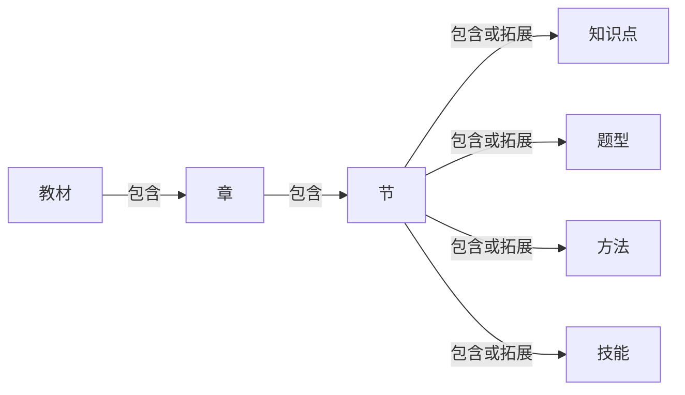
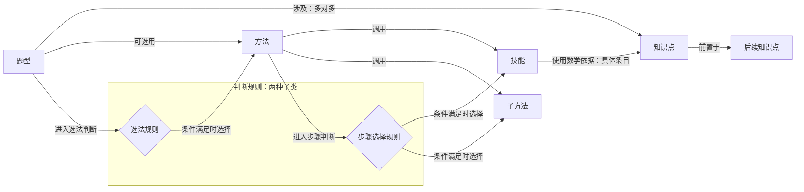
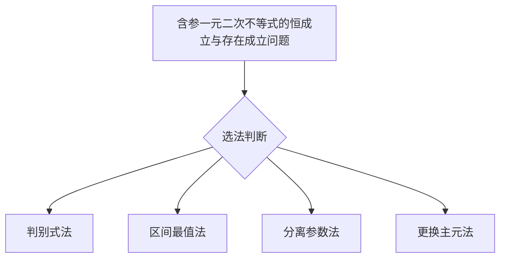
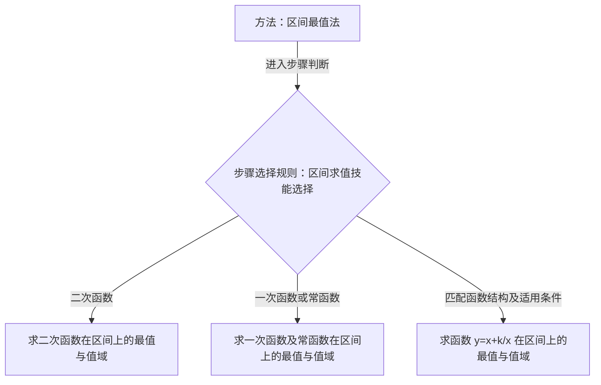

# 高中数学公共知识图谱设计

更新日期：2026-10-12。

本文定义公共图谱的对象、关联与教学用途，记录 2.1–2.3 节、相关专题及两份补充练习的知识点、技能、方法和题型。个人知识图谱与掌握评估单独设计。题型规则、方法模板及其执行衔接尚未实现。

现行内容约定见[知识点与方法清单](knowledge-graph-topic-inventory.md)、[知识图谱页面设计](knowledge-graph-pages-design.md)。

## 1. 目标与范围

在已支持的题型范围内，系统应能根据题目事实确认题型、解释方法选择、执行可验证的解题路径，并向学生展示一致的推理过程。

已确认的题型及其方法进入公共图谱，包括综合多个知识点的题型。能够确认匹配时，优先使用已有方法模板；整题未覆盖或仅有局部匹配时，检索相关知识点、题型、方法和技能，由 LLM 提出组合解法，并在求解中按需补充检索。

图谱定义对象及其关系；判断规则检查条件；方法模板组织技能、方法调用和分支；运行时完成计算与验证。LLM 可辅助题意结构化、路线规划和教学表达；两条求解路径均需数学验证，新解法经验证与审核后沉淀入图谱。

## 2. 公共对象与关联

### 2.1 八类节点

| 对象 | 定义 | 示例 |
| --- | --- | --- |
| 教材 Textbook | 教材版本及册次 | 人教 A 版必修第一册 |
| 章 Chapter | 教材内的内容组织 | 一元二次函数、方程和不等式 |
| 节 Section | 章内的教学组织 | 等式性质与不等式性质 |
| 知识点 KnowledgePoint | 可跨教材、章节和专题复用的数学主题，承载定义、表示和性质 | 二次函数、基本不等式 |
| 技能 Skill | 有明确输入、输出和使用条件的可复用操作 | 配方、消元、应用基本不等式 |
| 方法 Method | 面向一类任务的完整解题路径模板，组织技能、判断、分支及已有方法的调用 | 作差比较法、基本不等式法、基本不等式求参法 |
| 题型 ProblemType | 由题目结构、条件和求解目标界定的任务类别 | 和积最值问题 |
| 判断规则 JudgmentRule | 可复用的条件检查，根据题目事实或中间结果选择方法、技能或后续分支 | 选法判断、区间求值技能选择 |

判断规则分为两种子类，仍属于同一个顶层节点类型：

| 子类 | 进入判断的对象 | 选择的对象 | 用途 |
| --- | --- | --- | --- |
| 选法规则 | 题型 | 方法 | 判断本题可采用哪些解题方法 |
| 步骤选择规则 | 方法 | 技能或方法 | 判断当前步骤应调用哪个技能或子方法 |

技能可包含多个内部操作，粒度以清楚、可复用的输入输出为准。方法负责完成其承诺的任务；组合方法通过引用已有方法组织完整路径，仍使用 Method 类型。一个题型可采用多种方法，一个方法也可服务多个题型。

教材按“教材 → 章 → 节”组织内容，由节直接关联公共数学对象。章的内容范围通过所属节汇总，并按公共节点 ID 去重。专题按用途引用同一批公共对象，不重复建点。

具体题目与教学资源通过数据库目录关联公共节点，不增加为公共图谱节点类型。题目关联保留路线和步骤；资源关联指向图解、详情、视频等内容，文件本体仍由内容系统保存。

### 2.2 知识点内部条目

知识点包含结构化条目，每条具有稳定 ID、名称、内容类型、数学内容和成立条件。引用时同时指明知识点 ID 与条目 ID。

| 内容类型 | 二次函数示例 |
| --- | --- |
| 定义 | $f(x)=ax^2+bx+c$，实系数且 $a\ne0$ |
| 表达形式 | 一般式、顶点式、因式分解式；实数范围内的因式分解式要求 $\Delta\ge0$ |
| 图像表示 | 抛物线图像 |
| 性质／结论 | 开口、对称轴、顶点、单调性、判别式与横轴交点的关系等，分别注明条件 |

公式是内容的表达形式。内部条目可独立讲解和引用，无须全部显示为全局节点；需要跨主题独立组织时再确定是否提升为知识点。

基本不等式的公式、变量范围、取等条件与定和／定积应用均由同一知识点承载。定和或定积是相应最值应用的要求，不是基本不等式成立的额外前提。

### 2.3 节点关系

| 起点 | 关系 | 终点 | 约定 |
| --- | --- | --- | --- |
| 教材 | 包含 | 章 | 记录教材目录与顺序 |
| 章 | 包含 | 节 | 记录章节目录与顺序 |
| 节 | 包含、拓展 | 知识点、题型、方法、技能 | 表达本节教学范围；公共节点可以被多个节引用 |
| 知识点 | 前置于 | 知识点 | 基础知识指向后续知识，只保留必要依赖 |
| 题型 | 涉及 | 知识点 | 多对多，登记题型的关键知识范围 |
| 题型 | 可选用 | 方法 | 直接关联候选方法；执行前仍检查方法适用条件 |
| 题型 | 进入选法判断 | 选法规则 | 需要显式判断时使用 |
| 选法规则 | 条件满足时选择 | 方法 | 可以返回多个适用方法，也可能没有适用方法 |
| 方法 | 调用 | 技能 | 在具体步骤中调用，绑定输入与输出 |
| 方法 | 调用 | 方法 | 调用子方法，明确它负责完成的子目标 |
| 方法 | 进入步骤判断 | 步骤选择规则 | 根据本题条件或中间结果决定后续执行 |
| 步骤选择规则 | 条件满足时选择 | 技能 | 例如按函数类型选择区间求值技能 |
| 步骤选择规则 | 条件满足时选择 | 方法 | 例如根据转化后的不等式类型选择子方法 |
| 技能 | 使用数学依据 | 知识点及内部条目 | 引用操作使用的公式、性质及适用条件 |

在节与公共数学对象的关联中，“包含”表示本节直接讲授的内容，可以只覆盖某个知识点的部分内部条目；“拓展”表示围绕本节内容组织的延伸应用。例如，2.3 节讲授二次函数的零点与符号关系，属于“包含”，即使没有覆盖二次函数的全部性质。

题型“涉及”的是关键知识范围，用于组织与检索；判定具体题目的归属时仍检查题目事实与题型条件。技能引用知识条目，用于说明具体操作的数学依据。判断规则不连接知识点。

题型可以直接关联方法，也可以通过选法规则选择方法；方法可以直接调用技能或子方法，也可以通过步骤选择规则决定调用对象。公共规则定义检查逻辑，使用时绑定本题事实；调用顺序、输入输出衔接和分支写在方法模板中。

方法之间仅因实际调用连线，不因同题出现或内容相近连线。调用声明输入绑定、适用条件、返回结果及后续用途；涉及最值时，返回值还须注明可达性、取等条件及适用约束。

方法的知识清单通过实际调用的技能和子方法汇总，不另维护重复的全量“方法 → 知识点”关系。

**章节组织关系：**

**数学对象与解题关联：**

两张图共同展示八类节点的关系。“子方法”仍是方法节点，“后续知识点”仍是知识点节点；两种规则均属于判断规则。前置边表示已登记的必要依赖，方法间的边表示具体方法之间的调用。

### 2.4 公共身份与命名

- 全局节点 ID 和内部条目 ID 发布后不改名、不复用，不改变原有数学含义。
- 同义名称、等价表达和跨专题使用优先共用身份；教材节号不作为数学知识身份。
- 技能名称说明关键操作，必要时限定对象或目标；适用条件写入技能契约。通用技能不统一添加专题前缀。
- 现有题页 method 标签、旧图谱方法节点与求解器 runtime Method 分别建立映射，迁移时逐项核对引用。

## 3. 方法模板与执行

### 3.1 模板内容

| 内容 | 要求 |
| --- | --- |
| 适用条件与输入角色 | 明确表达式、变量、参数、范围、量词和目标 |
| 步骤与子目标 | 明确各步任务及调用的技能或已有方法 |
| 输入输出衔接 | 明确后一步使用哪些已有结果 |
| 判断与分支 | 明确分类前提、分支去向及合并方式 |
| 知识依据 | 通过技能引用所用知识条目，按实际技能及子方法调用汇总 |
| 完成条件与验证 | 明确哪些结果和证据足以完成目标 |

模板以语义角色描述路径，绑定具体题目后形成执行计划。组合方法保存对公共技能和方法的引用，具体题目的执行计划记录实际调用与中间结果。学生看到的题型判断、选法理由和推导均来自条件检查及真实执行记录。

### 3.2 判断与验证原则

- 题型根据变量角色、表达式、约束、定义域、量词和目标判断。匹配结果区分“符合、不符合、尚不能确认”，允许多重归属。
- 多种方法适用时保留选择；缺少事实或尚无验证能力时保留未确认状态。
- 含参条件可产生分支，每个分支继承前提；未知不能当作不成立。
- 计算保留定义域、非零条件、符号、等价性与新旧变量对应。系数为零时检查退化情形。
- 最值须证明界可达到；完整范围须证明范围内每个目标值都可达到。
- 执行前校验引用、输入输出和必要条件；执行后验证目标结果。教学展示与验证记录保持一致。

### 3.3 已知题型与未覆盖题型的求解

| 覆盖情况 | 求解方式 |
| --- | --- |
| 能够确认匹配已有题型，且方法适用条件满足 | 直接选用或经选法规则选择已确认的方法模板，绑定本题条件后执行；已知综合题型可使用组合方法 |
| 未匹配到适用的整题方法模板，或只能确认局部结构 | 检索相关候选，由 LLM 组织组合解法，调用已有能力并在求解中补充检索 |

提供给 LLM 的上下文包括原题事实、目标与变量角色、局部题型匹配、候选方法的条件与步骤、技能的输入输出、知识点的具体条目，以及按需检索的已验证参考题。候选区分已确认与待确认，不预设一次检索能找到全部所需知识，也不只提供节点名称。

LLM 提出的路线需保留各步依据、适用条件和未解决的子目标；图谱中缺少的知识或新方法作为待验证候选提出。计算与规则能覆盖的步骤直接验证，尚不能验证的推理保留待确认状态，LLM 自评不能替代数学验证。

新解法完成后先检查是否属于已有题型或方法；确有新增时，明确适用范围、路径与必要分支，经数学验证、审核和去重后加入图谱及对应验证题例。同一题型的新题只增加关联与样例，不重复建点。

### 3.4 与现有系统的衔接

| 公共设计 | 现有机制 |
| --- | --- |
| 技能 | runtime Method／Function capability |
| 方法模板 | Family 中的一条解法策略及相关动作 |
| 题型 | Family 的适用范围与目标约定，需显式映射 |
| 具体执行计划 | FunctionalPlan 及编译产物 |

当前 Family 标签选择和 live Plan 规划仍依赖 LLM。显式题型规则、跨步骤方法模板及绑定机制需在现有能力上补齐；对象同名不代表已经能够执行。

## 4. 已确认的章节内容

范围为人教 A 版必修第一册第二章。2.1 对应教材第 37–43 页；2.2 对应第 44–49 页，并结合基本不等式专题扩展；2.3 对应第 50–55 页，并结合恒成立与存在成立专题及两份补充练习扩展。专题引用其他章节的公共知识，技能和题型不等同于教材本节的全部教学要求。

| 范围 | 知识点 | 技能 | 方法 |
| --- | --- | --- | --- |
| 2.1 等式性质与不等式性质 | 4 个 | 3 个 | 作差比较法 |
| 2.2 基本不等式及专题 | 新增“基本不等式”，复用已有知识 | 8 个 | 基本不等式法、配方求最值法、和积换元法、二次函数最值法 |
| 2.3 二次函数与一元二次方程、不等式及专题 | 3 个基础知识点，专题补入 5 个公共知识点；已有对象共用身份 | 3 个基础技能、4 个专题技能，复用已有技能 | 判别式法、区间最值法、分离参数法、更换主元法 |
| 两份补充练习（见第 7 节） | 复用已有知识点，补充内部条目 | 新增 2 个，复用已有技能 | 补充 5 种，见第 4.3 节 |

### 4.1 知识点

| 引用范围 | 知识点 | 内部条目范围 |
| --- | --- | --- |
| 2.1 | 不等式与实数大小关系 | 不等式及不等式组表示、严格与非严格关系、数轴大小关系、作差判号的等价依据 |
| 2.1 | 等式的性质 | 对称、传递、同加减、同乘、非零同除；区分等价变形与单向推导 |
| 2.1 | 不等式的性质 | 交换两端与方向、传递、同加减、正负数乘除、同向相加、正数同向相乘、正数乘方 |
| 2.1、2.2 共用 | 平方的非负性 | 平方非负及取零条件；推论 $u^2+v^2\ge2uv$，等号当且仅当 $u=v$ |
| 2.2 | 基本不等式 | 公式及等价表达、算术平均数与几何平均数、变量范围、取等条件、定和与定积应用 |
| 2.3 及专题 | 二次函数 | 定义、表达形式、图像、开口、对称轴、顶点、零点、单调性、图像与 $x$ 轴的位置关系、区间上的值域与最值 |
| 2.3 及补充练习 | 一元二次方程 | 定义、判别式、实根分类、求根公式、根与系数的关系、实根与二次式因式分解的关系；保留实系数及二次项系数非零的条件 |
| 2.3 及专题 | 一元二次不等式 | 定义、解集、二次式符号分布、严格与非严格不等式的端点处理；二次项系数非零时，全实数上恒正、恒负、恒非负、恒非正的条件 |
| 2.3 专题引用 | 全称量词与存在量词 | 任意、存在与有解的含义，量词作用的变量及范围 |
| 2.3 专题引用 | 函数的值域与最值 | 值域、最大值、最小值、范围边界及其可达性，恒成立与存在成立对应的值域条件 |
| 2.3 专题引用 | 函数的单调性 | 单调性的含义、单调区间与函数值的比较 |
| 2.3 专题引用 | 一次函数 | 定义、图像、斜率、单调性、区间上的值域；系数为零的情形另按常函数处理 |
| 2.3 专题引用 | 函数 $y=x+\frac{k}{x}$ | 表达式、定义域、参数范围、图像、单调性、最值与值域；当前专题使用的性质注明 $k>0,\ x\ne0$ |

性质逐条保留成立条件。$a=b$ 可推出 $ac=bc$，反推须有 $c\ne0$；正数乘方性质为 $a>b>0\Rightarrow a^n>b^n$（$n\in\mathbb N,n\ge2$）。$u^2+v^2\ge2uv$ 适用于任意实数，不要求两数为正。

二次函数与一元二次方程中的初中内容沿用同一公共身份。函数零点是使函数值为零的 $x$ 值，等于对应方程的实根，也是图像与 $x$ 轴交点的横坐标。

补充练习不新增知识点节点。对于 $ax^2+bx+c=0$（$a\ne0$）的两个实根 $r_1,r_2$，保留 $r_1+r_2=-b/a$、$r_1r_2=c/a$ 及 $ax^2+bx+c=a(x-r_1)(x-r_2)$，作为“一元二次方程”的内部条目。

函数、方程与不等式的对应关系作为内部条目交叉引用，不另建“三者关系”知识点：不等式解集对应图像在 $x$ 轴上方或下方部分的横坐标集合，非严格不等式还包含相应零点。教材结构图中的包含、对应和使用关系分别表达，不统一视为前置依赖。

二次函数的区间性质、全实数上的二次式符号条件、边界可达性分别由上述知识点的内部条目承载。专题补入的公共知识优先复用已有身份。函数 $x+k/x$ 的性质不以基本不等式为唯一前置；具体步骤用基本不等式求界时才引用该依据。

### 4.2 技能

以下二十项分别为独立技能；跨章节使用时共用身份。

| 引用范围 | 技能 | 输入 → 输出 |
| --- | --- | --- |
| 2.1，2.3 复用 | 代数式化简 | 表达式及条件 → 等价的简化表达式及条件，包括展开、合并同类项等 |
| 2.1，2.3 复用 | 等式变形与推导 | 已知等式、指定操作及条件 → 新关系、成立条件及等价／单向推导标记 |
| 2.1，2.3 复用 | 不等式变形与推导 | 已知不等式、指定操作及条件 → 新关系、成立条件及等价／单向推导标记 |
| 2.2 | 应用基本不等式 | 满足适用条件的两项 → 和积界及取等关系 |
| 2.2 专题 | 配凑定和或定积结构 | 表达式、约束与指定目标 → 经拆项、添减项、调整系数等得到两项结构、补偿项及条件 |
| 2.2 专题 | 配齐次式 | 整体或局部表达式、约束与目标次数 → 在原条件下等值的齐次结构及改写依据 |
| 2.2 专题 | 换元 | 指定整体与新变量定义 → 改写后的条件、目标、范围及新旧变量对应 |
| 2.2 专题 | 用和与积表示对称式 | 指定两量及可用和积表示的表达式 → $s=u+v,p=uv$ 下的表达式、关系及原限制 |
| 2.2 专题 | 消元 | 条件、目标与待消去的变量或整体 → 减少变量后的关系及可行性限制 |
| 2.2 专题 | 分式分离 | 多项式分式 $P/Q$ → 整式商 $S$ 与余式分式 $R/Q$ 之和，保留 $Q\ne0$ 及原范围 |
| 2.2 专题、2.3 共用 | 配方 | 表达式与目标平方结构 → 等价的平方结构及条件 |
| 2.3，跨章节复用 | 因式分解 | 多项式及指定数域 → 等价的因式乘积或在该数域内不能继续分解的结论；本节先覆盖二次式 |
| 2.3，跨章节复用 | 求解一元二次方程 | 指定未知量、实系数且二次项系数非零的方程 → 实根情况及全部实根 |
| 2.3 | 根据开口与零点判断二次式的正负 | 开口方向、实根情况及零点位置 → 二次式为正、为零、为负的区间或集合 |
| 2.3 专题 | 求二次函数在区间上的最值与值域 | 二次项系数非零的函数、参数条件及指定区间 → 值域、实际存在的最值及对应取值；根据开口、对称轴、顶点与边界处理，含参时保留分支 |
| 2.3 专题 | 求一次函数及常函数在区间上的最值与值域 | 一次式、参数条件及指定区间 → 值域、实际存在的最值及对应取值；按斜率正、负、零处理 |
| 2.3 专题 | 求函数 $y=x+\frac{k}{x}$ 在区间上的最值与值域 | 函数、参数条件及指定区间 → 值域、实际存在的最值及对应取值；当前覆盖 $k>0$，保留 $x\ne0$，按单调区间和极值位置处理 |
| 2.3 专题及补充练习 | 将恒成立与存在成立转化为值域或最值条件 | 量词、变量范围或多变量联合约束、表达式及不等号 → 等价的值域限制；对应最值存在时转化为最大值或最小值条件 |
| 补充练习 | 由解集提取二次式的根与系数条件 | 完整解集、不等号及二次式 → 根、开口方向与系数关系；当前覆盖全实数范围内解集为非空有限区间的情形 |
| 补充练习，跨章节复用 | 将分式不等式转化为整式不等式 | 移项通分后的分式不等式及原定义域 → 等价的整式不等式及全部原限制 |

技能边界：

- 配凑定和或定积结构当前用于基本不等式求最值，改写保留补偿项与原限制；方法负责选择结构，技能负责完成改写。
- 配齐次式可处理局部或整体，目标不限于零次。例如在 $x+y=1$ 下，$x^2+y=x^2+y(x+y)$。
- 和积换元保留 $s^2-4p\ge0$ 及原范围；非对称目标不能直接全部用 $s,p$ 替代。两量的选择和完整求解由方法组织。
- 分式分离满足 $P/Q=S+R/Q$，其中 $R=0$ 或余式次数低于分母次数，保留原定义域；当前不涵盖部分分式分解。可跨专题用于函数和分式不等式，如 $(2x+3)/(x+1)=2+1/(x+1)$，$x\ne-1$。
- 配方不限于一元二次多项式，例如 $x^2+1/x^2=(x-1/x)^2+2$，$x\ne0$。
- 涉及大小关系的取倒数复用“不等式变形与推导”，检查非零、符号与方向。判断正性、检查定值和验证取等可达性属于方法中的判断与验证步骤。
- 计算判别式、使用求根公式和根排序可作为求解技能的内部操作，不分别新增公共技能节点；含参时先检查二次项系数是否为零。
- 根据开口与零点判断二次式的正负，覆盖两个不同实零点、重零点及无实零点三种情况。例如 $x^2-5x+6$ 在 $(-\infty,2)\cup(3,\infty)$ 为正，在 $(2,3)$ 为负，在 $\{2,3\}$ 为零；同零点、开口向下的二次式正负分布相反。
- 三个区间最值与值域技能统一按函数类型划分，单调性作为所用知识依据；输出注明边界能否取到。二次项系数为零时转入一次函数或常函数情形；定义域不连通时分段研究后合并值域。
- 条件转化技能负责建立等价要求，三个求值技能负责计算函数的取值。识别量词、选择方向及检查最值存在性属于转化中的判断步骤，规则见第 6.4 节。
- 分离参数中的移项、提取系数、乘除，以及更换主元后的重排，复用代数式化简、等式变形与推导、不等式变形与推导；完整路径由方法组织。
- 由解集提取根时，须区分二次式的零点与原变量范围造成的边界；受限区间的端点不一定是根。技能输出参数条件，完整求参及解集验证由解集反推法组织。
- 对多项式 $P,Q$，分式转化在原定义域内乘以 $Q^2>0$，不改变不等号方向；约分消去的分母零点仍须排除。例如 $\frac{2-x}{3x+1}\ge1$ 等价于 $(1-4x)(3x+1)\ge0$ 且 $x\ne-1/3$。

方法按题目不等号选取符号区间并处理零点，再结合原变量范围或整数要求得到实际解集。集合交并、实数平方根有意义的条件等作为前置知识引用，端点填写、取整数等不单列本节技能。

**配方与因式分解的操作说明**

初中知识节点暂不扩展；以下内容保存在现有技能的操作说明中。

| 技能 | 内部操作 | 示例 |
| --- | --- | --- |
| 配方 | 识别平方项与交叉项，确定目标平方结构；按需提取系数、同加同减补项，改写为平方项与余项之和；展开核对等值，保留原定义域与参数条件 | $x^2+6x+5=x^2+6x+9-4=(x+3)^2-4$ |
| 因式分解 | 识别公因式、完全平方或平方差结构；按需提取公因式、逆用公式改写为因式乘积；在指定数域内判断能否继续分解，并展开核对等值，保留参数条件 | $x^2+6x+9=(x+3)^2$；$x^2-9=(x-3)(x+3)$ |

### 4.3 方法

**2.1：代数式比较大小问题与作差比较法**

| 题型 | 核心任务 | 涉及的知识点 | 可选用方法 |
| --- | --- | --- | --- |
| 代数式比较大小问题 | 给定两个代数式及变量条件，比较大小，并说明相等条件或必要的分类结果 | 不等式与实数大小关系 | 作差比较法 |

2.1 节通过“包含”关联该题型，题型通过“可选用”关联作差比较法。

给定比较对象 $A,B$ 及约束，构造 $D=A-B$ → 代数式化简 → 判断差的符号 → 得到大小关系及适用条件。核心依据是 $A>B\iff A-B>0$ 等条目；按需引用平方非负性或不等式性质。无法统一判号时保留条件分支。

构造差是方法的固定步骤，不单列技能节点。

**2.2 专题：四种方法**

| 方法 | 对应任务 | 路径概括 | 题例 |
| --- | --- | --- | --- |
| 基本不等式法 | 和积最值问题 | 准备两项结构 → 检查正性与定值 → 建立界 → 验证取等 → 还原目标 | Q01–Q27、Q30 的相应路线 |
| 配方求最值法 | 和积最值等最值问题 | 按需消元或换元 → 配方 → 研究平方项取值 → 建立界并验证可达性 | Q01、Q02、Q09 |
| 和积换元法 | 和积最值问题；二元二次方程约束下的线性式取值范围 | 选择两量 → 和积换元 → 联合条件与和积可行性关系 → 求范围或最值 → 验证可达性 | Q28、Q29、Q30 |
| 二次函数最值法 | 和积最值等可转化为二次函数的最值问题 | 按需整理、消元或换元 → 确定函数及变量范围 → 根据顶点与区间求最值 → 回代验证 | Q01、Q09 消元路线的顶点分支 |

配凑、配齐次、换元、消元和分式分离可用于方法的准备步骤，不分别派生同名方法节点。“用和与积表示对称式”技能完成表示转换，“和积换元法”组织完整求解。

二次函数最值法使用已有的消元、换元、代数式化简及二次函数区间求值技能，不新增知识点或技能；2.2、2.3 通过拓展关系共用该方法。Q01、Q09 的配方分支关联配方求最值法，顶点分支关联二次函数最值法。和积换元法按实际任务可调用基本不等式求界或二次不等式求解，不把所有候选调用同时记作一次解题的实际路径。

**2.3 应用专题：四种方法**

下表题号属于 `/2/` 专题。

| 方法 | 本专题的适用条件与路径概括 | 当前题目路线 |
| --- | --- | --- |
| 判别式法 | 全实数上的二次不等式恒成立：检查次数与退化 → 对非退化二次式建立开口与判别式条件 → 求范围并合并分支 | Q01–Q03 |
| 区间最值法 | 指定区间上的恒成立或存在成立：转化为值域要求 → 经“区间求值技能选择”调用相应求值技能 → 求待求量范围 | Q04–Q07 |
| 分离参数法 | 可等价分离参数或参数表达式：检查乘除条件并改写 → 研究不含待求量的辅助函数值域 → 求参数范围 | Q01、Q04–Q07 |
| 更换主元法 | 按量词变量重新组织函数：本专题得到关于量词变量的一次式或常数式 → 利用区间性质建立条件 → 求待求量范围 | Q08、Q09 |

四个方法名称保持通用，支持的题型、条件和分支由具体模板声明。判别式法还可用于方程实根或表达式范围等任务，但不能套用本专题的恒成立条件：`/2/Q01` 的非退化路线要求开口向上且 $\Delta\le0$，`/1/Q28` 的目标换元路线若用判别式，检查的是方程有实根，即 $\Delta\ge0$。不同任务分别定义适用分支。

区间最值法涵盖最值不存在时的值域分析，通过“区间求值技能选择”规则选择求值技能（见第 6.5 节），数学依据由实际调用的技能引用。

**补充练习：五种方法**

| 方法 | 对应题型 | 路径概括 |
| --- | --- | --- |
| 二次函数图像法 | 不含参数的一元二次不等式求解问题 | 整理并检查实际次数 → 求零点并排序 → 根据开口判断符号区间 → 按不等号和原范围写出解集 |
| 含参一元二次不等式分类讨论法 | 含参数的一元二次不等式求解问题 | 整理 → 找出影响次数、开口、实根情况与根次序的参数条件 → 按必要分支求解 → 汇总各参数条件下的解集 |
| 解集反推法 | 由一元二次不等式的解集求参数 | 读取完整解集的边界与符号信息 → 建立根与系数条件 → 求参数 → 验证完整解集 |
| 分式不等式转化法 | 一元分式不等式求解问题 | 保留原定义域 → 移项通分 → 等价转成整式不等式 → 求解 → 与原定义域取交集；当前题例转成二次不等式 |
| 基本不等式求参法 | 应用基本不等式的恒成立与存在成立问题 | 转化量词要求 → 明确所需值域或最值 → 调用基本不等式法 → 利用求界及可达性结论求参数范围 → 核验严格性与边界 |

含参分类讨论只划分会改变求解结论的条件，并保留题目原有的参数限制。非退化二次分支可调用二次函数图像法处理已经确定的开口和根次序；退化分支按一次式或常数式处理。能够统一表达解集时不强行分类。

基本不等式求参法是独立的组合方法节点，调用已有基本不等式法完成求界任务，不复制其路径。基本不等式法返回界、取等条件及在原约束下的可达性；调用方负责量词要求和参数范围。界未取到时，还须证明能否任意接近；仅有一个估计值不足以确定完整参数范围。

## 5. 基本不等式专题的题型与题目

### 5.1 两个题型

| 题型 | 核心特征 | 题目 |
| --- | --- | --- |
| 和积最值问题 | 两量定积求和，或定和求积；允许由可验证变形获得结构，以及原目标为和、积的明确单调变换 | Q01–Q27、Q30，共 28 题 |
| 二元二次方程约束下的线性式取值范围 | 给定二元二次方程及变量限制，求线性式的完整范围 | Q28、Q29，共 2 题 |

和积最值中的两个量可以是表达式。Q01、Q07、Q09 为定和求积，其余 25 题为定积求和及目标变式。分类保留原约束、符号、新元范围和目标方向，不因准备操作不同而拆成多个题型。

第二类的一般结构为：

$$
Ax^2+Bxy+Cy^2+Dx+Ey+F=0,\qquad t=\alpha x+\beta y+\gamma,
$$

其中 $A,B,C$ 不全为零，$\alpha,\beta$ 不全为零，并保留全部变量范围和附加限制。该题型不预设正定性、有限上下界或特定解法。

### 5.2 三十题分类

下表记录用于分类的数学结构与可行转化，不代表题页已实现全部路线。$F$ 表示原题目标表达式；新字母仅在本行使用。题目可以关联多个题型，表中列主要归属。

| 题号 | 题型／内部任务分支 | 用于分类的标准结构 | 必要转化或判断 |
| --- | --- | --- | --- |
| Q01 | 和积最值／定和求积 | $U=m,V=n$，$U+V=2$，$F=UV$ | 正数定和；也可消元配方 |
| Q02 | 和积最值／定积求和 | $U=x^2,V=1/x^2$，$UV=1$，$F=U+V$ | $x\ne0$，两平方项正；也可配方 |
| Q03 | 和积最值／定积求和 | $U=x,V=2y$，$UV=8$，$F=U+V$ | 把目标系数计入两个量 |
| Q04 | 和积最值／定积求和的反向目标 | $U=-x,V=-4/x$，$UV=4$，$F=-(U+V)-4$ | 由 $x<0$ 正化；和最小对应原式最大 |
| Q05 | 和积最值／定积求和 | $U=2^a,V=2^b$，$UV=8$，$F=U+V$ | 由 $a+b=3$ 推出指数项的积固定 |
| Q06 | 和积最值／定积求和 | $U=2(x-1),V=2/(x-1)$，$UV=4$，$F=U+V+2$ | 配凑并补回常数；$x>1$ |
| Q07 | 和积最值／定和求积的反向目标 | $U=x^2,V=9-x^2$，$U+V=9$，$F=-\sqrt{UV}$ | $-3<x<0$；积最大对应原式最小 |
| Q08 | 和积最值／定积求和 | $U=x+y,V=4/(x+y)$，$UV=4$，$F=U+V$ | 用 $xy=1$ 改写平方和；保留 $x+y\ge2$ |
| Q09 | 和积最值／定和求积 | $U=2a,V=3b$，$U+V=1$，$F=UV/6$ | $a,b\ne0$；基本不等式路线需符号分类，配方路线可直接处理实数 |
| Q10 | 和积最值／定积求和 | $U=25y/x,V=4x/y$，$UV=100$，$F=25+U+V$ | 整体乘入 $x+5y=1$ 后展开 |
| Q11 | 和积最值／定积求和 | $t=a+1$，$U=2b/t,V=4t/b$，$UV=8$，$F=(6+U+V)/3$ | 换元、整体配齐次；保留 $1<t<3$、$t+b=3$ |
| Q12 | 和积最值／定积求和 | $A=2m+1,B=n+1$，$U=B/A,V=A/B$，$UV=1$，$F=(2+U+V)/8$ | 换元、整体配齐次；$A+B=8$，且 $A,B>1$ |
| Q13 | 和积最值／定积求和 | $U=b/a,V=a/b$，$UV=1$，$F=2+U+V$ | 只给 $1/a$ 乘入 $2a+b=1$ |
| Q14 | 和积最值／定积求和 | $U=4xy,V=1/(xy)$，$UV=4$，$F=5+U+V$ | 整体乘条件；也可先换元再配齐次 |
| Q15 | 和积最值／定积求和 | $U=2b/a,V=2a/b$，$UV=4$，$F=2+U+V$ | 拆项后局部乘入 $a+b=1$ |
| Q16 | 和积最值／定积求和 | $U=y+1,V=9/(y+1)$，$UV=9$，$F=U+V-3$ | 消元、分式分离、配凑；$0<y<7/2$ |
| Q17 | 和积最值／定积求和 | $U=1/(5n^2),V=4n^2/5$，$UV=4/25$，$F=U+V$ | 消去 $m^2$、分式分离；$0<n^2\le1$，还须保证 $m^2\ge0$ |
| Q18 | 和积最值／定积求和 | $U=b/4,V=1/b$，$UV=1/4$，$F=U+V+1/4$ | 条件整理为 $(2a+1)(b+1)=4$ 后消元；$0<b<3$ |
| Q19 | 和积最值／定积求和 | $U=a-1,V=36/(a-1)$，$UV=36$，$F=U+V+37$ | 消元、分式分离、配凑；原条件推出 $a>1$ |
| Q20 | 和积最值／定积求和 | $U=2(n-3),V=2/(n-3)$，$UV=4$，$F=U+V+9$ | 消元、分式分离、配凑；原条件推出 $n>3$ |
| Q21 | 和积最值／定积求和 | $A=4a+b,B=a+2b$，$U=B/A,V=A/B$，$UV=1$，$F=(2+U+V)/3$ | 双换元、整体配齐次；保留 $2A>B,4B>A$ |
| Q22 | 和积最值／定积求和 | $A=2x-y,B=x+2y$，$U=2B/A,V=2A/B$，$UV=4$，$F=5+U+V$ | 双换元、整体配齐次；保留 $A+2B=1$、$3A>B,2B>A$ |
| Q23 | 和积最值／定积求和 | $U=x,V=4/x$，$UV=4$，$F=U+V-1$ | 分式分离；$x>0$；还要求对应的取等点 |
| Q24 | 和积最值／定积求和 | $t=x-2$，$U=t,V=4/t$，$UV=4$，$F=U+V+2$ | 换元、分式分离；$t>0$；题目要求取最小值处的 $a$ |
| Q25 | 和积最值／定积求和 | $t=x+1$，$U=t,V=4/t$，$UV=4$，$F=U+V+1$ | 换元、分式分离；$t>0$ |
| Q26 | 和积最值／定积求和的反向目标 | $U=x/2,V=2/x$，$UV=1$，$1/F=U+V$ | $F>0$，倒数最小对应原式最大 |
| Q27 | 和积最值／定积求和的反向目标 | $t=2x+1$，$U=t,V=5/t$，$UV=5$，$1/F=(U+V-2)/4$ | 取倒数、换元、分式分离；保留 $t>1$ 并检查取等 |
| Q28 | 二元二次方程约束下的线性式取值范围 | $x^2+y^2-xy=1$，$F=x+y$ | 和积换元；或令 $t=x+y$ 后消元，用实解条件得到 $t\in[-2,2]$ |
| Q29 | 二元二次方程约束下的线性式取值范围 | $x^2+4y^2-2xy=1$，$F=x/2+y$ | 缩放后和积换元；或令 $t=x/2+y$ 后消元，用实解条件得到 $t\in[-1,1]$ |
| Q30 | 和积最值／定积求和 | $U=a-1,V=2b-1$，$UV=4$，$F=U+V+2$ | 原条件可配成 $(a-1)(2b-1)=4$ 并推出两因子正；现有消元路线等价，另有和积关系路线 |

Q09 的基本不等式路线须处理变量符号；Q17、Q21、Q22 须保留新元可行性限制；Q26、Q27 须还原最值方向。两项达到相等还须满足原题全部条件。

Q28、Q29 不要求原变量为正。Q28 令 $s=x+y,p=xy$，由 $s^2-3p=1$ 和实数可行性 $s^2-4p\ge0$ 得 $s\in[-2,2]$；范围内每个 $s$ 均能对应实数 $x,y$。Q29 令 $u=x,v=2y$ 后得到相同结构，目标为 $(u+v)/2$，范围为 $[-1,1]$。

表中目标换元后，须经等价消元并检查方程次数和原变量限制；得到非退化二次方程且无其他变量限制时，$\Delta\ge0$ 足以确认目标值可达。

## 6. 一元二次不等式专题的题型与题目

本节题号属于 `/2/`，共 9 道题、14 条现有路线，与第 5 节的 `/1/` 题号分别使用。

### 6.1 题型

| 题型 | 核心任务 | 题目 |
| --- | --- | --- |
| 含参一元二次不等式的恒成立与存在成立问题 | 在指定变量范围内，求使不等式恒成立或存在成立的待求量的取值范围 | Q01–Q09 |

恒成立（全称量词）与存在成立（存在量词）作为同一题型的量词特征及任务分支，用于匹配方法模板和转化条件。

题型记录原式结构、量词、量词变量、待求量、变量范围、不等号及可能的次数退化。全实数、闭区间、开区间和半无限区间作为题型特征；现有四个目录名称对应方法分组。

含参二次结构允许系数为零的退化分支，具体步骤按实际次数处理。Q08、Q09 原式关于 $x$ 具有二次结构，量词却分别作用于 $m$、$a$；更换主元后按一次式或常数式研究，不改变原题的量词和目标。

### 6.2 选法判断节点

题型与四种方法之间设置一个公共节点“含参一元二次不等式的选法判断”，顶层类型为判断规则（JudgmentRule），子类为选法规则。

输入为题目表达式、已知条件、量词及其变量、变量范围、待求量和不等号。节点分别检查四种方法，为每种方法返回“可用、不适用、待确认”，附上所依据的题目事实、匹配条件及需处理的条件分支。无法验证的条件保留为待确认；可用方法可以有多个。

| 候选方法 | 本专题的选法条件 |
| --- | --- |
| 判别式法 | 要求对全体实数恒成立，关于量词变量具有二次结构；二次项系数可能为零时，须保留退化分支并单独处理 |
| 区间最值法 | 能利用已支持的函数性质和区间求值技能研究所需值域，再按量词及不等号建立条件；开区间或半无限区间须处理边界未取到、无最值等情形 |
| 分离参数法 | 能等价改写为参数或参数表达式与不含待求量的辅助函数之间的比较，并能研究该辅助函数的值域；所需乘除条件已确认或可分类处理 |
| 更换主元法 | 量词变量与原式主元不同，按量词变量整理后，本专题可得到一次式或常数式，并可利用指定区间上的函数性质 |

判断依据来自条件检查，方法名称或目录归属不能代替检查。例如 Q01 对所有实数 $x$ 成立，整理后的二次项系数恒为 $1$，可匹配判别式法；同时 $a^2-3a$ 与 $x$ 无关，也可匹配分离参数法。Q02 匹配判别式法时附带先处理 $k=0$ 的要求。Q05 是开区间上的存在成立，不能套用全实数恒成立的判别式条件，可检查区间最值法与分离参数法。

选法判断负责筛选路线并说明为什么可用；“将恒成立与存在成立转化为值域或最值条件”技能在所选路线中完成等价数学转化。方法执行时仍检查具体分支条件。

### 6.3 九题特征

| 题号 | 量词要求 | 量词变量与范围 | 待求量 | 关键特征 |
| --- | --- | --- | --- | --- |
| Q01 | 恒成立 | $x\in\mathbb R$ | $a$ | $a^2-3a$ 与 $x$ 无关；可移项用判别式，也可研究左侧最大值 |
| Q02 | 恒成立 | $x\in\mathbb R$ | $k$ | $k=0$ 时退化为 $-2<0$，须保留此分支 |
| Q03 | 恒成立 | $x\in\mathbb R$ | $a$ | $a=1$ 时退化为常数式，$a=-1$ 时退化为一次式，分别检查 |
| Q04 | 恒成立 | $x\in[1,2]$ | $m$ | 闭区间上的函数值须全部小于零；分离参数时除以正数 $x$ |
| Q05 | 存在成立 | $x\in(1,2)$ | $m$ | 值域中须存在正数；开区间端点不包含，本题无最大值 |
| Q06 | 恒成立 | $x\in(-\infty,0)$ | $a$ | 半无限区间；分离参数时除以负数 $x$，不等号反向 |
| Q07 | 恒成立 | $x\in[2,3]$ | $m$ | 区间路线处理 $m=0$ 的常数情形；分离参数利用 $x^2-x>0$ |
| Q08 | 恒成立 | $m\in[1,3]$ | $x$ | 整理为 $(x^2-x+1)m-6$，关于 $m$ 的系数恒正 |
| Q09 | 恒成立 | $a\in[-1,1]$ | $x$ | 整理为 $(x^2-x)a-x+1$，关于 $a$ 的系数可能为正、负或零 |

### 6.4 条件转化与判断规则

恒成立要求整个值域满足不等关系，存在成立要求值域中至少有一个值满足不等关系。设 $D\ne\varnothing$，$c$ 与量词变量 $x$ 无关；下表每行均以对应的最大值或最小值存在为前提。

| 原条件 | 等价最值条件 |
| --- | --- |
| $\forall x\in D,\ f(x)\le c$ | $\max_D f\le c$ |
| $\exists x\in D,\ f(x)\le c$ | $\min_D f\le c$ |
| $\forall x\in D,\ f(x)\ge c$ | $\min_D f\ge c$ |
| $\exists x\in D,\ f(x)\ge c$ | $\max_D f\ge c$ |

对应最值存在时，严格不等号也按同样方向转化；最值不存在时保留值域条件，不将未取到的边界当作最值。以 $f(x)=x^2+mx+4$ 为例，Q05 转化为 $f((1,2))\cap(0,+\infty)\ne\varnothing$；Q04 则先转化为 $\max_{x\in[1,2]}f(x)<0$，再调用二次函数的区间最值与值域技能，最后解关于 $m$ 的条件。

$D$ 也可以是由多变量联合约束定义的非空可行集合，此时对整个集合中的变量组合应用同一转化规则。

模板保留四类判断：量词与比较方向；二次项系数为零后的次数退化；乘除的正负与非零条件；边界可达性及严格／非严格关系。分类讨论中，每个分支先与其前提取交集，再将各分支结果取并集。

### 6.5 区间求值技能选择

公共节点“区间求值技能选择”的顶层类型为判断规则（JudgmentRule），子类为步骤选择规则。区间最值法在需要研究函数取值时进入该规则，按当前研究变量下的函数类型及适用条件选择求值技能。

输入为当前函数、研究变量、区间及已知参数条件；选择对象如下：

| 函数类型及条件 | 选择的技能 |
| --- | --- |
| 二次函数，二次项系数非零 | 求二次函数在区间上的最值与值域 |
| 一次函数或常函数 | 求一次函数及常函数在区间上的最值与值域 |
| 函数 $y=x+\frac{k}{x}$，符合当前技能覆盖范围 $k>0$，保留 $x\ne0$ | 求函数 $y=x+\frac{k}{x}$ 在区间上的最值与值域 |

规则负责选择，技能负责实际求值及边界可达性分析。函数识别和条件检查的具体实现留到单元测试阶段细化。

## 7. 补充练习的题型与方法组合

来源为《一元二次不等式小条（1）》《一元二次不等式小条（2）》。以下“第 1 页／第 2 页”分别指这两份练习，与 `/1/`、`/2/` 专题题号无关。

### 7.1 题型归属

| 题型 | 核心任务 | 题例 | 对应方法 |
| --- | --- | --- | --- |
| 不含参数的一元二次不等式求解问题 | 给定具体系数，求未知数的解集 | 第 1 页 4(1)；第 2 页 4(1)、4(2) | 二次函数图像法 |
| 含参数的一元二次不等式求解问题 | 系数含参数，求各参数条件下未知数的解集 | 第 1 页 4(3)、5(2)；第 2 页 3(3)、4(3) | 含参一元二次不等式分类讨论法 |
| 由一元二次不等式的解集求参数 | 已知完整解集，反求系数或参数 | 第 1 页 1、5(1)；第 1 题求参后还需解另一不等式 | 解集反推法 |
| 一元分式不等式求解问题 | 求满足分式不等式及原定义域的解集 | 第 1 页 4(2) | 分式不等式转化法 |
| 应用基本不等式的恒成立与存在成立问题 | 通过基本不等式确定所需的值域边界及可达性，再由量词要求求参数范围 | 第 2 页 2 | 基本不等式求参法 |
| 和积最值问题（复用） | 定和求积、定积求和及可验证的等价转化 | 第 1 页 2、3；第 2 页 1 | 基本不等式法，适用时可用配方求最值法 |
| 含参一元二次不等式的恒成立与存在成立问题（复用） | 在指定变量范围内，由量词要求求待求量范围 | 第 2 页 3(1)、3(2) | 按选法条件匹配更换主元法、区间最值法、分离参数法等 |

前五行为新增公共题型节点，后两行复用已有节点。“应用基本不等式的恒成立与存在成立问题”保留学生易懂的名称；识别时须确认量词与求参目标，以及所需值域边界可由合法的和积结构转化获得，不能仅凭题目出现正数或“恒成立”就归类。

求解含参不等式与由恒成立条件求参数是不同任务，按量词变量和待求量区分。含参求解未必需要多个分支：第 2 页 4(3) 可写成 $(x-m)(x-m-1)<0$，两根始终满足 $m<m+1$，因此可统一得到 $(m,m+1)$。

### 7.2 基本不等式求参法的调用示例

第 2 页第 2 题：已知 $x,y>0$ 且 $(x-1)(y-2)=2$，求使 $3x+2y>m$ 对全部可行 $(x,y)$ 恒成立的 $m$ 的范围。

外层方法先明确需要研究 $F=3x+2y$ 的下界及可达性，再调用基本不等式法求最小值。由约束可得 $x(y-2)=y>0$，所以 $y>2$，进而 $x>1$。令 $u=x-1>0$、$v=y-2>0$，则 $uv=2$，且

$$
F=7+3u+2v\ge7+2\sqrt{6uv}=7+4\sqrt3.
$$

当 $3u=2v$，即 $u=2/\sqrt3,\ v=\sqrt3$ 时等号成立，且满足原约束。内部方法返回“最小值为 $7+4\sqrt3$，可以取到”及取等条件。

外层方法据此完成量词转化：因原题要求严格大于 $m$，参数范围为

$$
m<7+4\sqrt3.
$$

图谱登记“基本不等式求参法 → 调用 → 基本不等式法”。前者组织条件转化与求参，后者复用换元、应用基本不等式等技能完成求界与取等验证。

## 8. 后续细化

- 各方法的详细适用条件、选取依据、技能及方法调用、分支、输入输出绑定与完成目标的判定。
- 知识点内部条目、技能契约及节与公共节点的具体关联。
- 在单元测试阶段，结合题例继续讨论题型匹配、判断规则执行、Plan 生成与数学验证的具体约束，包括候选检索与变形搜索。

旧节点映射及运行流程迁移在实现阶段处理。
