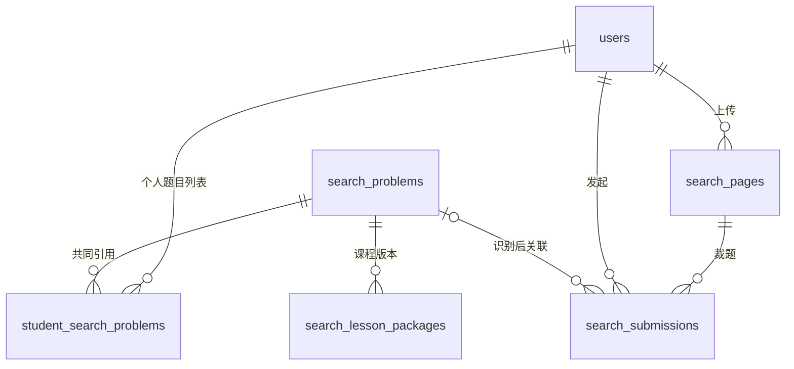
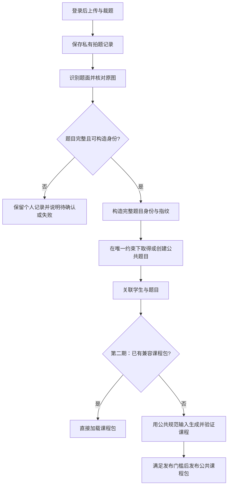

# 公共题库、学生关联与解析复用：设计稿

> 日期：2026-10-23；第一期实施说明更新于 2026-10-24。状态：**第一期已进入实现与本地验收；第二期保留设计方向**。
> 当前尚无学生使用，按最小可用流程推进：先完成登录 → 拍题 → 题目入库 → 个人历史 → 删除。第一期范围以第 9.1 节为准，后续能力按实际使用需求评估，不作为第一期的前置条件。
> 本文替换此前“用账号目录保存拍题历史”的设计建议：题目和个人拍题历史应以 PostgreSQL 为权威；图片和计算产物仍可存文件。本文保留设计依据与实施前核查，实际实现、验证范围和运行命令见[第一期实施说明](shared-problem-library-and-student-learning-stage1.md)。

## 1. 已确认的方向

| 事项 | 已确认的决定 |
| --- | --- |
| 入口 | 全站导航顺序为：首页 → 拍题学 → 初中题库 → 高中专题 → 知识图谱；暂沿用 `/lab/search/` 地址 |
| 登录 | 游客可浏览介绍和公开示例；拍照、选图、打开个人题目时必须登录，复用现有手机号登录 |
| 历史 | “我拍过的题”使用真实记录，删除模拟手机号、模拟历史和虚构额度 |
| 题目归属 | 题目是公共内容，保存到数据库；通过中间表关联学生和题目 |
| 文件存储 | 首版存服务器文件系统的持久目录；后续迁移云文件服务，数据库使用稳定的 storage key 引用文件 |
| 自动合并 | 首版按“完整题意一致”合并，允许照片、排版和支持的数学记号写法不同；不扩展到变量改名、任意数学等价变形或选项换序 |
| 解析复用 | 第二期接入公共课程包，通过第 6 节的发布与兼容检查后复用；第一期仍按本次提交生成课程 |
| 教学题面 | 第一期沿用现有教学流程；第二期课程统一使用由公共结构化题目生成的规范题面，本人照片和原文转录仅作来源展示 |
| 题目内容 | 公共题目内容不可变，不原地修订。首版不做纠错工具：某次提交识别错了，学生删除这条记录后重拍；公共题目本身有问题（如误含个人信息）时由运营停用 |
| 分期 | 第一期：登录、页面与提交落库、公共题目去重、个人历史、照片保留与单题删除；第二期：公共课程包与公共生成路径；备份恢复列入正式上线前清单，账号注销按当前决定暂缓 |
| 教学范围 | 复用现有解题教学，个人作答保存在本机并按账号隔离；公共课程复用属于第二期，个性化学习路径以后再评估 |
| 照片保留 | 整页原图及旋转副本按首次上传期限保留 24 小时，删除单题不提前清除整页；单题裁剪图保留 30 天，主动删除时提前清除该题裁剪图和私有产物 |
| 删除历史题目 | 删除该学生这道题的全部拍题记录及其裁剪图；不删除其他学生的记录和不含个人信息的公共题目、课程 |
| 旧数据 | 保留原有匿名测试文件，不自动归入任何账号，也不继续开放匿名直链 |
| 交付 | 每期分别完成代码与 8779 本地验收，本轮不部署线上 |

这里的“公共”表示**不同学生可以引用同一题目内容**，不表示公开某位学生上传的整页照片、批注、模型调用日志或个人作答，也不表示开放匿名题库读取接口。

题目去重、请求幂等和解析复用分别解决三个问题：

- **题目去重**：数据库里是否已经有这道题。
- **请求幂等**：浏览器重试是否重复创建了同一次上传或拍题。
- **解析复用**：这道题是否已有当前版本可使用的课程。

三者需要分别有身份和约束，不能共用一个图片哈希解决。

## 2. 现状与需要补齐的能力

以下为实施前只读核查得到的代码现状，第一期接入情况见[实施说明](shared-problem-library-and-student-learning-stage1.md)：

| 现有能力 | 可复用部分 | 边界 |
| --- | --- | --- |
| 站点登录 | PostgreSQL 用户、手机号身份、Cookie session、登录弹窗及 `require_user` | 拍题学首页仍使用模拟登录，拍题 API 尚未接入学生认证 |
| 内部 `problems` 表 | 题目、来源、修订和构建分离的设计经验 | 要求工作区及成员身份，不能直接作为所有学生共用的题库 |
| 本地拍题流水线 | 上传、旋转、裁题、识别复核、求解、持久化教学事件 | 题目产物目前按文件目录定位，没有公共题目表和学生关联表 |
| 图片哈希 | 当前模型输入的识别与审计证据 | `question_sha256` 来自有损预处理后的图片，不等于原始裁剪像素身份 |
| 数学 canonical | 数学比较和候选匹配的辅助依据 | 不完整保留题面、选项与所有目标限定，不能直接作为公共题唯一键 |
| 学生快照 | 数学步骤、交互、选法与知识依据的公开投影 | 内部 `checkpoint.json`、SQLite 导出不是可直接共享的课程包 |
| 页面组装 | `present_lesson` 组装阶段二，随后合入阶段三展示 | 目前还使用本次拍题的 `features`、`original_text`、`candidate` 和作为 `problem_id` 的 `search_id`，不能只缓存阶段三 |
| 前端教学引擎 | 一次快照恢复交互内容的 `hydrate` 能力 | 当前传输默认继续轮询；共享包需要只读快照模式 |

当前正式服务入口尚未接入本地拍题接口；生产 OCR、代理上传和 WebSocket 配置另有差异。此次先复用 8779 的本地运行入口，不将本地验收等同于已具备生产上线条件。

核查补充：阶段一的 `reviewed_candidate / source_reviewed` 承担原图复核；阶段二接收这份准入结果，`verify=True` 控制的是 `verify_amgm` 数学证书验证，不能将它描述为再次核对上传原图。

## 3. 数据模型建议

### 3.1 数据表

建议新增站点级表，直接关联现有 `users.id`，不要求学生成为内部工作区成员。以下表名和字段是设计建议，尚不是迁移脚本。

| 表 | 期次 | 主要内容 | 关键约束 |
| --- | --- | --- | --- |
| `search_problems` | 一 | 公共题目 UUID、身份规范版本、内容指纹、完整身份 JSON、规范题面、可教学的结构化题目、状态（`active / disabled`）、创建时间 | `UNIQUE(identity_version, fingerprint)`；题目不属于某个学生；只在阶段一复核通过后创建，内容写入后不可变 |
| `student_search_problems` | 一 | 学生 ID、公共题目 ID、首次/最近搜题时间 | `PRIMARY KEY(user_id, problem_id)`；最近一次提交按需从提交表查询，不另存指针 |
| `search_pages` | 一 | 私有上传页面 ID、用户 ID、图片 storage key/哈希/尺寸、OCR 与旋转元数据、来源页面 ID、创建时间、图片状态 | 页面属于上传者；旋转产生新页面；整页图片 24 小时后清除 |
| `search_submissions` | 一 | 私有拍题 ID、用户 ID、页面 ID、裁剪框、裁剪图片 storage key 与哈希、识别/生成状态、错误码、工作目录、可空公共题目 ID、可空客户端请求 ID、时间 | `UNIQUE(user_id, client_request_id)`；允许识别前和失败状态；页面与提交必须属于同一用户；裁剪图是提交自己的独立文件 |
| `search_lesson_packages` | 二 | 公共题目 ID、包协议版本、不可变教学 payload、payload 哈希、生成修订、发布时间、发布/撤回状态 | 部分唯一索引：同一题目、同一包协议版本最多一个未撤回的包；已发布 payload 不覆盖 |

“暂不支持”结论的独立缓存推迟到第二期之后，见第 6.6 节。

课程包可先将教学 JSON 保存在 PostgreSQL 的 JSONB 中。图片、大型计算产物和内部审计文件首版保存在服务器文件系统的持久目录，数据库记录 storage key、内容哈希与归属。后续迁移云文件服务，不改变题目、学生关系和文件引用，具体方式见第 5.3 节。

### 3.2 题目、拍题和学习身份分别使用

- `problem_id`：公共题目身份，不带用户、上传时间、文件路径或求解运行 ID。
- `search_id`：某次拍题身份，保留现有页面 URL 的使用方式，例如 `problem.html?search=...`。
- `page_id`：某张私有页面图片的身份，裁剪前就需要检查归属。
- `package_id`：不可变课程包身份。同一道题在同一包协议版本下最多一个可用包；撤回后重新生成的是新包。
- `run_id / lesson_version`：生成过程与教学内容的现有身份，不为了共享而任意改写。

`fingerprint` 用来按身份规范找同题。题目内容不可变，一个 `problem_id` 只对应一份内容，课程包和提交只需引用 `problem_id`。

一次上传页面可以切出多道题；同一个学生可以多次拍到同一道题；不同学生可以引用同一公共题目。这些都不会要求复制公共题目正文。

提交不绑定课程包。读取课程时按“题目 ID + 当前包协议版本”查唯一的未撤回包，不存在就是未命中；包 ID 只出现在前端本机进度的作用域里，用来在包被替换后丢弃旧进度。

归属由服务端从登录会话取得，前端不能指定用户。页面和提交属于同一用户用一条复合外键保证：`search_pages UNIQUE(id, user_id)`，提交的 `(page_id, user_id)` 外键引用它。

**首版不做纠错工具。** 识别错误只影响那一次提交：A 的 `≥` 被误识别成 `>` 时，A 关联到 `>` 的题，B 的原题本来就是 `>` 也关联这道题，这道题对 B 是正确的，不应停用。A 删除这条记录后重拍即可。只有公共题目本身有问题（缺必要条件、误含个人信息）时，运营将它标为 `disabled`：停止新关联、撤回课程包，已关联的学生在历史中看到“题目已下线，请重新拍摄”。运营后台改提交归属、学生“题目有误”反馈，等有实际纠错需求再做（第 10 节）。

### 3.3 哪些内容不放在公共题目里

公共题目不保存学生手机号、学生作答、练习完成状态、原始整页照片、手写批注或模型调用记录。拍摄来源、题号与出处等来源信息保留在提交侧；只在能够明确分离时，才不把它们计入题目身份。

规范题面和选项从经过校验的结构化题目身份生成，不直接保留首位上传者的整段 OCR 原文。结构化 JSON 本身不代表文本安全：必须限定题目字段及用途，剔除非题目内容，来源中的指令性文字始终只作数据，不参与系统指令或教学生成规则。不能确认题目完整、私人内容已分离时，不发布公共记录或课程。

题目尚未核对完整时，先保存在 `search_submissions`。识别失败、缺图或选项不完整不能通过创建一个“看起来完整”的公共题目来填补。

复核完整但当前解法暂不支持的题目，可以有公共题目记录；“能否识别题目”和“能否生成课程”是不同状态。

## 4. 不重复录入题目的流程

第一期到“关联学生与题目”为止，之后沿用现有流程按本次提交生成课程；第二期才接入课程包命中和公共规范输入生成。

### 4.1 首版只按完整题目身份匹配

首版不做“相同裁剪像素直接复用识别”的快速命中，新拍题一律先识别复核，再匹配完整题目身份。图片哈希只用于文件完整性，不用作公共题目的唯一键。

### 4.2 完整题目身份与指纹计算

不同人重拍同一道题，像素一般不同，需要完成识别复核后再匹配题目内容。建议新增明确版本的 `ProblemIdentity` 构造器，不额外调用 LLM 判断两道题是否相同。

身份至少保留：

1. 规范题干及完整数学结构，包含符号角色、定义、条件、量词和定义域。
2. 严格与非严格不等号、区间开闭、目标类型与全部限定。
3. 全部小问及其原有顺序、条件作用域和小问对应的选项。
4. 选择模式、选项标签、有序选项内容；明确“没有选项”和“选项解析不完整”的区别。
5. 解题必要的图形信息；没有可靠完整的图形身份时，不能仅凭文字跨照片合并。

上传 ID、运行 ID、原文字节偏移、图片位置等来源字段不参与公共身份，但仍保存在私有提取证据中。不能直接对整个候选 JSON 求哈希；必须先构造与上传无关、保留完整题意的身份对象。同一规范身份使用同一确定性的 key；相似检索即使命中候选，也不绕过完整身份比较。

计算规则固定为：`fingerprint = SHA-256(UTF-8(canonical_json(ProblemIdentity)))`。身份对象包含 `identity_version`；序列化固定对象键顺序、字符编码和数值表示，数组保留小问和选项的原始顺序。因此它是完整结构化身份的摘要，不是整段 OCR 文本、图片或求解答案的摘要。版本对应的规范化规则一经发布就冻结。

允许规范化空白、换行和已经支持的等价记号写法，例如同一不等号的 Unicode 与 TeX 表示。变量名、条件内容和小问顺序不做语义重写。

对于出处、试卷题号等文字，首版只排除已经明确识别为来源字段的部分；不使用宽泛正则删除数字、括号或题干前缀。无法安全分离时允许少命中，不能误删数学条件。

建议以整题（包含全部小问）作为首版入库单位；仅截出某一道小问而缺少公共题干时，不能直接关联完整题。

### 4.3 合并示例与边界

| 两次提交的差异 | 首版建议 |
| --- | --- |
| 同一题的两张照片，复核后完整题意一致 | 关联同一公共题目 |
| 空格、换行、支持的公式记号写法不同 | 安全规范化后合并 |
| `∀` 与 `∃` 不同 | 不合并 |
| `> 0` 与 `≥ 0` 不同 | 不合并 |
| 区间 `(1,3)` 与 `[1,3]` 不同 | 不合并 |
| 题干一致但 A、B 选项互换 | 不合并，避免正确字母与题面错位 |
| 同一答案但条件不同 | 不合并 |
| 变量改名、数学等价变形或同一题型的不同数字 | 本版不自动合并 |
| 两张图文字一样，但配图不同或未识别完整 | 不按文字合并 |
| 第一张只识别出两个小问，第二张包含三个 | 不合并；不完整识别保留为待处理提交 |

数据库能保证“同一规范身份只保存一份”，不能保证所有拍摄差异、OCR 表述差异都自动识别成同题。首版允许保守的重复，优先避免误合并。

### 4.4 并发归并

识别和模型调用放在数据库短事务外。拿到完整身份后，在同一事务中：

1. `INSERT ... ON CONFLICT (identity_version, fingerprint) DO NOTHING` 后读取该题目，不用“先查再插”。
2. 比较完整身份 JSON，不能只比较哈希；不一致时中止归并并记录内部异常。
3. 将本次提交关联到公共题目，Upsert 学生—题目中间表：保留首次时间，最近时间取 `GREATEST(原值, 本次提交时间)`，乱序完成也不会倒退。

两个学生同时搜同题，唯一约束将公共题目收敛成一行，两人各自拥有关联和提交记录。

### 4.5 以后升级身份规范

首版只有 v1 身份，直接存在 `search_problems` 上。真正需要升级规范时再新增身份别名表，把新旧版本身份映射到同一题目 UUID，并先回填已有题目再切换写入，不能只改版本号后重新建一整套题目。别名只表示“同一道题在不同规范下的身份”，不能用来合并不同题意。

## 5. 请求重试、后台任务与存储一致性

### 5.1 请求幂等只保护“建题”

只有“学这道题”（创建提交并启动识别）会花模型费用，首版只对它做幂等：前端为每次点击生成一个请求 ID，提交表上 `UNIQUE(user_id, client_request_id)`。网络重试带同一个 ID，插入冲突时返回已有提交，不重复识别；学生主动再拍一次是新 ID。上传整页和旋转重复了只会多一行页面记录，不做幂等；图片在来源页首次上传 24 小时后失效并清理，页面行保留非内容元数据与待清理项。

删除提交会连同请求 ID 一起删掉。浏览器的自动重试发生在几秒内，删除发生在之后很久，两者重叠的窗口可以忽略，不为此单独保留删除回执。

### 5.2 数据库与文件各自负责什么

| 信息 | 权威来源 |
| --- | --- |
| 公共题目、学生关系、历史查询、访问权限 | PostgreSQL |
| 提交的业务阶段、失败/中断状态 | PostgreSQL |
| 图片字节、工作流文件、内部日志 | 持久文件存储，数据库登记位置与哈希 |
| 当前数学运行的步骤、事件与可恢复检查点 | 现有运行存储与契约，本轮不重写求解器事件机制 |
| 已发布共享课程 | 数据库登记的不可变课程包及其校验哈希 |

数据库与文件系统没有同一个原子事务，采用“先写文件、后提交数据库”的顺序：文件写完并校验后，再在数据库里登记引用和状态。数据库提交失败只会留下孤立文件，由清理任务处理；不会出现数据库显示成功而文件不存在。

**后台完成写入与删除互斥。** 后台任务完成时，在一个事务里 `SELECT ... FOR UPDATE` 锁定提交行，确认它仍存在，再写状态、建立题目关联或发布课程包；提交已被删除就回滚，产生的文件交给清理任务。删除提交也先锁同一行，所以两者串行，不会出现删除后又建关联。

任务状态持久化在提交行上。进程重启后，没有终态的任务标为“中断”，不依赖进程内 `errors/judging` 永久显示“生成中”，也不自动重发模型请求。读取历史只读状态，不隐式触发识别或求解。本轮沿用本地执行机制，不建设新的调度系统。

### 5.3 先用服务器文件系统，后迁移云文件服务

首版文件存储使用服务器上的持久目录，根位置由配置决定，不放在代码目录、临时目录或可匿名访问的静态目录中。数据库只保存相对路径形式的 storage key，例如 `search/pages/<page_id>/original.png`，不保存机器绝对路径。以后迁移云文件服务时按 key 复制文件即可，数据库引用不变；首版不为此预先抽象存储接口。文件读取先检查数据库里的账号归属。阶段三执行权威已统一到 PostgreSQL（见[执行存储实施说明](stage-three-postgresql-execution-storage.md)）；冻结输入、文件锁和临时工作目录仍使用本地文件系统。

## 6. 公共解析如何复用

### 6.1 共享不可变课程包

采用“公共课程包 + 独立个人作答”的模型，**阶段二、阶段三和页面组装一起构成课程**。仅保存阶段三快照再调用 hydrate，不足以还原学生看到的完整页面。

| 包的组成 | 冻结内容 |
| --- | --- |
| 题目表示 | 公共题目 ID、内容哈希、由结构化身份生成的规范题面和选项、公共目标引用 |
| 阶段二 | 经过公开投影的完整阶段二结果，以及与它一致的规范 `candidate`、`features`、题型和选法内容 |
| 页面组装 | 使用以上同一份输入生成的 `present_lesson` 结果，包括读题片段、目标、选法与图谱所需公开数据；读取时不再用新上传或当前图谱重新拼接 |
| 阶段三 | `EventStore.snapshot()` 的公开教学快照，包含数学步骤、交互、答案和必要知识依据 |
| 包清单 | 包协议版本、包 ID、内容校验哈希、生成修订和发布信息；不含上传者身份 |

当前组装调用的四个拍题输入，第二期逐个改为明确的数据来源：

| 当前输入 | 公共课程的数据来源 | 本次拍题的数据用途 |
| --- | --- | --- |
| `features` | 与公共 `candidate` 同步生成并校验的冻结特征，`target_ref` 与包内目标完全一致 | 只用于本次识别和匹配，命中后不能注入已冻结课程 |
| `original_text` | 从公共结构化题目身份确定性生成的规范题面，包含有序选项 | 原始转录只作本人的私有来源证据 |
| `candidate` | 同一公共内容版本的规范候选，目标路径和符号角色稳定 | 用于识别复核、构造身份和检查表示对应 |
| `search_id`（目前作为 `problem_id` 传入） | `present_lesson` 改用公共 `problem_id`；课程版本由 `package_id / lesson_version` 区分 | 留在外层提交授权、照片访问和 URL 定位中，不进入公共教学身份 |

**课程从一开始就用公共规范输入生成，只有一条生成路径。** 第二期起，阶段一复核通过并归并到公共题目后，先由公共结构化题目确定性生成规范 `candidate`、规范题面和对应的 `features`；阶段二、阶段三和页面组装一律以这份规范输入运行。首位学生自己的页面看的也是这份课程，不存在“先按私有 OCR 生成、事后转成公共包”的转换步骤。

这样做的原因：现有 `lesson_version` 由阶段一、阶段二结果和实现修订共同计算（`stage_three/runner.py`），卡片哈希和交互引用又依赖它。按私有输入生成的课程已把私有原文绑定进这些身份，事后无法在不改写已校验内容的前提下去掉。读题片段的原文偏移同理，直接基于规范题面计算，不需要从首位上传者的原文重建映射。

已确认的产品取舍：学生看到的是规范题面，不是自己照片的 OCR 原文；本人照片和原文转录只作来源展示。

**公共题目本身就是准入结果，不另存准入证明。** 公共题目只在阶段一复核通过后创建；规范输入由这份已入库内容确定性生成，重新生成时直接使用，不依赖已清除的照片或 OCR。阶段二需要新增一个接受规范输入的入口，按“来自已入库公共题目”准入，而不是把规范候选标为 `source_reviewed=true` 冒充原图复核。“已核对原图”徽标只取本次提交实际的阶段一复核状态。

**公共题面、选项及教学自由文本只从受约束的公共结构化字段和教学模板生成。** 当前 `choice_source` 依赖 `original_text`，第二期改为读取规范题面或直接读取结构化选项。手写批注、来源中的指令性文字、任意 OCR 附注和私人信息不进入规范输入，因此也不会进入课程包。

现有学生投影和 `consumer.hydrate()` 可以复用；整个 SQLite、`checkpoint.json`、`EventStore.export()` 或未经投影的阶段二运行结果不能直接共享。公共包独立拥有公开教学资产，不依赖上传者私有工作目录中的图片或文件。包内不放私有提交 ID，也不伪造一份可继续计算的 solver run。

第一期生成的课程仍按私有提交输入产生，不转成公共包；第二期上线后，这些题目在学生下次主动重新生成时按公共输入生成新课程。

### 6.2 发布门槛

不能仅凭顶层 `status == completed` 发布，因为当前聚合状态可能包含跳过或不支持的目标。第二期发布要求：

- 所有实际目标都有可用的已验证解答，目标和完成态一致。
- 保留路线的数学卡校验通过，必需步骤交互已就绪；数学执行和必需交互无待处理、冲突或失败状态。
- 题面、变量、目标路径、小问顺序和选项与公共题目完全对应。
- 阶段二结果、读题片段、页面组装和阶段三快照来自同一规范输入，目标引用一致。
- 使用支持的快照/课程包契约，通过公共字段检查和包内容校验，公开资产已独立持久化。

部分可用的解题过程仍可在原提交页按现有规则展示，但第二期不把它当作完整公共课程命中。

这里的“交互已就绪”指课程必需的步骤交互，不把可选的阶段④问答补充状态当成数学验证状态。当前 `handoff.status` 不能单独作为数学通过的依据；包中只包含本次已完成且通过检查的补充问答，不带待处理任务或原运行的重试入口。

### 6.3 版本兼容和发布竞争

**兼容性只看一个整数：包协议版本。** 它写在代码里，覆盖快照、数学卡、交互、阶段二组装和前端读取包所需的全部结构；任何一处发生前端无法读取的变化就加一。读取时包的协议版本与当前版本不相等就不复用，按未命中处理。教学措辞、样式和普通实现修复不加版本，旧包继续使用并保留冻结文案。

正确性或安全问题不靠版本号处理，而是撤回受影响的包。包上记录生成时的代码修订，只用于审计和定向撤回。现有运行指纹仍用于运行恢复校验，与公共包复用无关。

**同一题目、同一协议版本最多一个未撤回的包**，由部分唯一索引保证。已发布 payload 不覆盖，包一直有效直到被撤回；协议版本升级后旧包自然不再命中。

只复用已经发布完成的课程，不合并还在生成中的任务。两个学生同时首次生成同题时，后完成者插入失败即放弃发布，自己的页面照常显示自己的结果。读取时包校验失败，服务端直接把它标为撤回（原因“损坏”）再按未命中处理，避免损坏的包占住唯一位置、导致新包无法发布。

### 6.4 命中后的页面

建议为现有课程描述增加 `mode: "snapshot"`：加载公共包快照，调用既有 hydrate，不连接 WebSocket、不轮询运行状态，也不提供“继续计算”。新拍题没有合格包时按已授权请求继续流式生成；打开历史没有合格包时按第 6.5 节提示，不隐式生成。

公共内容不会因一次性到达而提前显示答案；“自己做”仍按个人进度展示，“看 AI 解题”仍走回放。学生看到的题图来自本人提交，不能指向课程首位生成者的照片。

复用课程统一使用第 6.1 节的冻结组装结果，当前照片和原图转录继续作为本人的来源展示，不改变公共教学文本。图片到期后显示公共规范题面，并说明“原图已到期清除”。

由于课程只基于公共规范输入，本次提交的 `features`、目标引用和原文偏移是否与课程一致不影响复用：只要完整身份一致、课程包通过发布与协议兼容检查，就可以加载。协议不兼容时，新拍题按已授权的生成流程用公共输入重新生成，历史访问则提示主动重新生成。如果变量、小问或选项的题意本身不一致，连公共题目也不能合并。

### 6.5 撤回后的学生页面

撤回状态与不可变 payload 分离，撤回只改状态。每次打开或恢复课程都按“题目 ID + 当前协议版本”重新查未撤回的包：

- 查到包：加载它。若与本机进度记录的包 ID 不同（原包已撤回并重新生成过），丢弃旧进度，从头开始，提示“解析已更新”。
- 查不到包（被撤回、协议升级或损坏）：保留题面和历史，显示“解析已更新，点击重新生成”；学生点击后才触发模型计算，读取本身不触发。

重新生成从已入库的公共题目生成规范输入，不依赖已清除的照片。题目被 `disabled` 时不提供重新生成，按第 3.2 节提示重新拍摄。

### 6.6 暂不支持的结论缓存（推迟）

推迟到第二期之后，有实际费用数据再评估：当前阶段二以程序判断为主，主要费用在阶段一识别（缓存也省不掉）和阶段三。届时注意两点：只缓存能力规则能确定的“不支持”，未知题型、超时、服务异常不缓存；缓存键带显式的能力判断版本，支持范围扩大时更新。

## 7. 个人历史与个人学习记录

### 7.1 已确定要落库的历史

个人历史由当前用户关联表与提交表查询：

- 已识别的同一道公共题目显示一条，重复搜索更新最近时间。
- 每次拍题仍有独立提交记录，便于查原图、识别失败和重试。
- 尚未关联公共题目的识别中、失败或待确认记录，也应出现在个人历史中。
- 摘要、时间、状态和分页来自数据库，不扫描目录拼凑历史。
- 解析生成完成显示“可开始学习”，不能自动标为学生“已完成”。

新增 `GET /api/search/problems` 返回当前学生的历史，按最近时间倒序，每页 20 条，`limit/offset` 分页即可。每条返回打开用的拍题 ID、可空公共题目 ID、题干摘要、时间和状态。

现有 `problem.html?search=...` 继续定位私有提交，再通过数据库关系加载公共题目和课程，不开放按目录名读取文件。

同一道题有多次提交时，服务端选“最近一次有可用课程的提交”作为打开入口；都没有可用课程时选最近一次提交并显示其状态。第一期“可用”指课程已生成完成且私有产物未到期（第 7.3 节）；第二期指该题有未撤回、协议版本匹配的课程包。

### 7.2 作答进度

逐步作答进度继续只存在浏览器本机，不跨设备同步；服务器只保存拍题历史。

**进度键要加上账号。** 现有本机进度键没有账号维度：`walk.mjs` 的 `progressKey` 和 `graph-walk:${problemId}:${bundleVersion}`、`problem.js` 的 `pageProgressKey` 都只用 bundle 的 `problemId / bundleVersion`，同一设备换账号会读到上一个账号的进度。第一期改为：课程接口返回用户 ID，前端所有本机进度读写都以“用户 ID + bundle 的 `problemId / bundleVersion`”为键。用户 ID 由接口返回、在页面外层拼接，不写入第二期共享的 bundle。

第一期 bundle 的 `problemId` 仍是私有 `search_id`，进度按提交区分；第二期改为公共题目 ID，并以包 ID 作为 `bundleVersion` 的一部分，同账号重拍同题命中同一个包时接续进度，换包从新进度开始。第一期进度不迁移到第二期。删除一道题时清除当前设备上的对应进度，其他设备不做远程清除承诺。

服务端学习记录（完成、自评、跨设备继续）和个性化学习路径都不在两期范围内，见第 10 节。

### 7.3 删除与保留期

**整页原图只短期保留，长期只留单题裁剪图。** 整页照片常含姓名、班级等无关信息，且是同页多题共用的文件；只要它长期存在，删除一道题就必须连带处理整页及同页其他题。因此首版把两类图片分开保留：

| 数据 | 处理规则 |
| --- | --- |
| 整页原图、旋转副本、整页缩略图 | 从首次上传时间起保留 24 小时，旋转不延长期限；删除单题不提前删除整页，以保留同页选题和重新裁剪。之后清除，页面行只留不含图像和 OCR 原文的元数据（`image_state=expired`）。过期后要重新裁剪只能重拍 |
| 单题裁剪图及其预处理图 | 每个提交独立保存，从提交时间起保留 30 天；访问不刷新期限 |
| 私有识别与计算产物 | 含原始转录或用户信息的日志、工作目录和调用产物，随所属提交删除或到期 |
| 删除历史题目 | 删除该用户该公共题目下全部提交、关联、裁剪图、上述产物和当前设备的对应进度；不涉及同页其他题 |
| 公共题目与课程包 | 不含个人信息，独立保留，其他学生继续使用；误含个人信息时按第 3.2 节停用 |

**已确认的删除边界：** 单题删除立即停止访问该题的私有提交、裁剪图和产物，但不提前删除其来源整页及旋转副本；整页中仍可能包含这道题的像素，直至原来的 24 小时期限。其他已裁题目的记录、独立图片和课程继续可用。整页到期清理也包括 OCR 和区域文件，不把原文留在页面元数据中。

**未关联公共题目的提交随裁剪图到期一并删除。** 识别失败、待确认或从未关联公共题目的提交，到期后既没有图片也没有规范题面，也无法重试；30 天到期时直接删除整条提交，不在历史中留一条无法打开的空记录。已关联公共题目的提交到期后保留，显示规范题面和“原图已到期清除”。

**第一期的私有课程随产物到期一起失效。** 第一期课程读取（`dev_api.py` 中的 `present_lesson`）依赖本次提交的原始转录、`features` 和 `candidate`，它们 30 天到期必须清除。第一期不另存一份去掉原文的教学结果（那是第二期课程包的事）：清除产物时把提交的课程状态改为“已到期”，历史显示规范题面和“解析已随原图到期清除，重新拍摄可再次学习”。第二期起同一道题由公共课程包提供，不再受个人产物到期影响。

**删除只作用于删除时已关联到这道题的提交。** 删除时仍在识别、`problem_id` 为空的提交，在历史列表中本来就是单独一条“识别中”，不随这次删除取消；它之后识别完成并匹配到同一道题时，照常重新建立关联，因为学生确实拍过这道题。学生想一并删除时，可以单独删除那条记录。

删除时先锁定相关提交行，在同一事务中删除数据库个人记录并在保留的页面元数据中登记待清理 storage keys，再清理文件；与后台完成写入的互斥见第 5.2 节。到期和删除都立即停止访问，物理清理在本地服务启动及之后每分钟执行，失败保留任务并重试；等待清理或清理失败不恢复访问权限。

公共题目和课程包没有上传者归属外键，私有记录被删除不影响公共包读取。私有照片和含原文的工作产物不进入长期备份。

### 7.4 正式上线前清单（不属于两期交付）

以下属于生产运维，不阻塞两期的 8779 本地验收，在正式部署前单独落实：

- **备份恢复不复活已删数据（已实现，部署待接入）**：`product-backup/v2` 保留最多 30 天，拍题文件副本按原截止时间提前清除。独立追加式删除日志先于数据库删除持久化，恢复必须提供当前删除权威，先重放删除并执行原期限检查再开放服务；凭证不含照片、原文或手机号。详见[备份恢复与离线验收](search-backup-restore-local-acceptance.md)。停服期间的维护调度与实例外备份保留仍须部署时落实。
- **生产文件存储与清理任务**：持久目录位置、定时清理任务的部署与监控，以及上传代理、OCR 与 WebSocket 的生产配置差异。

账号注销按当前决定暂缓，不列本轮或当前上线前必做；当前没有注销接口，按题删除、退出登录和恢复时撤销会话都不等同于注销账号。若未来重新安排，须完整覆盖该账号的拍题、学习、认证及手机号关联数据，不随账号删除公共题目和课程包。

## 8. 登录和访问边界

- 首页使用共享导航和账号组件；介绍与公开示例不要求登录。
- 相机和真实题目页直接访问时也先检查登录，成功后再启动相机、上传或读取个人数据。
- HTTP 使用现有 Cookie 认证。现有 `require_origin` 是接口依赖，不是覆盖全部 `/api/search` 的中间件；新增或改造的每个 POST/PUT/PATCH/DELETE 接口都必须显式挂载身份及 Origin 检查，包括上传、旋转、裁题、重试、开始/恢复、重新生成及删除。
- WebSocket 在 `accept` 前检查 Origin、Cookie 身份和题目归属；匿名、错误来源和跨账号连接均拒绝。
- 页面、提交和原图只能由所属学生访问；其他账号得到 404。公共课程只能通过本人的拍题记录打开，不能凭 `problem_id` 直接读取或自建关联。
- 退出或换号时前端停止相机、轮询与流，丢弃旧账号的迟到响应，清空当前个人内容。
- 私有图片和个人历史响应禁止缓存，上传仍支持既有 20 MiB 边界；不能直接套用登录接口的 4 KiB 请求体上限。

## 9. 实施范围与验证顺序

**第一期范围已确认，按以下顺序实施。** 两期各自完成代码与 8779 本地验收，第一期不依赖第二期的任何结构。优先验证基本流程、账号隔离和题目内容正确性；不为尚未出现的使用需求增加额外机制。

### 9.1 第一期（范围冻结）：真实登录、题目入库与个人历史

1. **身份与存储**：实现 v1 题目身份和四张表（`search_problems`、`student_search_problems`、`search_pages`、`search_submissions`），落实整页 24 小时与裁剪图 30 天的保留方案。用真实题目样例确认规范化细节，在隔离测试库验证唯一约束。
2. **拍题接入**：将页面和提交登记到数据库，接登录、Origin 与归属校验，再将复核结果归并为公共题目。课程仍按现有流程从本次提交生成。
3. **个人历史与删除**：接真实列表与入口选择，删除模拟登录和模拟数据，本机进度改为按接口返回的账号作用域保存，实现单题删除和到期清理，检查换号与迟到任务。
4. **导航与本地验收**：同步共享导航及生成页面，在 8779 验证桌面、平板和手机布局。

第一期保留必要的唯一约束、账号归属检查、本机进度隔离，以及删除与后台完成的行锁互斥。暂不增加身份别名表、纠错工具、删除回执、共享生成任务、跨设备进度或文件存储抽象；按前文已明确的取舍实现即可。

| 场景 | 预期 |
| --- | --- |
| 两学生同时提交同题 | 一条公共题目、两条学生关联、两份私有提交 |
| 同学生再次主动拍同题 | 公共题不增加、个人列表一条、提交记录增加 |
| 点“学这道题”时网络重试 | 同一请求 ID 返回已有提交，不重复识别 |
| 最近提交失败或仍生成中，较早提交已有课程 | 入口打开较早的可用提交，同时显示最新提交状态 |
| 跨用户的页面与提交 | 复合外键直接拒绝 |
| 换照片但完整题意一致 | 复核后命中同一题 |
| 量词、不等号、端点、目标或选项顺序不同 | 不合并 |
| 缺图、选项不完整或未核对 | 不创建公共题目，保留为个人待处理提交 |
| 某次提交识别错了 | 学生删除后重拍；关联同一题的其他学生不受影响 |
| 公共题目被 `disabled` | 不再有新关联；已关联学生看到“题目已下线，请重新拍摄” |
| 数据库提交失败、进程中断 | 不显示假成功，不永久显示处理中 |
| 退出或换号、HTTP/WS 直链访问 | 无匿名绕过和跨账号数据串用 |
| 同一设备换账号打开同一道题 | 不读取上一个账号的本机进度 |
| 枚举全部 `/api/search` 写接口与 WS | 每个接口都验证来源和身份 |
| 删除一道题 | 该题提交、关联、裁剪图和当前设备进度清除；同页另一题不受影响 |
| 删除与后台完成同时发生 | 锁定同一提交行串行执行，不会出现删除后又建关联 |
| 整页原图满 24 小时 | 整页图清除，已有裁剪图的提交照常可用 |
| 裁剪图满 30 天 | 立即不可访问；已关联题目的提交显示规范题面和“已到期”，课程不再可用；未关联的提交整条删除 |

### 9.2 第二期（后续实施）：公共课程包

1. **公共生成路径**：由已入库公共题目生成规范输入，阶段二新增接受规范输入的准入入口，阶段二、阶段三和页面组装改用规范输入；`choice_source` 改读结构化选项，`present_lesson` 改用公共 `problem_id`。
2. **课程包**：实现冻结边界、发布校验、包协议版本、`mode: "snapshot"` 及撤回。新拍题保留流式生成路径，历史读取不暗中求解。

| 场景 | 预期 |
| --- | --- |
| 课程未完成、协议版本不同 | 不命中；新拍题按公共输入生成，历史读取只提供主动重新生成入口 |
| 普通措辞或实现更新，协议版本没变 | 已发布课程仍命中 |
| 两学生同时首次生成同题 | 只有一个包发布成功，另一方放弃发布，各自页面正常 |
| 包撤回或校验失败 | 损坏的包被标为撤回；打开时提示点击重新生成，读取不调用模型；新包发布后本机旧进度丢弃 |
| 原文夹带批注、私人信息或指令性文字 | 不进入规范输入，因此也不进入课程包 |
| 首位学生自己的页面 | 显示规范题面，与之后命中的学生看到的课程一致 |
| 同包被两学生学习 | 课程内容相同，作答及进度互不影响；不返回别人的照片、日志或内部路径 |
| 从缓存进入“自己做” | 后续答案仍按学生操作逐步揭示 |
| 首位上传者删除这道题 | 其个人记录和裁剪图清理，其他学生仍可读公共课程 |
| 图片清除后主动重新生成 | 从已入库公共题目生成规范输入，不依赖已删原文 |

测试使用独立数据库、模拟短信与录制结果。旧匿名文件不迁移、不删除；不修改与本设计无关的内容，不在本轮做生产部署。

## 10. 有实际使用需求后再评估

以下事项不阻塞第一期，也不因文档中提及就默认纳入第二期。先观察实际使用和费用，再决定是否投入；正式上线前仍须完成第 7.4 节清单。

| 后续能力 | 当前做法 | 何时再评估 |
| --- | --- | --- |
| 服务端学习记录与个性化路径 | 服务器保存拍题历史，逐步作答只存本机 | 学生出现跨设备继续学习、自评或因材施教的实际需求时 |
| 纠错工具或学生反馈 | 识别错了删除重拍，公共题目有问题由运营停用 | 识别错误频率明显影响体验时 |
| 身份规范升级与别名 | v1 身份直接保存在公共题目表 | 现有规范确实需要升级时，按第 4.5 节处理 |
| 合并生成任务与“不支持”缓存 | 允许并发生成，第二期只复用已完成课程包 | 重复计算费用有实际数据且值得优化时 |
| 历次拍摄入口 | 历史按题聚合，优先打开最近可用课程的提交 | 学生确实需要对比多次拍摄时 |
| 云文件服务 | 服务器持久目录保存文件，数据库使用 storage key | 需要迁移存储时再接入 |

## 11. 相关设计与代码依据

### 设计文档

- [学生拍题学页面设计](student-problem-search-design.md)：产品流程、题型范围、登录和历史的目标体验。
- [产品服务架构](product-service-architecture.md)：数据库与产物分工、后台运行及恢复边界；部分为目标架构，不代表当前本地拍题已接入。
- [产品数据库设计](product-database-design.md)：内部题库、来源、修订与构建的现有设计背景。
- [手机号登录本地测试](site-login-local-testing.md)：现有账号、登录、隔离数据库和 8779 入口。

### 代码入口

- [产品模型](../server/shuxueshuo_server/product/models.py)、[内部上传去重](../server/shuxueshuo_server/product/services.py)：工作区约束及已有去重范围。
- [登录 API](../server/shuxueshuo_server/auth/api.py)、[SiteAuth](../site/assets/auth/site-auth.js)：现有登录能力。
- [本地拍题 API](../server/shuxueshuo_server/search/dev_api.py)、[阶段一](../server/shuxueshuo_server/search/stage_one.py)、[题图预处理](../server/shuxueshuo_server/search/question_image.py)：当前文件布局、识别和图像哈希。
- [课程组装](../server/shuxueshuo_server/search/lesson.py)、[选法页面](../server/shuxueshuo_server/search/walk.py)、[阶段二执行](../server/shuxueshuo_server/graph_lesson/stage_two/runner.py)：冻结边界、公共教学身份、验证与能力判断缓存的接入点。
- [稳定序列化](../server/shuxueshuo_server/problem_understanding/identity.py)、[原题选项提取](../server/shuxueshuo_server/graph_lesson/stage_three/choice_source.py)：身份构造可复用的局部能力。
- [学生快照投影](../server/shuxueshuo_server/graph_lesson/stage_three/public_snapshot.py)、[数学运行版本](../server/shuxueshuo_server/graph_lesson/stage_three/runner.py)、[聚合状态契约](../server/shuxueshuo_server/graph_lesson/stage_three/contracts.py)：共享课程的发布与身份边界。
- [前端流消费者](../site/assets/graph-walk/stage-three-stream.mjs)、[拍题页面](../site/lab/search/problem.js)：快照加载、运行身份和个人进度接入点。
