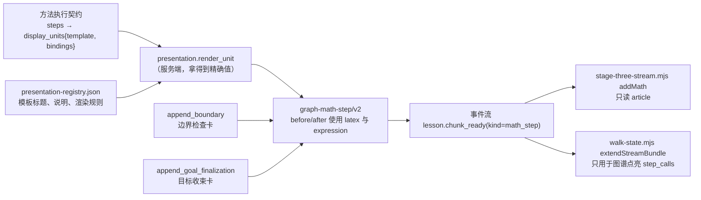
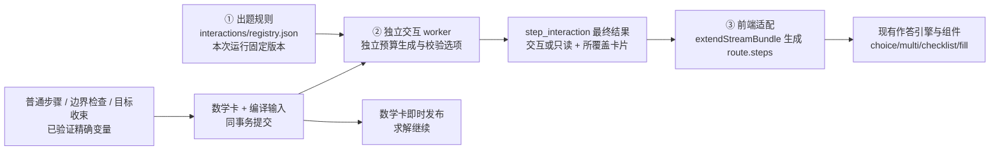

# 阶段三步骤交互卡技术方案

> 状态：设计已确认；三轮审查修订已纳入（2026-10-20）。第 1 阶段（规则与编译）、第 2 阶段（独立执行、事件与存储）与第 3 阶段（前端适配）已实现，第 4～6 阶段待实施。分批验证记录见第 13 节。
> 相关文档：[阶段三实施计划](graph-guided-stage-three-implementation-plan.md)、[图谱引导交互课设计](graph-guided-interactive-lesson-design.md)、[Q01 Demo 设计](graph-walk-demo-q01-design.md)。

## 1. 背景与目标

阶段三已经能为真实拍题逐步产出通过局部检查的数学步骤（新卡为 `graph-math-step/v2`），网页端也能实时接收，整条路线随后完成独立验证。但这些步骤目前只渲染成**只读卡片**（标题、变形前后公式、说明），学生在“自己做”模式下只能点“下一步”往下读。

Demo（`site/data/graph-walk/quadratic-always-q01.json`）里的方法步骤则是**交互题**：学生先作答（单选、多选、逐项核对、填空），答对后才展示该步结果并点亮图谱。

本方案的目标：

1. 让阶段三的步骤按统一规则自动变成与 Demo 同类的交互题，不再逐题手写。
2. 正确答案只来自阶段三通过局部检查的计算结果；路线随后独立验证失败或目标被撤销时停用练习（第 6.4 节）。干扰项由程序生成并校验“确实错误”。
3. 前端复用现有交互组件和学生作答引擎（草稿、判题、反馈、完成态、AI 讲解回放、图谱点亮）。
4. 出题失败不影响数学内容：没有交互的步骤退回只读卡，照常可读。

不在本方案范围：阶段④大模型生成的问答（`step_qa`）本身；正式登录与额度；选方法、选路线（D3、D4）的交互，它们已由阶段二和图谱准入负责。

## 2. 现状

### 2.1 数据流



关键约束：

- 发到前端的数学卡片带有 `display_unit`、`before/after` 的 `latex` 与 `expression`、`explanation`，部分值还带 `exact`；但**没有完整的模板 ID 与出题绑定变量**（例如“下确界在哪儿取到”“是否取到”）。前端无法可靠地据此出题。
- 数学卡片不可变：`math_step_sha256` 校验，前端发现同一 `step_id` 内容变化会报 `stream.immutable_math_step`。
- 新卡使用 `revisions_ref`；公共快照为 `graph-stage-three-snapshot/v2`，与完整内部恢复检查点分开。历史 v1 卡按原内容和原哈希读取，不为增加交互改写或升级它们。
- `site/data/knowledge-next/execution/*.json` 全部计入运行版本 `revisions`；改动其中任何文件，都会使进行中的运行无法续算。

### 2.2 前端已有的交互能力

`walk.mjs`、`walk-state.mjs` 已支持以下组件，判题逻辑在 `gradeDecision`：

| 组件 `interaction.type` | 作答格式 | 正确答案格式 | 适用场景 |
| --- | --- | --- | --- |
| `choice` | 选项 `value` | `{one_of: [...]}` | 单个判断；选项可带 `graph`（图像选项）与逐项 `feedback` |
| `multi` | `value` 数组 | `{required, allowed}` | 选出全部满足条件的情形 |
| `checklist` | 每行一个 `value` | `{terms: [...]}` | 逐项核对（如 Demo 的边界检查） |
| `fill` | 每个空一个 `term` | `{terms: [...]}` | 从候选项中选数填空 |
| `grid`、`plane` | 坐标格 | `{cell}` | 读题、选方法，本方案不用 |

流式路线已有雏形：`extendStreamBundle` 为每条路线建 `{streaming: true, steps: []}`；`currentDecision` 在 `steps` 用完时返回空，页面显示等待卡（`bundle.pending`）；路线 `streaming` 期间不会判定完成。**也就是说，引擎天然支持“步骤边到边做”，只是现在 `steps` 永远为空。**

## 3. 已确认的设计决定

| 问题 | 结论 |
| --- | --- |
| 出题规则绑定什么 | 绑定**展示模板**（如 `policy`、`interval_cases`、`classified_range`）；同一模板在不同方法中提问角度不同时，允许按“方法 + 步骤”覆盖。不按题型绑定，题型差异通过本步变量传入。 |
| 哪些步骤出题 | 不是每张卡都出题。同一路线中重复出现的同类步骤，第一次完整交互，之后只在出现新判断时交互，其余只读。 |
| Q13 区间路线 | 第 5、6、8 张只读；第 2 张拆成“选分类依据 + 填分界点”两问；第 10、11 张合并成一题。 |
| 合并规则由谁决定 | 配置在 `interactions/registry.json` 的顶层 `merges`，服务端读取并匹配实际产生的相邻展示单元；前端使用服务端给出的分组，不自行猜测。 |
| 一张卡拆成多问 | 前几问完成后只显示该问的作答摘要，完整数学卡挂在最后一问的完成态上。这只是完成态的渲染选择，不增加解锁状态。原因：Q13 第 2 张的 `after` 就是第二问的答案。 |
| 交互放在哪 | 职责分离：交互作为单独的 `step_interaction` 片段下发，数学卡片保持不变。 |
| 编译失败如何隔离 | 数学卡及精确编译输入先原子提交，交互在独立 worker、独立预算内生成；异常或超时明确落成只读，不消耗求解或验证预算。 |
| 阶段④与反馈 | 允许阶段④大模型改写选错后的反馈文字；选项、正确答案和图像参数不变。 |
| 图像选项 | 第一批就做，见第 8 节。范围：二次函数、对勾型 \(ax+\tfrac bx\)、一次函数三类函数图，加新增的数轴组件；其余函数族退回文字或公式选项。 |
| 阅读进度 | 引擎按运行、小问、路线独立保存进度和草稿。系统仍在开发中，不做迁移：直接删除 `stage-three-stream.mjs` 的独立阅读游标（`reached`、`graph-stage-three-reading:*` 读写及“下一步 →”按钮）及相关测试。 |

文中“作答引擎”指浏览器端的 `walk-state.mjs`（状态、判题、提交、回放）与 `walk.mjs`（渲染、草稿、交互事件），不是服务端阶段三的求解驱动 `driver.py`。

## 4. 总体方案：三层



1. **出题规则**：一个独立的 JSON 文件，按展示模板描述“问什么、用什么组件、正确答案取哪个变量、干扰项怎么生成、选错怎么反馈、重复时是否出题”。
2. **服务端编译**：三类卡片生成时只收集已有精确变量，与数学卡一起持久化。独立交互 worker 随后生成选项、用 SymPy 校验干扰项并编译图像；同一运行的数学计算与交互编译按操作错开，数学优先，排队不计入计算预算。数学卡即时发布，交互结果或只读降级结果作为单独的 `step_interaction` 片段下发。
3. **前端适配**：`extendStreamBundle` 把“数学卡片 + 交互片段”转换成与 Demo 同格式的决策，追加到流式路线的 `steps`，交给现有引擎。

## 5. 第一层：出题规则文件

### 5.1 位置与版本

- 路径：`site/data/knowledge-next/interactions/registry.json`。**不放在 `execution/` 目录下**，避免改一句提问就让进行中的运行无法续算、改变数学卡片哈希。
- 文件内容的 SHA-256 记为 `interaction_revision`。启用交互的运行保存该规则文件的快照，已有运行及其续算继续使用同一份规则；更新文件只影响新运行。交互规则版本不加入数学卡的哈希或数学续算准入。
- 交互编译器及生成器代码另记 `interaction_engine_revision`，与规则快照一起保存在交互元数据中。恢复时若无法提供原编译器版本，已发布结果仍保留，未完成任务降级只读；这不能阻止数学续算。
- 当前 `runner` 会收集阶段三目录下全部 Python 文件，实施时须将明确列出的纯交互编译模块纳入独立版本清单；不能只增加新哈希却仍让它们触发数学版本变化。数学计算、精确输入采集及共享存储代码仍保留原数学版本保护，不因交互独立而放宽。
- `interaction_id` 是稳定逻辑身份，由运行、课程版本、小问、路线、按顺序覆盖的 `step_id + math_step_sha256`、`interaction_revision` 生成。`interaction_sha256` 单独校验内容；同一身份的不同内容属于冲突。每问的 `part.id` 使用 `interaction_id + 问题序号`，同时支持一卡多问和多卡合并。
- 新增 schema：`internal/schemas/graph-interaction-registry-v1.schema.json`。

### 5.2 结构

```json
{
  "contract": "graph-interaction-registry/v1",
  "generators": ["swap_bound", "swap_quantifier", "endpoint_only", "require_attained", "flip_strictness", "..."],
  "templates": {
    "policy": {
      "repeat": "first",
      "parts": [{
        "component": "choice",
        "title": "转化为最值条件",
        "question": "对所有 ${x} \\in {domain}$，${relation}$ 恒成立，等价于什么？",
        "answer": {"from": "policy_statement"},
        "distractors": [
          {"generator": "swap_bound", "feedback": "要让每个函数值都满足 ${relation_sign} 0，最该担心的是最小的那些值。"},
          {"generator": "swap_quantifier", "feedback": "“对所有”要求每个 $x$ 都成立，不是找到一个就行。"},
          {"generator": "endpoint_only", "feedback": "这个端点条件与本题区间上的整体条件不等价。"},
          {"generator": "require_attained", "feedback": "最小值可能取不到（例如开区间端点处只能无限接近），这时没有最小值，但每个函数值仍可能都满足条件。"},
          {"generator": "flip_strictness", "feedback": "注意原题是否允许等号。"}
        ],
        "min_options": 3
      }]
    }
  },
  "overrides": {
    "method-separation#quantifier": {"policy": {"parts": [{"question": "..."}]}}
  },
  "merges": [
    {"id": "boundary-goal", "display_units": ["boundary", "goal_finalization"], "title": "检查边界并得出最值"}
  ]
}
```

字段说明：

- `repeat`：同一路线中该模板再次出现时是否出题。
  - `"always"`：每次都出题。
  - `"first"`：只在第一次出现时出题。
  - `{"first_or": <条件>}`：第一次出题；之后仅当条件成立时出题，例如 `{"binding": "bound_attained", "equals": false}`。
  - `"never"`：只读。
- `parts`：一张卡可拆成多问（Q13 第 2 张是两问），按顺序作答；前几问完成后只显示作答摘要，最后一问完成后展示完整数学卡（第 7.3 节）。
- `answer.from`：正确答案取自本步哪个结构化变量。规则里**只写取值位置**，不写具体值。
- `distractors`：具名生成器列表，每个生成器配一条反馈模板。生成器只能从白名单 `generators` 中选。
- `min_options`：校验去重后选项数不足时，这一问不出题，退回只读。
- `merges`：服务端加载的合并规则。`display_units` 按顺序匹配同一小问、同一路线实际产生的相邻卡片的 `display_unit`，不是题号、卡片序号或展示模板名。匹配后生成一份引用两个 `step_id` 的交互片段，学生答对后两张卡一起展开。
- `overrides`：按 `方法#步骤` 覆盖某模板的部分字段，合并规则为逐字段替换。替换后的完整规则在加载时重新经过单卡规则 schema 校验。
- 行的 `seed` 下标在加载时按规则类型检查：单卡规则只能为 0，合并规则只能为 0 或 1。

问题与反馈模板沿用 `presentation-registry.json` 的 `${变量}` 写法，复用已有的模板渲染器。

这里的 `registry.json` 是待实现的配置文件。服务端并非预先知道某题“第 10、11 张要合并”，而是运行时发现 `boundary` 后紧接 `goal_finalization`，按 `boundary-goal` 规则分组；同一规则也适用于另一条路线的第 5、6 张。`goal_finalization` 是展示单元 ID，其展示模板实际为 `goal_minimum` 或 `goal_maximum`，因此合并明确按 `display_unit` 匹配。边界卡与目标收束卡也必须将这一标识及精确变量交给交互编译器，不能只接入普通 `render_unit` 产生的卡片。合并期间的待定状态及最终分组结果由服务端提供，前端不得仅凭后一张数学卡到达就把前一张定为只读。

首批合并规则只覆盖两张相邻卡，要求 `case_path` 相同；规则加载时拒绝会同时匹配同一对卡片的配置。合并题的 `parts` 沿用单卡规则的字段，按输入列表中的两个展示单元读取变量，不能用字典覆盖同名变量。匹配、失配与路线结束时的处理见第 6.4 节。

### 5.3 干扰项生成器（第一批）

生成器是服务端的纯函数：输入本步变量和正确答案，输出一个候选变体（精确值与显示用 LaTeX）。变体不保证错误，只有在本题上下文中确证与正确答案不等价后，才可作为干扰项；不能仅因它用了另一种方法或换了一个符号就判错。

| 生成器 | 做法 | 典型对应的错误 |
| --- | --- | --- |
| `swap_bound` | 下确界与上确界互换 | 恒成立该比较最小值，却比较了最大值 |
| `swap_quantifier` | “对所有”与“存在”互换 | 量词理解错 |
| `endpoint_only` | 只代入一个端点 | 以点代区间 |
| `require_attained` | 把“确界满足条件”改成“最值存在且满足条件” | 把取不到的确界当成必须取到的最值 |
| `flip_strictness` | `≤` 与 `<`、`≥` 与 `>` 互换 | 严格性错 |
| `flip_endpoint` | 有限端点开闭互换 | 端点是否取到错 |
| `skip_intersection` | 不与本情况参数范围取交集 | 分类讨论后忘记取交集 |
| `case_only` | 只保留本情况范围 | 忘记本情况内的条件 |
| `drop_piece` | 并集中去掉一段 | 合并时漏段 |
| `seam_puncture` | 在相邻两段的衔接点挖去一点 | 拼接处开闭弄错 |
| `boundary_scale` | 分界点乘 2 或除以 2 | 由对称轴位置反解参数时漏系数 |
| `flip_attained` | “取到”与“取不到”互换 | 开区间端点的极限当成最值 |
| `location_alternatives` | 最值位置的其他候选（左端、顶点、右端） | 最值位置判断错 |
| `case_basis_alternatives` | 其他分类依据（判别式、参数正负、开口） | 分类依据选错 |
| `domain_endpoints` | 把自变量区间端点当作参数分界点（填空候选） | 混淆自变量与参数 |
| `flip_direction` | 与同一确界比较但关系方向相反 | 比较方向弄反 |
| `flip_keep` | 边界点“保留／排除”互换（逐项核对） | 边界检查结论错 |

生成器分两类，校验方式不同（第 6.2 节）：

- **数学类**：输出命题、集合或表达式，如 `swap_bound`、`require_attained`、`flip_endpoint`、`skip_intersection`、`boundary_scale`。用代表值反例证明不等价。
- **类别类**：输出离散类别，如 `location_alternatives`、`case_basis_alternatives`、`flip_attained`。最值位置以本步确界候选证据为起点，逐位置精确检查是否取得确界（允许并列）；分类依据检验其在本题是否充分。不按类别名称不同判错。

## 6. 第二层：服务端编译

### 6.1 统一采集入口与独立编译

新增 `server/shuxueshuo_server/graph_lesson/stage_three/interaction.py`。数学路径只采集出题所需的精确输入 `interaction_seed`；选项生成、等价检查和图像计算均在数学卡提交后的独立交互 worker 中执行。

三类卡片使用同一输入结构，全部接入：

| 卡片来源 | 展示单元及模板 | 精确变量来源 |
| --- | --- | --- |
| `presentation.render_unit` | 契约中的 `unit.id` 与 `unit.template` | 绑定值及 `render_template` 的 `prepare` 后变量，通过显式返回值或统一包装暴露 |
| `append_boundary` | 展示单元和模板均为 `boundary` | 已通过的边界证据 `checks`、可行集及相关变量 |
| `append_goal_finalization` | 展示单元为 `goal_finalization`，模板为 `goal_minimum` / `goal_maximum` | 已通过的目标收束答案、可行集、取值及可达性证据 |

`interaction_seed` 包含卡片身份与**最终** `math_step_sha256`、`display_unit`、模板 ID、方法步骤、`case_path`、最小必要的精确变量及定义域，并原样复制路线的 `constraint_context`（可见已知条件）。使用现有精确值编解码，不从 `latex` 或 `expression` 反解析，不复制整条轨迹或恢复检查点。目标收束卡会在生成后补入 `exact` 并重算哈希，必须在这之后冻结 seed。

采集只选择、编码已有结果；需要新增数学推导的变量应在原计算能力中形成证据，不能在采集函数中增加求解。可选字段缺失或 seed 编码失败时记录诊断，并让该卡直接取得只读结果，不能拒绝已通过局部检查的数学卡。缺 seed 的记录仍保留模板、展示单元及卡片序号，供 `repeat` 计数使用，不能把后来的重复卡误当首次。

编译 worker 的接口为：

```python
def compile_interaction(seeds, rule, repeat_context) -> dict | None:
    ...
```

- `seeds`：单卡一个元素，合并题两个元素，按数学卡顺序排列。
- `rule`：来自本次运行固定的规则快照；包含所选单卡或合并规则。
- `repeat_context`：由持久化的路线 seed 序列与已提交交互结果重建的出现次数、已出题情况，不能只存在进程内存中。`first` 按首次出现判断；首次编译失败不会把后面的重复卡改成首次。
- 实现中以抛出 `NotInteractive(reason, diagnostics)` 代替返回 `None`，以便保留只读原因与诊断；`build_chunk` 将其包装为只读结果，未预期异常记为 `compile_error`。worker 不直接更改数学状态或发布事件。

交互编译使用独立受监督进程与独立预算账本，不复用 `driver.advance` 的 worker 或求解/验证预算。首批默认每个单卡或合并组最多 5 秒、每路线累计最多 30 秒，均可配置并可中断；这两个限额随新运行的交互规则一起冻结，续算沿用原值。旧运行没有预算元数据时，沿用账本已有的路线限额，单组限额使用默认值。图像生成也计入交互预算。领取任务时持久化尝试记录，恢复时计入已用时间，无法确认的中断尝试保守扣除已预留额度，不能通过重启刷新预算。超时、异常或预算耗尽由监督器提交只读结果，不修改数学路线的 `compute_seconds`、验证预算或完成状态。

独立账本不能消除 CPU 竞争。`DurableCalculations.call` 在领取预算和启动计时之前进入按运行目录共享的计算门闩，同一进程、同一运行最多执行一个计算操作，已有数学等待者优先于新的交互调用；当前正在执行的一组交互不抢占，数学最多需等待该组剩余预算（默认单组 5 秒）及收尾。准入发生在交互启动前，后续目标准备、求解与验证都受同一门闩保护。等待不生成预算预留，也不计入求解、验证或交互耗时；代价是整轮实际用时可能增加。数学卡的发布仍按原步骤进行，不等待整条交互路线结束。

这个门闩是进程内协调，隔离两类受预算约束的计算操作；SQLite 查询、检查点读取和事件发布仍有少量编排开销。产品的运行锁负责阻止同一运行被不同进程同时续算。不同运行及其他服务仍会竞争 CPU，需要部署层限制并发或隔离资源，不能保证任意机器负载下数学耗时完全不变。降低进程优先级不能代替这一约束。本机测试只验证操作不重叠与预算隔离，不作为 2 核 ECS 的性能结论。

数学提交只增加短事务写入；交互计算期间不得持有数学路线锁或数据库写事务。调度器先检查轻量提交游标，没有新提交时不反复加载完整检查点，并逐步延长等待至最多 1 秒；空闲时的新提交在下一轮回查被发现，`finish/stop` 主动唤醒。合并前缀等待下一张卡也使用此机制。复用现有事件存储即可，不需要另建数据库服务。

### 6.2 编译步骤

1. 调度器按路线顺序确认单卡或合并组（见第 6.4 节）；合并组使用合并规则，单卡先按 `方法#步骤` 找覆盖，再按模板找默认规则；都没有则返回 `None`。
2. 判断 `repeat`：不满足则返回 `None`。
3. 对每个 `part`：
   1. 从 seed 取正确答案；
   2. 逐个运行干扰项生成器；
   3. **校验**：在本题定义域、可见已知条件和当前情况范围内比较语义，不将待证明结论当作已知条件。结果分为“确证不等价／未证出”：只有确证不等价的候选可以保留，其余丢弃。保留候选之间也要两两确证不同，无法区分时保守丢弃后来的候选。具体做法见第 6.2.1 节；
   4. 去重后选项数小于 `min_options` 时，这一问不出题；全部问都失败则返回 `None`；
   5. 选项顺序用 `interaction_id + 问题序号` 做种子稳定打乱，保证回放与刷新后顺序一致。
4. 生成交互片段（见 6.3），计算 `interaction_sha256`。

#### 6.2.1 干扰项的校验方法

**数学类候选：代表值反例。** 不为每个干扰项把整道题重解一遍，而是证明“存在一个参数值使两者结论不同”：

1. 在本步参数范围内取一组代表值，**只用本卡 seed 冻结时已有的数据**：
   - 固定通用网格：整数 \(-4,\dots,4\)；
   - 本卡 seed 中出现的常数（定义域端点、系数等）；
   - 本卡 seed 中已有的分界点、可行集有限端点，包括端点本身及其两侧的点（端点本身必须包含，否则区分不了严格与非严格）；
   - 只保留落在本情况参数范围内、且满足可见已知条件的点，总数不超过 12 个。已知条件由编译器用路线侧的 `apply_visible_constraints` 从 seed 中的 `constraint_context` 读成参数集合，其有限端点也加入代表值；读不出（字段缺失或条件超出支持范围）时，需要代表值或集合比较的这一问退回只读，原因为 `known_conditions_unknown`。

   不读取后续卡片的结果，也不等待后续证据。路线较早的卡（如定策略卡）冻结 seed 时，分类、各情况结果和可行集都还没算出，这些卡只能用通用网格和自身常数找反例。规则编写时要为这类卡选“早期就能证明”的干扰项；需要精确边界才能区分的候选（如早期卡上的 `flip_strictness`）会因找不到反例而被丢弃，这是预期行为。
2. 在每个代表值上，用精确计算分别判定正确答案与候选是否成立。代入具体参数后只剩单变量问题（如求 \(f\) 在 \((0,\tfrac12]\) 上的确界及能否取到），复用独立验证中已有的单变量确界计算，计算量小，在交互 worker 及其预算内完成。
3. 找到一个结论不同的代表值，即确证不等价，记录该代表值作为证据写入内部诊断。所有代表值上结论都相同时视为“未证出”，丢弃候选。
4. 候选之间的去重用同一批代表值：两个候选在所有代表值上结论都相同，保留先出现的一个。

这一方法只会把真正不同的候选误判为“未证出”（导致丢弃，可能退回只读），不会把等价候选误留为干扰项；因为保留的前提是找到了具体反例。集合类答案（区间及端点）先与已知条件集合取交集再精确比较，只在已知条件以外不同的集合视为相同；表达式不能把 `simplify(a-b)` 未化成零当成不等价证明。

候选的判定谓词必须与选项文字字面一致。例如“上确界 \(>0\)”就按字面判定 \(\sup>0\)，不能沿用正确答案“确界取不到时允许相等”的语义；只有正确答案的文字会写出“且确界取到时不能相等”这类补充。

定策略题的题干与反馈按“对所有……恒成立”撰写，`policy` 量词不是 \(\forall\) 时这一问退回只读（`quantifier_unsupported`），待有对应文案后再开放。

代表值上的精确计算属于交互编译，不是数学路线的新推导，不写回数学卡或 seed；其结果只用于判定选项。

**类别类候选：按证据判定。**

- **最值位置**（左端、顶点、右端、常数；取到或取不到）：确界可能同时在多个位置取得，例如 \(f(x)=-x^2+x+a\)，\(x\in[0,1]\)，两端都取得最小值 \(a\)，而现有能力只把 `left_endpoint` 写入 `range.candidates`。因此**不能**把“被选中的 `location` 标签”当作唯一正确答案，必须逐个位置精确判定：
  1. 在某个参数代表值下，位置 \(p\) 是“确界位置”，当且仅当该处的函数值（开端点用单侧极限）精确等于确界，且可达性与题目一致：闭端点或区间内的点为取到；开端点只能“趋近、取不到”。
  2. 一个位置标签在本情况内正确，当且仅当它在本情况所有代表值上都是确界位置；只要在某个代表值上不是，即确证错误。被选中的 `location` 与情况内不变性证据作为正确集合的初始成员，其余位置用同样的精确检查补全，不跳过。
  3. 正确位置不止一个时，这一问改用 `multi`，`required` 为全部正确位置；或规则声明为单选时，只放一个正确位置，其余正确位置不得进入选项。不能把同样正确的位置留作干扰项。
  4. 代表值仍优先取情况内部的点；分界点上的并列（如 Q13 \(a=-1\) 时顶点与右端点重合）由第 1 条的精确判定自然处理，不影响内部点上的反例。
- **分类依据**：问题定为“按什么分类，才能在每一类里确定最值的位置？”。候选依据不按名称判错，而是检验它在本题是否**充分**：
  1. 每个候选依据由生成器给出一个关于参数的分类函数，例如“判别式符号”给出 \(\operatorname{sign}\Delta(a)\)，“参数正负”给出 \(\operatorname{sign}a\)；
  2. 在每个代表值上计算该分类函数的取值，以及该代表值下的**确界位置集合**（按上一条逐位置精确判定，可能含多个位置）；
  3. 找到两个代表值，分类函数取值相同、而两者的确界位置集合**没有交集**，即同一类里找不到一个对两者都成立的位置，才确证该依据不充分，可作干扰项。位置集合有交集时不算反例；找不到反例则丢弃。

  例如 \(f(x)=(x+a)^2-a\)，\(x\in[0,+\infty)\)：\(\Delta=4a\) 与对称轴 \(x=-a\) 给出同一套分类，按判别式找不到反例，被丢弃，不会把正确思路判错。Q13 中，“判别式符号”在 \(a=-3\) 与 \(a=3\) 时都有 \(\Delta>0\)，最值位置却分别是右端点和左端趋近，确证不充分；“参数正负”在 \(a=-3\) 与 \(a=-\tfrac12\) 时都为负，最值位置分别是右端点和顶点，确证不充分。部分正确的依据（如参数正负，\(0\) 确实是分界点）反馈须说明缺了什么。

### 6.3 交互片段 `graph-step-interaction/v1`

新增 schema `internal/schemas/graph-step-interaction-v1.schema.json`。最终结果随事件 `lesson.chunk_ready`（`kind: "step_interaction"`）下发。它一定晚于所有被引用的数学卡，但可以晚于后续数学卡或数学路线完成事件；不要求两个事件紧邻。

`status` 为 `interactive` 或 `readonly`。前者的 `parts` 非空；后者的 `parts` 为空，并携带 `reason`（如 `no_rule`、`repeat`、`insufficient_options`、`compile_timeout`、`compile_error`、`budget_exhausted`、`legacy_seed_missing`）。合并组编译失败时也可用一个只读结果覆盖两张卡，前端仍生成两张独立只读决策。

```json
{
  "contract": "graph-step-interaction/v1",
  "run_id": "…", "lesson_version": "…", "target_ref": "/root/goals/0", "route_id": "interval",
  "interaction_id": "…",
  "status": "interactive",
  "steps": [{"step_id": "…-interval-001-policy", "math_step_sha256": "…"}],
  "interaction_revision": "…",
  "interaction_sha256": "…",
  "parts": [{
    "id": "…#1",
    "title": "转化为最值条件",
    "question": "对所有 $x\\in\\left(0,\\frac12\\right]$，$x^2+ax+1\\ge0$ 恒成立，等价于什么？",
    "interaction": {"type": "choice", "field": "…#1", "options": [
      {"value": "o1", "label": "$f(x)$ 在区间上的下确界 $\\ge 0$"},
      {"value": "o2", "label": "$f(x)$ 在区间上的上确界 $\\ge 0$", "feedback": "…"},
      {"value": "o3", "label": "$f(x)$ 在区间上的最小值存在且 $\\ge 0$", "feedback": "最小值可能取不到：例如 $a\\ge0$ 时 $x\\to0$ 处只能无限接近 $1$，没有最小值，但每个函数值都满足条件。"}
    ]},
    "expected_answer": {"one_of": ["o1"]},
    "feedback": {"answer": "…"},
    "submit_label": "确认判断"
  }]
}
```

`parts` 中每项的字段与 Demo 决策一致（`interaction`、`expected_answer`、`feedback`、`submit_label`），前端可原样使用。选项 `value` 用不含语义的 `o1…on`，避免从值名猜答案。

正确答案会随片段发到浏览器，这与 Demo 一致：练习场景不防作弊，判题在本地进行，响应快且支持离线回放。

### 6.4 事件、存储与恢复

**每张卡只有一次交互决议：** `pending → readonly | interactive`。后两者为不可改写的终态，分别指向其只读或交互结果；一个合并结果可以被两张卡共同引用。数学路线状态与这些状态独立。

发布使用现有存储的两次原子提交：

1. **数学提交：** 同事务保存数学卡、seed（或缺失原因）、每卡初始状态并追加数学事件。正常卡为 `pending`；没有 seed 的卡直接附加只读结果。数学事件的外层 payload 携带 `interaction_status`，不改数学卡内容或哈希。
2. **交互提交：** 同事务保存最终 `step_interaction`、所有覆盖卡片的终态及对应事件。只有处于 `pending` 的卡能首次决议；重复的相同提交幂等。一个卡片不能同时属于两个最终交互组，单卡/合并结果也不能互相覆盖。

服务端校验固定规则版本；前端 `createEventConsumer.acceptInteraction` 校验运行、小问、路线、覆盖卡片身份及哈希。实时事件和快照复用同一结果形状校验：每个结果覆盖 1–2 张卡，`interactive.parts` 非空，`readonly.parts` 为空，运行身份及协议相符。按稳定 `interaction_id` 查重：相同内容忽略，不同内容报 `stream.immutable_interaction`；不同 ID 试图再次占用已决议卡片也报冲突。只有完整收到同组所有数学卡后才应用结果；事件缺口按现有序号补齐。

**合并与顺序：** 调度器处理每条路线中最早的待决卡，首批最多等待下一张数学卡。

- 该卡不是任何合并规则的首项：按单卡规则处理。
- 是合并前缀、后一张尚未产生：保留 `pending`，继续数学计算。
- 后一张到达且匹配同一路线、相同 `case_path` 的合并规则，并且两卡都为 `pending`、seed 均可用：两个 seed 一起编译，两个状态一起提交。若后一张已因缺 seed 等原因成为只读，待决前缀回退单卡规则，既有只读结果保持不变，不再等待或尝试覆盖它。
- 后一张不匹配：前一张回退单卡规则，后一张随后从规则匹配开始处理；不能把“失配”直接等同于只读。
- 数学路线进入不可继续追加卡的终态：未配对的前缀回退单卡规则；完整组继续独立编译。编译失败明确提交只读结果。
- 仅处于 `interrupted` 等可继续计算状态时，不当作数学终态；未配对前缀仍待定，页面保留继续计算入口。

因此 Q13 的顺序为：卡 10 保存为待定 → 卡 11 到达 → 提交覆盖 10、11 的一个最终交互。卡 10 在此期间不会先成为只读决策。求范围目标若只产生边界卡，数学结束后也会通过单卡决议解除等待。

**恢复与生命周期：**

- seed、固定规则、终态结果、尝试及预算记录存入内部恢复数据；`repeat` 与合并待决位置从这些记录重建，不依赖进程内计数器。任务租约不等于结果，崩溃后的待决任务可重新领取；已决议任务不重新编译。
- 在运行启动、续算及恢复调度时扫描未完成任务；数学已完成但交互尚未完成的运行也必须进入扫描。状态读取保持只读：运行已无执行者而仍有待决卡时，产品返回 `execution_status=interrupted`，显示现有继续入口。显式续算在校验当前 attempt 和运行版本、取得锁之后，只补交互；不重跑数学，也不更改数学路线的完成状态。
- 产品状态查询以 SQLite `mode=ro` 查询待决卡，不构造 `EventStore`、建表或执行迁移。旧库没有交互表视为没有待决卡；文件、数据库或身份检查失败时记录告警并保留原数学状态，不因辅助状态查询使整个状态接口失败。交互表在存储版本 3 的迁移中创建，已有交互表和结果保留。`checkpoint.identity_from_seed` 是纯函数，统一由 runner、preview 与待决状态查询从 `run.json` 推导运行身份及输入哈希；查询不额外读取完整版本清单，打开执行存储时仍验证 frozen revisions。
- `budget.lease_busy` 表示暂时被其他执行者占用，调度器退避后重试，不永久跳过路线，也不计入故障次数；等待前释放本方空闲租约，避免多个调度器互相等待。其他调度异常保留诊断，并在 SQLite 元数据中按小问/路线持久化连续失败次数。每个调度实例有独立尝试 ID，同一尝试幂等计数一次；整轮路线处理无异常且确实提交了交互结果后清零，单纯等待合并前缀既不计失败也不清零。
- 连续 3 轮失败（初次运行及其后 2 次续接）后，同一事务内关闭该路线后续交互编译，并将全部待决卡决议为 `readonly(reason=scheduler_error)`；已有终态保持不变，之后新增的数学卡直接只读。降级只使用已提交卡片的身份及哈希，不依赖坏 seed、编译输出或检查点的数学内容，不改变数学状态、答案或预算。失败记录绑定本次处理的待决卡集合；写入时若这些卡已被另一调度器解决，忽略迟到故障，即使此时已新增其他待决卡也不计数。调度读取的检查点与卡状态来自同一读事务，避免数学追加卡导致误报缺 seed。待决卡缺失 seed、重复 seed 或 seed 身份不匹配明确报调度错误，不能静默等待。数据库自身不可写时保留错误诊断，不伪造已提交的只读终态。
- `graph-stage-three-snapshot/v2` 增加 `interaction_states`（每卡身份、待定或终态、结果引用）和 `interactions`（最终结果）数组，与数学卡及 `last_seq` 在同一读事务中取得。公共快照不含精确 seed、完整绑定或内部预算账本；`hydrate` 先交叉校验卡片、每卡状态、最终结果的身份、哈希引用与覆盖关系，全部通过后才更新状态、页面和游标。终态必须指向对应结果，待定卡不得指向结果；拒绝缺失、孤立或冲突的引用。事件裁剪后仍能恢复待定及已完成状态。
- 新运行元数据显式声明 `interaction_protocol: "graph-step-interaction/v1"`。历史运行没有该标记或精确 seed 时，适配器明确给出 `readonly(reason=legacy_seed_missing)`，不从展示公式反推题目；历史数学卡及哈希保持原样。
- 数学路线的完成事件及答案可以先发布，交互失败不将路线改为 `math_failed`。交互是否完成以“已有卡全部取得终态”为准，路线仍可增长时不宣告交互全部完成。当前整轮运行选择等待交互调度收尾：`finish()` 不另设总超时，最终结果文件、产品 `execution_status=completed` 与运行锁释放均在收尾后进行。正常编译的剩余计算开销受每路线 30 秒预算约束，多条路线会累加，另有调度、存储及租约等待开销；这段时间产品仍报 `running`。暂不采用“限时退出后报 interrupted”，避免正常准备练习被显示为中断。
- 前端恢复若在交互回调中途失败，恢复调用前的交互状态、结果和协议，游标不推进，可重新接收本批结果。已经接收的数学卡沿用原恢复行为；外部回调的 DOM 副作用仍需回调本身支持重试，这不是整个 `hydrate` 的页面事务。
- 交互提交单独追加记录，不能向已经终态的数学 checkpoint 回写。监督器负责把异常、超时、未知或预算耗尽转成有原因的只读结果，日志不能代替决议。
- 提交前再次校验当前运行/attempt、固定版本与卡片哈希；目标撤销和路线失败状态在最终写事务内再次检查。此时迟到的交互结果转换为 `readonly(reason=route_unavailable)`，结果、每卡状态与事件同事务写入，并保留原请求哈希以支持幂等重投。已有终态不改写，沿用不可用状态禁止练习；迟到的交互结果不能重新启用路线。旧 attempt 的 worker 结果不得进入新运行。

## 7. 第三层：前端适配

### 7.1 由引擎驱动流式路线的步骤

在 `walk-state.mjs` 的 `extendStreamBundle` 中，为每条流式路线按 `ordinal` 生成 `steps`，每张数学卡片对应：

- **`interactive`**：每个 `part` 生成一个决策 `{id: part.id, source: "stream", ...part, stream_steps}`。
- **`readonly`**：每张覆盖卡生成一个只读决策 `{id: step_id, source: "stream", interaction: {type: "read"}, stream_steps}`。
- **`pending`**：暂不生成决策，也不能因暂时没有交互片段而视作只读。
- **合并题**：只生成合并后的决策，所覆盖的几张卡在完成态中一起展开。

`stream_steps` 是该决策覆盖的数学卡身份列表（`step_id`、`math_step_sha256`）；多问卡的各问共享同一列表，但只有最后一问计入图谱（见下）。

**图谱点亮不走普通 `effects.calls`。** 普通引擎的 `graphState` 对每个调用直接执行 `nodeId(call.ref)`；阶段三的内部调用 `ref` 可以为 `null`（只有依据，没有公开技能），交给普通路径会抛 `TypeError`。简单过滤空引用又会丢掉这些依据。因此：

1. 流式决策的 `effects` 只保留 `log`，`calls`、`nodes`、`edges` 置空，普通 `graphState` 对它们不做调用处理。
2. 把现有 `streamGraphState` 中的逻辑抽成纯函数 `streamStepGraph(bundle, step)`，原样保留：
   - 来源校验：卡片身份、路线和 `math_step_sha256` 必须与 `bundle.stream.math_steps` 一致；
   - 公开路径校验 `publicCallPath`，包括“方法 → 规则 → 技能”的规则路径及其边；
   - 内部调用（`ref` 为空或不在公开图谱中）只点亮方法与依据节点，不伪造技能调用或合成边。
3. `streamGraphState` 的输入从“阅读游标给出的可见卡片”改为“当前路线 `run.completed` 中 `source: "stream"` 且为该组最后一问的决策所覆盖的 `stream_steps`”。回放、撤销、切换路线后图谱随完成记录重算。
4. 删除 `setStreamProgress` 与 `streamProgress`（随旧阅读游标一起删除，见第 7.4 节）。

验收：含 `ref: null` 内部调用的卡片答对后不抛错且依据被点亮；规则路径的边被点亮；撤销后对应节点熄灭。

**生成顺序约束**：第 n 张卡的交互片段可能晚于卡片本身到达。前端依据第 6.4 节的最终决议，按原卡片顺序追加决策；待定卡不进入 `steps`，后续卡也不能越过它进入决策序列。合并由服务端按 `merges` 判断，不能把“下一张数学卡已到”或“数学路线已完成”当成前一张只读的依据。

`steps` 只追加、不改写：已进入 `steps` 的决策内容变化时报 `stream.immutable_decision`，与现有数学卡片的不可变检查一致。

学生走到待决卡时显示统一的等待卡“正在准备这一步的练习”，沿用现有 `bundle.pending` 的样式。不区分“正在编译”与“等待合并后项”：协议中只有 `pending`，不为文案增加等待原因字段及相应事件。

**流式更新统一刷新引擎。** 现有 `applyStreamSelection` 只在 `bundle.intro`（D1–D4）变化时重新渲染；交互晚到时 D1–D4 往往不变，页面会停在等待卡。另外 `state.done` 只在提交答案时计算：学生做完已收到的全部题目后，数学验证才结束，没有下一次提交就不会进入完成态。改为：

1. 每次收到流式视图（数学卡、交互终态、路线状态变化）都重建 bundle，并比较以下签名：`intro`、当前路线的 `steps` 及其决策 ID、每卡交互状态、路线终态。任一变化即进入刷新。
2. 刷新时调用纯函数 `refreshStreamState(bundle, state)` 重新计算 `done`（即：数学路线已终态、本路线所有卡已决议、`run.completed` 覆盖全部决策），以及当前决策。`submitAnswer` 内部也改为调用同一函数，避免两处判定不一致。
3. 当前决策 ID 未变时保留草稿与已选中的填空位；只有当前决策确实变化（例如等待卡被新决策替换）才清空草稿。
4. 重新渲染步骤区和图谱，并触发 `onState`，使页面保存进度。

验收：交互晚于数学卡到达时等待卡被替换为题目；学生先做完、数学后结束时自动显示完成态；刷新过程中正在作答的草稿不丢失。

**问答（`step_qa`）走独立的附加入口，不进入上面的刷新签名。** 问答可能在全部练习完成后才单独到达，此时步骤、交互状态和路线终态都不变，只靠刷新签名会漏掉它；而且问答到达不应触发整页重渲染。做法：

1. 引擎新增幂等入口 `attachStreamQA(chunk)`，以 `(step_id, math_step_sha256, verified_route_sha256)` 为键保存问答；同键同内容忽略，同键不同内容报 `stream.immutable_qa`（沿用现有消费者的检查）。
2. 若对应数学卡已在完成态中渲染，只替换该卡内的问答区域节点，不替换数学卡 DOM、不滚动、不重渲染步骤区；若卡片尚未完成（作答中或未到达），只保存，等该卡渲染完成态时一并带出。作答中不显示问答，避免泄露答案。
3. 完成态渲染函数从已保存的问答中读取，所以刷新页面、撤销重做、切换路线后再回来都能恢复问答。
4. `stage-three-stream.mjs` 的 `onQA` 钩子转发到 `attachStreamQA`；`hydrate` 后把快照中的全部问答逐条交给同一入口。
5. `problem.js` 外层的投影过滤（当前只比较读题选择、数学卡和轨迹）同时加入问答列表，或改为 `onQA` 直接调用引擎入口而不经投影过滤；两者选其一，不能让问答在外层就被过滤掉。

验收：全部练习完成后单独到达的问答能显示；刷新后问答恢复；问答附加前后数学卡 DOM 节点是同一个（不被替换）；作答中的卡不显示问答。

数学完成事件到达后，前端若仍有待决卡，继续订阅或轮询交互结果，显示“计算已完成，正在准备练习”。只有数学路线终态、所有卡均已决议且当前路线的决策已完成，才显示练习完成。数学中断时保留继续计算入口；失败或被撤销的路线沿用不可用提示，不显示练习成功。正常完成条中的数学结论不需要等待学生完成所有练习才存入数据。

### 7.2 新增 `read` 组件

只读卡也走引擎，统一阅读进度、图谱点亮和回放：

- 作答格式为 `"read"`，判题直接通过。
- 当前步显示数学卡片内容和一个“读完了，下一步”按钮。
- 完成态与其他步骤一样折叠成“已完成”。

### 7.3 卡片在不同阶段的显示

| 阶段 | 显示内容 |
| --- | --- |
| 作答中（交互题） | 当前问显示标题、问题、组件，以及该步 `before` 公式作为题干背景；不显示 `after` 和说明 |
| 答错 | 选项自带反馈，或 `feedback.answer`；可重试 |
| 多问卡的前几问答对后 | 只显示该问的作答摘要（复用引擎在无 `display` 时的 `answerSummary` 分支），不显示 `after` 和说明 |
| 最后一问答对后（完成态） | 完整数学卡片：`before`、`after`、说明；`step_qa` 到达后附在下方。单问卡即为唯一一问 |
| 讲解模式（AI 解题） | 引擎自动提交正确答案，直接显示完成态，与 Demo 回放一致 |

完整数学卡只挂在一张卡（或一个合并组）最后一问的完成态上。这是完成态渲染的选择，不引入新的解锁状态：每问仍各自记录完成，渲染时按“是否为该组最后一问”决定显示摘要还是整卡。Q13 第 2 张的 `after` 就是三段分类条件，若第一问后就展示，第二问“填分界点”会失去意义。

需要在 `completedHTML` 中增加一个分支：`source === "stream"` 时用数学卡片内容渲染完成态，不再查 `bundle.templates`。数学卡片 HTML 从 `stage-three-stream.mjs` 的 `addMath` 抽出为共享函数，两处共用。

### 7.4 与现有 `stage-three-stream.mjs` 的分工

- 保留：事件接收、身份与哈希校验、快照恢复、每卡交互状态、路线状态、收束结果与问答数据。完成条与问答的实际 DOM 挂载交给引擎，避免两个模块同时维护同一张卡；问答经第 7.1 节的 `attachStreamQA` 独立附加。
- 移交给引擎：当前步、作答、阅读进度。`mountStageThreeStream` 改为只负责数据，不再自己渲染卡片列表。

**新进度按路线独立保存：** 以 `(run_id, lesson_version, target_ref, route_id)` 保存作答事件、完成记录和草稿；D1–D4 等小问级选择另按目标保存。`run.completed` 是当前路线记录的投影。流式 `switchRoute` 必须改为先保存当前路线、再装载目标路线，不能沿用当前清空 `completed` 的实现。离开 A 路线再返回时恢复其完成位置和草稿；学生记录与 AI 自动回放记录保持分离。

**删除旧阅读游标，不做迁移：** 系统仍在开发中，没有需要保留的真实进度。直接删除：

- `stage-three-stream.mjs` 中的 `reached`、`revealThrough`、`persist` 及 `graph-stage-three-reading:*` 的读写；
- 路线区块里的“下一步 →”按钮及其状态文案；
- `mountStageThreeStream` 的 `mode` 隐藏逻辑与 `onReading` 回调，以及 `problem.js` 中对应的 `setStreamProgress` 接线；
- 上述行为的前端测试，改为引擎侧的进度测试。

浏览器里残留的旧键不再读取，也不主动清理。

### 7.5 组件对应关系

| 出题规则 `component` | 前端 `interaction.type` | 备注 |
| --- | --- | --- |
| `choice` | `choice` | 选项可带 `graph`，复用图像选项渲染 |
| `multi` | `multi` | |
| `checklist` | `checklist` | 用于合并题、逐个边界检查 |
| `fill` | `fill` | 候选项来自正确值加干扰值，如分界点 |
| （无规则） | `read` | 新增 |

## 8. 图像选项与图像题干

可视化是本产品的核心，第一批即支持图像。图像有三种用法，成本依次递增：

| 用法 | 说明 | Q13 中的例子 |
| --- | --- | --- |
| 题干图 | 作答前给一张图帮助思考，不承担判题 | 第 1 张：函数在区间 \((0,\tfrac12]\) 上的示意图 |
| 完成态图 | 答对后与数学卡片一起展示 | 第 10 + 11 张：\(a=-\tfrac52\) 时，曲线在右端点 \(x=\tfrac12\) 与横轴相交，区间内函数非负；该端点不是切点 |
| 图像选项 | 每个选项是一张图，学生读图作答 | 第 2 张：对称轴在区间左侧、内部、右侧三种位置；第 3、7 张：最小值点的位置，取不到时画空心点；第 4、9 张：数轴上的参数集合 |

### 8.1 图像规格由服务端生成

出题规则为图像声明“画什么”，服务端编译时用本步精确值算出“怎么画”，以 `graph: {kind, params}` 写进选项或题干：

```json
{"kind": "quadratic", "params": {"coefficient": 1, "vertex": [1.25, -0.5625],
  "interval": [0, 0.5], "interval_closed": [false, true],
  "bounds": [-0.5, 2, -1, 2], "xTicks": [[0.5, "1/2"]],
  "points": [{"x": 0, "open": true}, {"x": 0.5}], "variable": "x",
  "title": "…", "description": "…"}}
```

区间端点的开闭必须画出来：左端 \(x=0\) 不在定义域内，用空心点表示曲线趋近但取不到；右端 \(x=\tfrac12\) 是实心点。现有组件的 `points` 已支持 `open`，`interval` 本身还没有开闭标记，需新增 `interval_closed` 参数，用于区间边界线的虚实。第 7 张（\(x\to0\) 时趋近 \(1\)、取不到）完全依赖这个空心点表达。

前端只按 `kind` 分发到已有组件，不做任何数学推导。

该示例对应 \(f(x)=x^2-\tfrac52x+1\)，顶点精确值为 \((\tfrac54,-\tfrac9{16})\)，且 \(f(\tfrac12)=0\)、\(f'(\tfrac12)=-\tfrac32\)。绘图参数保留表达这些关键点所需的精度，不把用于显示的四舍五入值重新当作函数参数；窗口内同时画清题目限定区间及端点，区间外曲线不能被误解为也必须非负。

### 8.2 需要解决的问题与成本

1. **含参函数要选代表值。** 本步函数常含参数（\(x^2+ax+1\)），画图必须在当前情况内取一个代表值（如 \(a\le-1\) 时取 \(a=-2\)）。代表值要严格落在情况内部、远离分界点，画出来的形状才典型。需要一个 `representative_parameter` 函数，并在代表值处复核图像确实呈现所述情形（例如对称轴确实在区间右侧）。
2. **自动取窗口和刻度。** 要让区间、顶点、关键点、端点同时可见且不挤在一起，刻度标签要从精确值转成短文本（如 `-5/2`）。这是工程量最大的部分：窗口太大细节看不清，太小关键点出界；相邻刻度过近（如 \(-\tfrac52\) 与 \(-2\)）要合并或错开。
3. **干扰项也要画成可信的错图。** 文字干扰项只是改一个符号；图像干扰项要画出“错误情形”本身：
   - 情形类：如对称轴的另外两种位置，用同一函数族换代表值画出；
   - 位置类：同一条曲线，点标在顶点或另一端；
   - 集合类：同一条数轴，端点开闭或区段不同。

   每个生成器都要有对应的“出图方式”，并检查各选项的图在像素层面确实可区分（例如开闭端点不重叠在同一刻度上）。
4. **函数族覆盖有限。** 现有组件只有 `quadraticGraph`、`reciprocalSumGraph`（\(ax+\tfrac bx\)）、`linearGraph`。Q13 两条路线都能覆盖（区间路线是二次函数，分离路线的 \(\tfrac{-x^2-1}{x}=-x-\tfrac1x\) 是对勾型）。需要一个从 SymPy 表达式识别函数族的函数，识别失败时这一问退回文字选项，不阻断出题。第一批只识别这三类，加上数轴；其他函数族（一般分式、绝对值、根式等）以后按需新增组件。
5. **缺数轴组件。** 参数集合（第 4、9 张）最适合画在数轴上，现有组件只能在抛物线的横轴上画解集。需要新增独立的 `numberLine` 组件：多段、无界、端点开闭、刻度标签。
6. **前端分发需要泛化。** `walk.mjs` 的图像选项和图像挂载目前只认 `data-quadratic-graph`，要改成按 `kind` 分发到三类函数图和数轴。
7. **教学设计工作量。** 每个模板要设计“用什么图问、错图长什么样”。这是人力成本最大的部分，代码只能执行规则，图问得好不好要逐模板审。
8. **验收。** 增加按模板的截图金标、移动端布局检查（3～4 张图选项的排布），以及无障碍描述（`title`、`description` 由服务端按情形生成）。

### 8.3 降级规则

- 识别不了函数族、代表值复核失败、窗口无法让各选项可区分时，这一问退回文字或公式选项。
- 图像只做说明，判题只看选项 `value`；正确性校验仍以精确值为准。
- 阶段④只能改反馈文字，不能改图像参数。

## 9. 示例：Q13 区间路线

题目：\(\forall x\in(0,\tfrac12]\)，\(x^2+ax+1\ge0\)，求 \(a\) 的最小值。区间最值路线共 11 张数学卡片。

| 卡片 | 模板 | 是否出题 | 交互 |
| --- | --- | --- | --- |
| 1 | `policy` | 出题 | `choice`：等价于下确界 \(\ge0\)；保留两个干扰项：“上确界 \(\ge0\)”（反例 \(a=-3\)）与“最小值存在且 \(\ge0\)”（反例 \(a=1\)）。端点条件与正确答案无法区分，丢弃；存在条件与上确界条件无法区分，去重；“下确界 \(>0\)”只在 \(a=-\tfrac52\) 处不同，首卡 seed 中没有这个值，找不到反例，丢弃 |
| 2 | `interval_cases` | 出题，两问 | 第一问 `choice` 选分类依据：对称轴与区间的位置（干扰项：判别式、\(a\) 的正负；后者只对了一半，\(0\) 确实是分界点，反馈须说明还缺 \(-1\) 这个由对称轴到达右端点决定的分界）。第二问 `fill` 填两个分界点，候选 \(-1,-\tfrac12,0,\tfrac12\)，正确为 \(-1,0\)；\(-\tfrac12\) 来自 `boundary_scale` |
| 3 | `classified_range` | 出题（第一次出现） | `choice`：\(a\le-1\) 时最小值在右端点 \(x=\tfrac12\) 取到；干扰项为顶点、左端 \(x\to0\) |
| 4 | `interval_conditions` | 出题（第一次出现） | `choice`：结果为 \([-\tfrac52,-1]\)；干扰项为 \([-\tfrac52,+\infty)\)（忘取交集）、\((-\infty,-1]\)、\((-\tfrac52,-1]\) |
| 5 | `classified_range` | 只读 | 重复出现且取到，不满足 `first_or` 条件 |
| 6 | `interval_conditions` | 只读 | 重复出现 |
| 7 | `classified_range` | 出题 | 重复出现但 `bound_attained = false`，满足 `first_or`。`choice`：\(x\to0\) 时趋近 \(1\)、取不到；干扰项“在 \(x=0\) 处取到最小值 \(1\)”来自 `flip_attained` |
| 8 | `interval_conditions` | 只读 | 重复出现 |
| 9 | `interval_merge` | 出题 | `choice`：\([-\tfrac52,+\infty)\)；干扰项为漏段、端点开闭、衔接点挖空 |
| 10 + 11 | `boundary` + `goal_minimum` | 合并为一题 | 按展示单元 `boundary` + `goal_finalization` 匹配合并规则；`checklist` 两行：“\(a=-\tfrac52\) 时原不等式是否对所有 \(x\) 成立”（成立，保留／不成立，排除）；“\(a\) 的最小值”（\(-\tfrac52\)／不存在）。\(-1\) 不在这两张卡的 seed 中，按第 6.2.1 节不引入 |

第一题的语义金标以 \(D=(0,\tfrac12]\)、\(f(x)=x^2+ax+1\) 为上下文：

| 候选条件 | 对应参数集合 | 处理 |
| --- | --- | --- |
| \(\inf_D f\ge0\) | \([-\tfrac52,+\infty)\) | 正确答案 |
| \(\sup_D f\ge0\) | \(\mathbb R\) | 保留为干扰项 |
| \(\min_D f\) 存在且 \(\ge0\) | \([-\tfrac52,0)\) | 保留为可达性干扰项 |
| \(\inf_D f>0\) | \((-\tfrac52,+\infty)\) | 真正不同，但首卡找不到反例，丢弃 |
| \(\exists x\in D:f(x)\ge0\) | \(\mathbb R\) | 与上确界候选等价，去重 |
| \(f(\tfrac12)\ge0\) | \([-\tfrac52,+\infty)\) | 与正确答案等价，丢弃 |

端点条件的等价性可由恒等式 \(f(x)=(x-\tfrac12)(x-2)+(a+\tfrac52)x\) 核对；而 \(x\to0^+\) 时 \(f(x)\to1\)，故上确界条件和存在条件对任何实数参数均成立。\(a\ge0\) 时下确界 \(1\) 只在 \(x\to0^+\) 时趋近、取不到，最小值不存在，所以“最小值存在且 \(\ge0\)”对应 \([-\tfrac52,0)\)。规则不写死这些参数集合，编译器也不计算它们：编译时只用第 6.2.1 节的代表值反例判定。这些集合只作为离线核对的金标，用来检查代表值判定的结论是否正确。

**首卡产生时的代表值。** 定策略卡是路线第一张卡，冻结 seed 时分类、各情况结果和可行集都还没算出，所以代表值只有通用网格 \(-4,\dots,4\) 和 seed 自身常数（定义域端点 \(0,\tfrac12\)、系数 \(1\)）。其中：

- \(a=-3\)：下确界 \(f(\tfrac12)=-\tfrac14<0\)，上确界不小于 \(1\)，区分正确答案与上确界候选；
- \(a=1\)：下确界 \(1\) 取不到，最小值不存在，区分正确答案与可达性候选；
- 区分 \(\ge0\) 与 \(>0\) 需要 \(a=-\tfrac52\)，不在首卡代表值中，严格性候选被丢弃。

验收必须用首卡提交时实际冻结的 seed 编译，不能直接提供整条路线的最终结果。

学生在这条路线上完成 7 组交互，共提交 8 次（第 2 张两问），读 3 张只读卡。

按同一规则，分离参数路线（6 张卡）预计：第 1 张变形（`divided`，问“同除 \(x\) 后不等号是否改变”）、第 2 张定策略、第 3 张求值域、第 5 + 6 张合并出题；第 4 张解一次不等式只读。具体以规则编写后的编译结果为准。

第 1 阶段实测：分离路线定策略卡冻结时只有通用网格和自身常数，“端点条件”“最小值存在”与正确答案在这些代表值上无法区分，默认规则只剩两个选项。因此为 `method-separation#quantifier` 配置覆盖规则，改用 `swap_bound`、`flip_direction` 等早期可证的干扰项，编译后为三选一；第 2 张定策略和第 5 + 6 张合并题已出题，变形、求值域与解不等式卡暂无规则（第 5 阶段覆盖）。

## 10. 规则编写所需的变量补充

编译依赖第 6.1 节的统一 seed。普通步骤从 `presentation_templates.py` 的 `prepare` 显式暴露变量；边界检查和目标收束分别从自己的证据、答案入口采集。所需变量如下：

| 模板 | 需要的变量 | 现状 |
| --- | --- | --- |
| `policy` | `policy`（比较下确界还是上确界）、`relation`、`domain` | 已有 `policy`；`relation`、`domain` 需从路线上下文传入 |
| `interval_cases` | 分类依据种类、每个分界点的精确值 | 只有渲染好的 `cases` 条件，需输出分界点列表 |
| `classified_range` | `bound_value`、`bound_attained`、**确界位置**（左端、顶点、右端） | 缺确界位置 |
| `interval_conditions` | 解出的集合、本情况范围、交集 | 已有，需结构化区分三者 |
| `interval_merge` | 各段集合、并集 | 已有 |
| `boundary` | 每个边界点及是否保留 | 已有 `checks` |
| `goal_minimum` / `goal_maximum`（展示单元 `goal_finalization`） | 目标种类、取值、是否取到 | 已有 |

## 11. 顺带修复的卡片问题

以下问题与交互无关，但会直接出现在题干中，建议随第一批一起修：

1. 区间条件显示为 `-1 < a \wedge a < 0`，应合并为 `-1<a<0`。
2. `interval_cases` 的说明是通用模板，写着“按二次项系数是否为零、开口方向”，与本题无关时应按实际分类依据渲染。
3. `interval_conditions` 的 `after` 并列“解出的集合”和“取交集后的集合”，没有标注区别。
4. `boundary` 卡的 `before` 为空。

## 12. 测试与验收

- **规则 schema**：所有模板规则通过 schema 校验；生成器名称都在白名单内；合并只匹配同路线、同 `case_path` 的相邻两卡，歧义配置在加载时拒绝。
- **编译单元测试**：
  - 每个生成器至少一个用例；
  - 干扰项与正确答案等价时被丢弃（例如 \([-\tfrac52,+\infty)\) 与 \([-\tfrac52,\infty)\) 写法不同但等价）；
  - 在定义域与当前情况内判等；未证出不得当作不等价，候选之间无法区分时去重；
  - 代表值反例：代表值必须包含可行集有限端点本身；找到反例才保留，并在诊断中记录反例；代表值个数不超过上限；
  - 类别类候选：最值位置的正确类别取自 `range.candidates[].location` 证据，干扰类别在情况内部代表值上判定，不取分界点（Q13 \(a=-1\) 处顶点与右端点重合）；分类依据按充分性判定，不按名称；
  - Q13 第一题用首卡提交时实际冻结的 seed 编译（不注入后续卡的分界点或可行集）：剔除正确的端点条件，去掉重复的存在条件，因无反例丢弃严格性候选，保留上确界与可达性两个干扰项，最终恰有三个选项；
  - 代表值只来自本卡 seed 与固定网格：构造测试确认编译器不读取后续卡片数据；
  - 分类依据按充分性判定：\(f(x)=(x+a)^2-a\)，\(x\in[0,+\infty)\) 时“判别式符号”不得被保留为干扰项；Q13 中“判别式符号”“参数正负”各有一对反例；
  - 并列确界位置：\(f(x)=-x^2+x+a\)，\(x\in[0,1]\) 时左右端点都取得最小值，右端点不得作为干扰项（改用 `multi` 或只放一个正确位置）；分类充分性的反例要求两代表值的位置集合无交集；
  - 选项不足时退回只读；
  - `repeat` 与 `merges` 的判断；
  - 选项顺序稳定。
- **三类卡片入口**：普通步骤、`append_boundary`、`append_goal_finalization` 都产生绑定最终数学卡哈希的 seed；目标卡补入 `exact` 后的哈希必须一致；缺失变量、编码失败及历史无 seed 均落为只读，不改数学卡。
- **Q13 金标**：区间路线编译结果与第 9 节表格一致（出题卡片、组件类型、正确答案、图像种类）；区间路线 10+11、分离路线 5+6 均真实经过合并编译，不能只测普通 `render_unit`。
- **图像规格**：代表值落在情况内部并复核情形；各选项图可区分；区间开闭端点画对（Q13 左端 \(x=0\) 空心）；函数族识别失败时退回文字选项；按模板截图金标。Q13 末图核对顶点 \((5/4,-9/16)\)、右端点值 0 及导数 \(-3/2\)，文案、图参数与关键点一致。
- **隔离与预算**：注入慢速等价检查、异常、worker 硬终止及累计预算耗尽；与关闭交互时比较，数学卡内容/顺序/哈希、答案和验证结果相同，求解/验证预算不计交互耗时。每项交互失败均有只读终态；中断恢复不重置交互预算，不能无限重试。
- **22 份原始录制回归**：全部路线编译无异常；统计每条路线的出题数与只读数，人工抽查。
- **事件与恢复**：交互片段晚到、重复到达、逻辑身份冲突、不同组重复占用卡片、快照恢复及续算不重复发布。逐个覆盖以下断点：数学事务已提交但任务未领取；合并前缀已提交后崩溃；worker 返回但最终决议未提交；决议已提交但事件未送达；数学先完成而交互后到；重试换运行后旧 worker 迟到。
- **合并收尾**：Q13 按卡 10、卡 11、合并交互的顺序到达时，卡 10 不提前成为只读；相邻卡失配、后一张缺 seed 已只读、求范围仅有边界卡、数学失败、可恢复中断、合并编译超时都有明确状态；终态运行没有永久待决卡，可恢复中断显示继续计算入口。
- **版本兼容**：修改规则后新运行使用新版本，旧运行使用固定快照；仅交互编译器不可恢复时降级待决卡，不阻断数学；已发布结果不重编；v1 卡及旧快照读取后原数学哈希不变。
- **前端**：
  - `extendStreamBundle` 生成的 `steps` 只追加不改写；
  - `read` 组件；
  - 作答中不显示 `after`；多问卡前几问完成后只显示作答摘要，最后一问完成后才显示完整卡（Q13 第 2 张第一问答完后看不到三段分类条件）；
  - 讲解模式自动作答；
  - Q10 两小问各自保存进度，切换小问互不影响；
  - A 路线做一半切 B 再回 A，完成位置与草稿保留；刷新、撤销只影响当前路线；
  - 待决卡显示统一等待卡；交互晚到时等待卡被题目替换（D1–D4 未变化也要刷新）；
  - 学生先做完已收到的题、数学后结束时，无需再次提交即进入完成态；刷新时当前草稿保留；
  - 含 `ref: null` 内部调用的卡片答对后图谱不抛错、依据点亮；“方法 → 规则 → 技能”路径的边点亮；撤销后熄灭；
  - 全部练习完成后单独到达的问答能显示，刷新后恢复；附加前后数学卡 DOM 节点不变；作答中的卡不显示问答；
  - 数学完成后交互仍待定时继续接收事件；失败或撤销后迟到结果不重新开启练习；
  - 旧阅读游标代码、“下一步 →”按钮及 `graph-stage-three-reading:*` 读写已删除，对应旧测试已移除；
  - 图谱点亮与 Demo 一致。
- **浏览器验收**：Q13 真实上传，学生模式完整做完两条路线。

## 13. 分阶段实施

1. **规则与编译**（已完成）：规则及 seed 契约、三类卡片的统一采集、第 10 节变量补充、纯函数 `interaction.py`、Q13 所需的 7 个模板规则与生成器、干扰项语义金标。此批仅用测试输入调用编译器，不把编译临时塞入 `render_unit` 或数学 worker。
   - seed 存于驱动状态 `interaction_seeds`，与数学卡同一检查点提交；公共快照与路线产物不含 seed。
   - 确界位置直接取自已有的 `range.candidates[].location`；分类依据取自分类证据中根恰为分界点的判定多项式，无需改动数学能力。
   - `interaction.py` 不计入数学指纹（`runner.fingerprint` 排除 `interaction.ENGINE_FILES`），另有 `engine_revision()`；规则文件不在 `execution/` 下。
   - 测试：`server/tests/solver/test_graph_stage_three_interactions.py`。
2. **独立执行、事件与存储**（已完成）：规则快照与独立版本、数学卡及 seed 原子保存、独立交互 worker 和预算、每卡待定/终态协议、合并与失败收尾、`step_interaction`、公共快照、前端 `acceptInteraction`。第 12 节隔离和崩溃恢复测试通过后再开启真实流式编译。
   - 运行冻结：新运行在首张数学卡前把规则、`interaction_revision`、`engine_revision` 和每组/每路线预算限额写入元数据 `interactions`；之后不可更改。没有该键的旧运行不建交互状态，前端按旧协议显示。
   - 存储：`EventStore.commit_route` 在同一事务中写数学卡、`interaction_states`（`pending`，或无 seed / 哈希不符 / seed 未就绪时直接只读）及数学事件，事件外层 payload 带 `interaction_status`。`commit_interaction` 按 `{target}:{route}:interaction:{id}` 幂等，校验身份、修订、卡片哈希、连续性和 `interaction_sha256`；终态不可改写。诊断只存内部表 `interactions`，公共快照只投影最终结果。
   - 调度：`interaction_jobs.InteractionScheduler` 在 `run_sample` 中以后台线程运行，按 `plan_groups` 分组（路线到达数学终态前，可能与后卡合并的前缀保持待定）。编译经 `DurableCalculations` 以 `route#interaction` 租约与 `interaction` 预算桶执行，默认每组 5 秒、每路线 30 秒；超时、worker 异常、预算耗尽分别以 `compile_timeout`、`compile_error`、`budget_exhausted` 决议为只读；路线失败或目标不可用记 `route_unavailable`，引擎版本变化记 `engine_unavailable`。崩溃后续算复用已持久化的 worker 回执，不重复计时。`interaction.ENGINE_FILES` 与 `interaction_jobs.ORCHESTRATION_FILES` 均不计入数学指纹。
   - 前端：`createEventConsumer` 处理 `step_interaction`，校验覆盖卡已发布、哈希一致且连续；同一结果重放幂等，改写报 `stream.immutable_interaction`，与其他结果争用卡片报 `stream.interaction_conflict`。`hydrate` 恢复 `interaction_states` 与 `interactions`，快照不得删除或改写已决结果；`view()` 暴露 `interaction_protocol`、`interaction_states`、`interactions`。第 3 阶段再接入练习引擎，挂载层转为纯数据入口。
   - 审查修复：完成数学后的续接走 `resume_interactions`，只排空待决交互；状态查询不启动计算。最终提交事务重新检查可用性，迟到结果只读；租约占用可重试，真实预算冲突可诊断；预算限额冻结并兼容旧账本；前端快照先完成状态/结果交叉校验，再整体应用。
   - 资源与恢复复审：同一运行的计算操作互斥、数学优先，排队在预算领取之前；没有新提交时跳过检查点重读并退避。交互测试只使用 `interaction_dispatch`、`interaction_calculation_returned`（回执结算前）及 `interaction_returned`（结果提交前），不继承数学故障钩子。seed 诊断使用实际原因，内容哈希错误独立报 `events.interaction_hash_mismatch`。状态查询只读、交互建表进入版本迁移；交互恢复回调失败可回滚内部投影。整轮收尾等待的取舍见第 6.4 节。
   - 测试：`server/tests/solver/test_graph_stage_three_interaction_jobs.py`（冻结规则与 `compile_route` 一致、事件顺序、幂等与不可改写、指纹、旧运行、超时/异常隔离、合并前缀待定、返回后崩溃、路线与引擎不可用、续算清空待定）；`test_graph_stage_three_interaction_commit.py`（撤销竞态、同事务降级、崩溃重放）；`test_graph_stage_three_interaction_scheduler.py`（租约重试、预算恢复与冲突）；`server/tests/search/test_stage_three_interaction_resume.py`（拍题 API 只续交互，不改变数学结果、检查点或预算）；`tools/tests/graph-stage-three-stream.test.mjs`（包括损坏快照原子拒绝）。
   - 资源与查询回归：`test_graph_stage_three_calculation_gate.py`（互斥、数学优先、排队不扣预算、异常/回执重放释放）；`test_graph_stage_three_interaction_boundaries.py`（独立钩子与诊断）；`test_graph_stage_three_interaction_storage_migration.py`（版本迁移、历史数据与回滚）；`server/tests/search/test_stage_three_interaction_status_read.py`（只读文件/表不变、活动 WAL、身份与锁异常回退）。调度器测试同时覆盖提交游标未变时不读检查点、无事件的终态提交仍被发现。
   - 持续故障复审：调度失败次数跨续接保存，三轮后只读收尾；回归覆盖坏输入、坏输出、预算冲突、缺失 seed、计数幂等与成功重置，以及产品继续入口最终消失。实时/快照复用结果形状校验；三个服务端入口复用纯身份推导并保持原哈希语义。
   - 本轮验证（2026-10-20）：最终代码固定后的后端联合回归 221 passed，前端流/快照/路线/拍题测试 120 passed，Ruff 与 `git diff --check` 通过，真实 LLM 调用为 0。覆盖迟到旧错误不误伤新卡、检查点与卡状态同事务读取及身份校验；本轮未跑全部阶段③数学测试。
3. **前端适配**（已实现）：按最终分组生成追加式 `steps`、`read` 组件、等待卡、完成态复用渲染（多问卡仅最后一问显示整卡）、独立路线进度/草稿；`streamStepGraph` 由完成记录驱动图谱；流式更新统一刷新并重算 `done`；删除旧阅读游标代码及测试。
   - 数据适配：`extendStreamBundle` 只投影已决议的顺序前缀，前面的待定卡阻挡后续卡；单卡多问与双卡合并均保留最终结果身份。已经生成的决策不可改写；没有交互协议的历史数学卡投影为 `read`。实时首卡的交互状态会确立协议，不把早期空快照之后的待定卡当成旧只读卡。`consumer.view()` 从已验证数学卡带出每卡哈希与序号，与公共快照保持一致。
   - 练习与展示：作答中只展示 `before`，最后一问完成后展示整组数学卡；其他问题显示答案摘要。`stream-math-dom.mjs` 统一生成只读卡、已完成卡、问答区域和目标完成条，公式和说明通过文本节点渲染。`mountStageThreeStream(identity, options)` 只接收/转发数据，调试预览由独立展示适配器消费同一共享 DOM 函数。
   - 状态与图谱：`refreshStreamState` 同时用于提交与流式刷新；完成状态受数学终态、交互终态及作答记录约束。按运行版本、小问、路线保存学生事件和草稿，AI 回放另存位置；切换路线保留各自进度，撤销只回退当前路线。初始快照暂缺路线时保留已保存进度，等待路线数据恢复。图谱只使用完成组对应的真实来源，保留内部依据以及“方法 → 规则 → 技能”路径。
   - 拍题接线：`problem.js` 的刷新签名包含交互状态、决策与路线终态；问答独立调用 `attachStreamQA`，不触发数学卡重建。等待卡可被迟到交互替换；数学稍后完成时无需再提交一次就会显示完成态。旧阅读游标、揭示按钮与对应存储已删除。
   - 复审修复：AI 当前路线失效或全部撤销时，不匹配没有路线的方法；若回放动作不再保持原前缀，取消旧计时器并使迟到回调失效，学生记录不变。调试预览收到目标撤销后同时撤回完成条、问答和“已完成验证”文案，保留数学步骤供检查。
   - 第二轮复审修复：路线或目标停止后，练习结束，但等待卡内仍以只读方式展示已提交、尚未通过作答揭示的数学卡（不挂问答）。双卡合并组作答中只展示首卡 `before`，避免后卡 `before` 泄露前卡结论。流式模式在路线内没有作答时禁用撤销。运行或课程版本变化时清空卡片与问答缓存，同一运行内切换小问仍复用。
   - 浏览器验收：[Q01 默认入口](../internal/solver-runs/graph-guided-stage-three/interaction-default-q01-20261020-04/index.html) 与 [Q13 拍题页](../internal/solver-runs/graph-guided-stage-three/interaction-frontend-20261020-04/index.html) 均使用新引擎完成两条路线，覆盖草稿刷新、待定屏障、完成条、附加问答保持数学 DOM、独立路线进度、学生/AI 隔离、显式继续、游标过期恢复、按完成卡点亮真实图谱路径及目标撤销。旧浏览器验收入口已迁移，数学金标与执行来源校验保留；完整执行证据只在测试专用接口提供，实际页面仍读取公共紧凑快照。[调试预览回归](../internal/solver-runs/graph-guided-stage-three/interaction-preview-20261020-02/browser-evidence.json) 覆盖验证前 4 张卡、完成后 10 张卡、双路线完成、刷新恢复及目标撤销。全部使用录制输入，新增真实 LLM 调用为 0；图像组件和图像选项仍属于下一阶段。
   - 定向回归（2026-10-20）：前端流/快照/共享 DOM/状态/引擎/拍题测试 218 passed，后端运行身份与拍题 API 测试 33 passed；浏览器无未捕获错误，Ruff、JS 语法及 `git diff --check` 通过。本批没有重跑全部阶段③数学测试或其余题目的浏览器验收。
4. **图像**：函数族识别、代表值与复核、自动窗口与刻度、`numberLine` 组件、前端按 `kind` 分发；Q13 两条路线的题干图、完成态图和图像选项。
5. **覆盖其余模板**：判别式法、分离参数、换主元等剩余模板的规则与图像；22 份录制回归统计。
6. **阶段④衔接**：允许 `step_qa` 为交互题改写选错后的反馈，但不改变选项、正确答案和图像参数。

## 14. P2 审查处理与实施门槛

以下为设计处理结果，不代表相应代码已经实现或测试通过。

| 原审查项 | 设计处理 | 实施验收 |
| --- | --- | --- |
| 合并题提前变成只读 | 第 6.4、7.1 节明确待定与最终决议，前端不按后一张卡或数学完成事件推断 | 10 → 11 → 合并结果的顺序、失配及中断恢复 |
| 多问第一问完成后泄露后续答案 | 第二轮审查改为：前几问只显示作答摘要，整卡挂在最后一问完成态（第 7.3 节），不增加解锁状态 | Q13 第 2 张第一问后看不到分类条件；各问完成状态独立记录 |
| Q13 正确条件误作干扰项 | 第 6.2、9 节按定义域和情况判等，未证出丢弃，更换并去重候选 | 首题三个选项及其精确参数集合 |
| 干扰项校验无可执行方法 | 第 6.2.1 节：数学类用代表值反例（含端点本身），类别类按证据判定；编译器不重解整题 | 首题两个反例被记录；位置类不取分界点 |
| 首题反例依赖尚未计算的结果 | 第 6.2.1 节：代表值只来自本卡冻结的 seed 与固定网格；早期卡选早期可证的干扰项，新增 `require_attained`；Q13 首题改为上确界与可达性两个干扰项 | 用首卡实际 seed 编译，恰三个选项 |
| 分类依据按名称互斥会误判 | 第 6.2.1 节：改为检验候选依据在本题是否充分，找到“同类且位置集合无交集”的一对代表值才判错 | \((x+a)^2-a\) 反例中判别式不被判错 |
| 单个 `location` 不能排除并列最值位置 | 第 6.2.1 节：逐位置精确检查是否取得确界及可达性，选中的 `location` 只是正确集合的初始成员；多个正确位置时改用 `multi` 或只放一个 | \(-x^2+x+a\) 在 \([0,1]\) 上右端点不作干扰项 |
| 单独晚到的问答无更新入口 | 第 7.1 节：引擎幂等入口 `attachStreamQA`，只替换问答区域；`problem.js` 不在外层过滤问答 | 完成后晚到问答显示、刷新恢复、数学卡 DOM 不变 |
| 协议示例使用已弃用干扰项 | 第 6.3 节示例改为“最小值存在且 \(\ge0\)” | 示例与第 9 节一致 |
| 编译入口漏边界/目标卡 | 第 6.1 节统一三类 seed 入口，合并按 `display_unit` 匹配 | 两条 Q13 路线末尾都产生合并题，绑定最终卡哈希 |
| 交互编译拖垮数学预算 | 第 6.1、6.4 节先提交数学卡，使用独立 worker/预算，失败终态只读 | 慢操作、异常、硬终止不改变数学结果或预算 |
| 切路线丢进度 | 第 7.4 节按小问和路线保存；开发阶段不做旧游标迁移，直接删除旧代码 | 多小问、多路线、刷新、撤销回归 |
| Q13 相切描述与绘图值错误 | 第 8.1 节改为右端点相交，使用精确顶点及导数核对；补区间开闭端点 | 数学参数、文字与截图一致 |
| 合并等待期间无提示 | 第 7.1 节统一等待卡文案；协议只有 `pending`，不增加等待原因字段 | Q13 卡 10 等卡 11 时显示等待卡 |
| 流式调用交给普通图谱处理会抛错 | 第 7.1 节：流式决策不带 `effects.calls`；抽出 `streamStepGraph` 保留来源校验、内部依据与规则路径，改由完成记录驱动 | `ref: null` 不抛错且依据点亮；规则路径边点亮 |
| 交互晚到与完成态不刷新 | 第 7.1 节：比较 `intro`、路线 `steps`、交互状态、路线终态签名，统一刷新；`refreshStreamState` 重算 `done`，保留未变决策的草稿 | 晚到题目替换等待卡；先做完后结束自动完成 |

实施中如需改变以上行为，应先同步本设计及验收条件；不得以“已有运行可读”替代独立预算或终态决议的验收。
