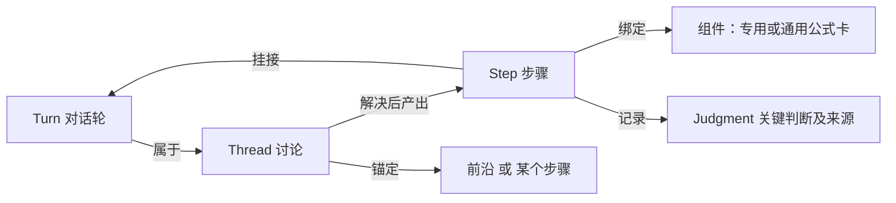
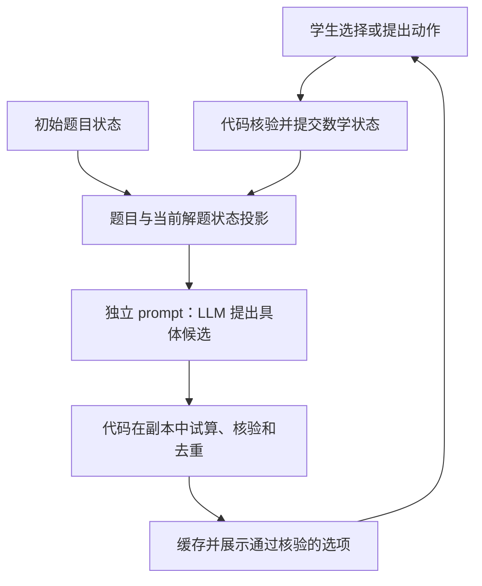

# 学生讲解模式：会话上下文设计（讨论稿）

更新日期：2026-10-06。**当前 demo 采用 LLM 生成推导、数学状态与后续操作，代码负责会话和页面；不再用 Q12 专用验算器推进当前页面。** 下方“历史设计记录”保留旧协议，供追溯；其中“已核验事实”“代码试算候选”“能力包白名单”等不代表当前实现。

## 实验访问地址与隔离边界（2026-10-06）

Q12 原练习页已移除“我来讲解”入口，保留原有题目和练习逻辑。需要恢复体验时，从本文直接打开：

- 纯页面：[http://127.0.0.1:8768/1/q12/explain/page/](http://127.0.0.1:8768/1/q12/explain/page/)
- 页面 + 对话：[http://127.0.0.1:8768/1/q12/explain/](http://127.0.0.1:8768/1/q12/explain/)
- 启动：在 `server/` 下执行 `uv run python tools/run_site.py --data-dir /private/tmp/sss-auth-stage1 --instance auth-stage1 --port 8768`；需要已配置的本地数据库和模型凭据。

共享教学 API 的 `enable_explanation` 默认是 `False`。默认主服务不导入、初始化或注册讲解 API；仅本地 `run_site.py` 显式设为 `True`，测试需要讲解接口时也显式启用。页面源码仍保留在独立目录，直接访问页面文件不代表后端路由已启用。

旧教学模型继续使用原 `Proposal`、原 prompts、1600 输出 token 上限和单次调用；JSON 修复属于讲解子类，格式自动重试只由讲解生成器的 `format_attempts=2` 启用。生产额度账本和冷却规则不变；本地不限次数是另行确认的开发配置。

本次隔离回归：教学模块非在线模型测试 408 项通过、14 项跳过、53 项未选中；另在本地测试数据库运行额度与鉴权测试，23 项通过、1 项未选中。新增隔离测试覆盖默认路由关闭、原教学请求参数、单次调用、异常处理和额度拦截；浏览器确认 Q12 原练习页入口已移除。此次未调用付费模型做在线回归，也未验证生产部署。

## 当前方案：LLM 完成本步并模拟学生的下一步

学生决定下一步做什么。LLM 完成学生选择的局部数学操作，组织规范的数学推导，并模拟学生在这个状态下可能想到的下一步具体操作。代码不编写题目解法或换元板书模板，也不预先遍历解题路径。

```text
原题 + 参考解法 + family 通用解法 + 当前数学状态 + 当前分支推导 + 当前讨论 + 学生选择
                         ↓ 一次 LLM 调用
             本步变化 + 关键结果 + 详细推导 + 新状态 + 下一批具体操作
                         ↓ 结构检查、整体提交
                一张板书卡 + 可点击的下一步
```

### 职责与边界

| 部分 | 当前职责 |
| --- | --- |
| LLM | 理解操作、检查数学条件、计算与推导、完整状态更新、生成下一批动作；发现错误或歧义时反馈 |
| 服务端代码 | 校验响应结构及事件类型、原子保存、版本冲突与幂等控制、权限/额度、快照/撤回/分支、记录来源 |
| 页面 | 安全渲染 LaTeX、展示具体操作、提交候选 ID、显示板书和反馈、自己写一步 |
| 后续可选增强 | 接入通用符号计算或独立数学验证；不能通过补每题特例作为当前 demo 的默认实现方式 |

**结构检查不是数学证明。** 当前界面移除“已验算”“系统验算通过”等标记，统一记录 `provenance=llm_generated`。模型可能算错、漏条件或遗漏选项；不能把模型生成结果描述成代码已验证事实。

### 一次调用的输入与输出

输入 `projection`：

- `problem`：仅题干、原条件、目标和题目标识。公开题目数据仍白名单提取，参考资料通过下面两个独立字段提供。
- `reference_solutions`：已有参考路径及数学推导。读取题目配置的 `reference_routes`，并合入旧 lesson 路径的 `results`；不传旧练习的 `criteria`、交互答案槽、提示策略或强制路径要求。
- `family_guidance`：按题目 `family_id`（或 `problem_ir` 的 family 前缀）读取 family spec 的说明、适用范围、策略原则，以及 `strategy_reference` 指向文件中的 `strategy_overview` 和 `methods`，保留来源与版本摘要。基本不等式直接复用 `internal/llm-prompts/basic-inequality-strategy.json` 的六种通用解法，不复制重写。
- `state`：当前快照中的表达式、条件/结论、变量定义、可选对象、输入符号和完成状态。未开始时为空。
- `steps`：仅当前分支已经提交的推导和学生选择，不能带入撤回步骤或其他分支的数学结论。
- `discussion`：当前焦点最近的讨论；其他分支历史虽保留，但不自动成为本轮依据。
- `request`：初始生成、候选选择、表单操作、文字讲解、提示、步骤追问或重新生成选项。

输出 `GeneratedTurn`：

| 字段 | 含义 |
| --- | --- |
| `outcome` | `initial`（仅建立初始状态/生成候选）、`step`（生成一步）、`feedback`（仅讨论/错误/澄清） |
| `step` | `title`、关键变化 `change`、独立 `highlight` 和完整 LaTeX `lines`；不用固定“设—因为—所以”模板，由模型按实际推导组织 |
| `state` | 完整的后继快照：`expression/facts/definitions/symbols/objects/complete` |
| `candidates` | 最多 3 个 `{label}`，按当前状态下的适合程度排序；label 就是完整的数学动作，不另藏一套不同的动作计划 |
| `reply` | 错误/歧义/提示/暂未找到候选的反馈；成功时通常留空，用板书呈现结果 |

`step` 必须同时返回完整推导和新状态；缺少必填字段、请求与结果类型冲突、提供提示却擅自推进步骤等情况整轮拒收。模型偶尔附带的无关字段（如输入来源字段、空备注）通过白名单结构解析丢弃，不进入状态或页面，也不因这些额外字段让有效推导失败；用户事件仍严格拒绝协议外字段。模型响应、输入投影与 prompt 版本留在服务端审计记录，不作为未经验证的 HTML 返回页面。

### 步骤卡：关键结果与详细推导分层

每张卡先显示学生实际选择的操作和 `change`，再显示 `highlight`，下面默认展开“数学推导”及 `lines`。这些部分由同一次模型调用生成，服务端一并保存，撤回/切换后恢复原记录；后续投影中的历史步骤保留 change 和 highlight。

- `change={before, after}`：只抽取本次操作涉及的关键部分，before/after 使用 LaTeX；例如展开分母，只对比分母的乘积形式与展开式，不复制整道题。
- 页面将“使用的式子”和“本步结果”并列，突出结果；窄屏上下排布。两块之间的箭头只表示执行所选操作，不充当数学等号；条件、界等结果必须在 after 中完整表达，具体等式或因果关系留在推导中，避免将两个条件用等号串联。数学正确性仍由模型负责。
- 学生操作展示来自服务端保存的真实 action，不让模型改写学生的选择。change 缺失或字段不合法时整轮拒收，沿用格式恢复策略。


- `highlight.kind=problem`：本步换元、消元或等价改写改变了问题形式，突出“当前问题化为”，content 写清当前条件、定义域、目标表达式及目标类型。
- `highlight.kind=conclusion`：本步仅得到关系、界或最终结论，突出“本步得到”。不能把必要条件当等价问题，也不能把下界当最小值。
- content 使用普通文字与 `$...$` 数学，lines 优先使用不带定界符的 LaTeX 推导。页面同时兼容 `$...$`、`$$...$$`、`\(...\)`、`\[...\]` 以及文字与公式混排，避免将整行文字和定界符当作一条公式解析；渲染不信任 HTML。摘要不能预告下一步，推导末尾不重复完整摘要。
- highlight 与本步推导、state 的语义一致性由模型负责；代码校验字段与类型，不宣称独立数学验证。

参考资料仅帮助模型理解路线及生成候选。它们不是学生进度：参考变量、未来结论和答案不得提前进入 state/highlight/lines。偏离参考路径的有效尝试仍允许；学生本次选择的动作边界优先于参考路径中的分步方式。引用 family 解法说明也不意味着启用该 family 的 solver 执行能力。

### 数学推进与候选原则

1. **一次选择对应一步。** 双换元一次完成、一次入板书、一次撤回，不暴露内部的半换元状态。
2. 只执行学生选中的动作及其必要代入、算术和条件改写，不替学生自动应用下一条策略。展开止于展开及合并同类项；通分止于合并与必要算术；消元止于代入和定义域改写；配方止于恒等式；关联换元同时换写已有条件和原式。不能以补充正性证明为由自动配方，也不能先在推导中完成一个动作、再把它放到候选中。学生明确表达的复合动作按原意完成。这些是通用生成规则，不是每题解法硬编码；目前没有代码层面的语义证明器保证模型永不越界。
3. 板书使用 `\because`、`\therefore` 等数学符号；不无定义地引入 `F`。原式、条件、结论应形成连贯数学过程。
4. 每个候选包含全部对象与参数，点击立即执行。不能用“观察”“整理”等抽象动作，也不能点击后再补变量或乘数。
5. 候选最多 3 个，优先当前最可能、最合适且不重复的具体动作，按适合程度排序，兼顾不同思路；不足 3 个时不凑数。数量在 prompt、输出 schema 和服务端规范化中共同约束：模型多给时，先校验条目、按完整 label 去重，再保留前 3 个，不因此丢弃有效推导；页面也限制最多展示 3 个。语义重复由模型避免。仍允许学生尝试成立但未必有用的操作，不声称穷举所有可能，不把动作结果或完整解法提前塞进按钮。
6. 候选中的猜想和未执行操作不得进入当前事实。原条件、变量关系和仍需使用的结论必须保留。
7. 最值目标完成须包含界和原条件下的可达性；这是模型应遵守的生成约束，目前没有独立证明器保证。
8. 候选为空只表示暂未找到可建议操作，不能宣布数学上无路可走；页面提供自己写一步、重新生成和回退。

### 会话、版本与失败处理

- `tools/run_site.py` 本地开发入口注入无次数额度策略，练习与讲解共用；不受会话、个人每日和全站每日调用次数限制，不读写额度账本。并发保护、登录与归属、幂等和最多一次格式自动重试仍生效。生产入口继续使用 `CallBudget`。

- 初始生成单独调用一次模型；随后每次选择/表单提交/讲解使用一次调用，同时产生推导和下一批候选。
- 服务端为快照、候选、步骤、分支分配 ID。点击只提交候选 ID 和 revision，服务端从当前快照取出对应动作，不接受客户端伪造候选内容。
- 所有提交使用 event_id；成功请求重试返回原响应，不增加步骤或重复调用。过期 revision 或过期候选拒绝并返回当前视图。
- 完整响应通过结构校验后，步骤、新状态和新候选一起保存；网络失败、模型超时、协议错误均不提交任何半步，原状态及输入可重试。
- **格式恢复先代码、后模型。** 讲解生成器先解析 JSON；解析失败时，只在解析器定位的出错位置修复缺逗号/冒号、全角分隔符、多余尾逗号、非法反斜杠转义和字符串内未转义控制字符，并兼容完整 JSON 代码块包裹。每次修复后重新解析，最多 64 处；不会全局替换公式内的标点，不补写数学内容，不接受重复键、多份 JSON 或截断内容。
- 本地修复成功后仍须通过 `GeneratedTurn` 结构校验。修复不了、必填字段不完整或模型输出被截断时，使用同一原始上下文重新请求一次，不把失败结果加入学生状态或历史。最多两次模型调用，线上每次单独预留额度；本地开发入口不限制调用次数，本地代码修复不增加模型调用。两次失败后才进入失败冷却并提示重试；额度不足则停止，网络/鉴权等错误不作为格式问题反复调用。旧练习模式不自动启用这个重试策略。
- 同一事件恢复期间保持会话锁与原子提交，成功只产生一张步骤卡；请求重放仍使用 event_id 返回同一结果。前端等待窗口为 115 秒，覆盖两次各 45 秒的服务调用及必要开销。
- 撤回/从某步另开思路复制该步边界的快照及当时选项，原分支保留；切换分支恢复其状态与讨论焦点。这些操作不调用模型。
- 提示和步骤追问只保存对话，代码禁止修改数学状态。重新生成选项不得改写现有数学状态。
- 讲解暂存服务进程内存，权限隔离、调用额度和已有登录机制复用；刷新页面或服务重启仍需重新开始。

### 当前实现范围与验收

- 纯页面及页面 + 对话共用新的生成流程；每一步都有下一批动态选项。纯对话独立页面仍未实现。
- Q12 是当前静态演示页的题目内容；运行器读取 `ProblemSpec` 和独立参考上下文，没有 Q12 数学常量或执行规则。更换题目需提供题目数据与页面题干，不需要新增该题求解函数。尚不能据此宣称各种题型的生成质量都已验证。
- 页面中的“自己写一步”保留常用操作输入组件；组件只表达学生意图，交给同一 LLM，不再走旧验算器。
- 历史 `math.py/context.py/session.py/candidates.py/legacy_api.py` 和测试保留用于回归与参考，**不挂载到当前运行路由**。当前入口为 `api.py → generated_session.py → generated_llm.py → prompts/generate.jinja`。
- 验收覆盖：跨题数据、连续多步、一次点击一张卡、旧候选拒绝、失败原子性、幂等、撤回与分支恢复、仅讨论不推进、空候选重试、权限隔离，以及真实模型的页面操作检查。

### 本次验证记录

- 操作边界与变化展示更新：回归 102 项通过；新增变化字段与缺失字段原子拒收、历史投影/撤回保留检查。后续关系展示简化为操作方向箭头后，相关 40 项生成与格式恢复测试重新通过。真实浏览器顺序执行消元、通分、展开：展开只得到分母多项式，未提前配方或求最值，配方留在下一批候选；变化对比和完整推导正常渲染。语义边界仍是模型约束，不能据此声称所有生成均有保证。

- 格式恢复补充验证：本地修复保持数学文本、拒绝截断/缺内容/重复键、结构错误再请求、逐次额度、两次失败保留状态、成功只提交一次及事件幂等；相关后端测试 60 项通过，8 项数据库/在线测试因未启用对应环境跳过。

- 新流程及历史回归共 74 项测试通过；包含关键结果字段、撤回/历史投影保留、参考路径和 family 原始说明的隔离加载，以及首步/后续/撤回的候选数量上限与去重。浏览器公式回归页 `tools/tests/student-explanation-math.html` 的 11 个检查通过，覆盖截图中的文字、定界符、纯公式、安全回退。JavaScript 语法与 Ruff 检查通过。
- 真实模型测试 Q12：首步候选、双换元成一张卡、后续生成、撤回恢复选项及保留分支。
- 另提供“正数 p、q 满足 p+q=12，求 pq 最大值”的题目数据，用同一生成器得到数学推导，未增加题目执行规则。
- 实测发现模型会附带协议外备注、把中间量放缩扩展到整个目标、在按钮中提前展示结果。前者由结构白名单处理；后两者通过通用 prompt 约束动作边界和文案，仍属于模型生成质量问题，不能声称代码已保证语义或数学正确。

## 历史设计记录

以下为此前“LLM 解释操作 + Q12 专用代码验算”的设计与阶段记录。与上文冲突时以上文为准。

## 1. 首版改造前的问题（历史背景）

当前已有 `ExplanationSession`，但尚未把讨论、判断和证据关联建成统一的上下文模型。每轮由 `ExplanationSession.handle` 临时拼一份 JSON 交给模型：

- `lesson.json`：题干、条件、目标、6 个操作的说明和两个理解示例；
- `context`：当前数学状态（当前式子、条件、可选对象、下界）；
- `steps`：最近 12 个步骤，是执行器的原始输出（LaTeX 推导行、uuid、组件参数）；
- `messages`：当前分支最近 8 条对话，每条只有原话、回复、状态和类型；
- 本轮原话、选中对象、是否请求提示。

主要问题：

1. 对话和步骤是两条无关的列表。步骤只记录最后一句原话，促成它的追问过程丢失。
2. 没有"正在讨论"的概念。追问轮只是一条普通消息，下一轮能否接上全靠模型从近期消息中猜。
3. 执行器已能保留失败操作之前成立的步骤，但意图协议不能同时表达“完整操作 + 缺参数的待澄清操作”，这类混合表达仍会整体进入追问。
4. 学生说的理由没有字段承载；哪些判断由学生说出、哪些由模型推断或系统代算，也没有记录。
5. 消息按分支过滤并机械截断，另开思路后历史消失。

## 2. 会话上下文模型

`ExplanationContext` 是一道题一次讲解的唯一权威状态。模型调用、页面视图和测试都从它读取，不再各自拼装。



### 2.1 对象

| 对象 | 内容 |
| --- | --- |
| `Problem` | 题干、条件、目标；能力清单；关键判断策略；参考解法（见第 3 节） |
| `Turn` | 一轮对话：说话方、原话、当时选中的对象、所属讨论与分支、模型原始输出与 prompt 版本、执行结果、时间。只追加，不删除 |
| `Thread` | 一个未解决或已解决的话题：锚点（分支、数学状态版本、可选步骤标识）、状态、所含对话、待修正的操作、当前追问点 |
| `Step` | 已核验的数学步骤：实际执行的操作、核验结果、关键判断及来源、讲解状态、促成它的对话、组件绑定、依赖 |
| `Judgment` | 一条关键判断：键、值、归属操作或步骤、绑定对象、来源对话及原话片段、是否经过提示、程序核验状态 |
| `Branch` | 一条思路：步骤列表和每步之后的数学状态快照 |
| `MathSnapshot`（新增设计） | 不可变的数学状态：题目与能力版本、变量定义及定义域、表达式、已核验等式与不等式、各结论的依赖、目标完成状态；有独立状态标识 |
| `CandidateBatch`（新增设计） | 某个数学状态的一批候选：批次标识、状态标识、来源分支、生成状态、上下文摘要、模型与 prompt 版本、模型原始输出、逐项核验结果及可展示候选 |
| `Candidate`（新增设计） | 参数完整的单个动作或有序动作组、依赖对象与结论、规范化结果键、试算结果及后继状态；标识由服务端分配，显示文案由核验后的操作生成 |

所有分支共用一条可见的对话时间线，页面不因切换分支而删除历史。分支同时限定当前数学状态、讨论焦点及可用证据；“历史可见”不代表“可作为当前步骤的依据”。

### 2.2 讨论（Thread）的生命周期

讨论的锚点有两种：

- **前沿**：在讨论下一步怎么走，是最常见的情况；
- **某个步骤**：学生回头追问某张卡，或系统追问某一步缺少的理由。

同一时刻只有一个焦点讨论。学生在卡片上提问会切换焦点，回到"接着讲"则回到前沿讨论。

每个锚点记录 `branch_id`、`state_revision`，步骤讨论另记 `step_id`。这里的状态版本指已提交的数学状态；仅补充对话不改变它。前沿推进后，待修正操作必须重新绑定到新状态并核验依赖，不能直接沿用旧参数。

一轮讲解提交后：

| 本轮结果 | 处理 |
| --- | --- |
| 全部操作核验成立，且必需的判断都已说出 | 生成步骤，标记"讲通"；讨论解决，期间所有对话挂到产出的步骤上 |
| 操作成立，但缺少必需的判断 | 生成步骤，标记"待说明"；在该步骤上开一个讨论，只追问一个缺口。学生可以继续往下讲 |
| 部分操作成立，其余有歧义或错误 | 成立部分先生成步骤；其余作为待修正操作留在当前讨论，继续追问 |
| 数学错误、指代不清、暂不支持 | 不生成步骤；讨论保持打开，围绕这次尝试继续 |
| 提问、请求提示 | 不生成步骤；对话计入当前焦点讨论，提示的来源单独记录 |
| 学生改换思路 | 当前讨论标记为放弃并保留，开新讨论 |

分支切换与撤回另按以下规则处理：

- 切换已有分支时保存原分支焦点，恢复目标分支自己的焦点；只有锚点及依赖仍有效时才继续原讨论，否则创建新的前沿讨论。切换本身不等于放弃原讨论。
- 撤回或另开分支时，在新前沿创建讨论，不继承旧分支尚未完成的追问、待修正操作或选中对象。
- 分叉只继承分叉时刻共同前缀中的已核验步骤和已绑定证据；后续补充的判断按分支记录，不能反向改写另一分支的“讲通”状态。
- 旧分支内容若要用于新分支，学生需明确引用或重新提出，由程序在当前状态重新绑定、核验，并保存历史来源。孤立的“就乘它”不能从其他分支自动补出乘数。

"待说明"的步骤只有在数学上已经成立时才能生成。如果把它也当成"有问题不保存"，学生会在一个其实正确的步骤上被卡住，无法继续讲下去。

### 2.3 对话与步骤的关系

一轮对话可以产出多个步骤，一个步骤也可以来自多轮对话。步骤保存对话标识的列表，不复制原话。卡片展开时，可以看到促成它的完整对话和之后围绕它的追问。

### 2.4 组件绑定

步骤成立后，程序按操作语义和核验数据选择组件：`substitution`、`rewrite`、`amgm`、`equality` 等，没有专用组件时使用通用公式卡。组件参数只来自核验结果，不来自模型输出。

## 3. 能力清单、参考解法与关键判断策略

这一节回答两个问题：能力清单是什么；原有解题路径里的步骤是不是能力清单。

### 3.1 三个概念

| 概念 | 回答的问题 | Q12 的现状 |
| --- | --- | --- |
| 能力清单 | 执行器能核验哪些操作，参数是什么 | `explanation/lesson.json` 的 `capabilities`：`claim`、`substitute`、`multiply`、`expand`、`combine`（合并同分母的项）、`amgm`、`attain` |
| 参考解法 | 这道题已知的完整解题路线及每一步的预期答案 | `tutor_demo/lessons/q12.json` 的换元路线 6 个节点；直接乘 1 路线只写在设计文档里 |
| 关键判断策略 | 某类操作中，哪些判断必须由学生说出，哪些允许系统代算 | 散落在 `q12.json` 每个节点的 `required_evidence` 和 `criteria` 文字中 |

能力清单与解题方法无关，它只描述执行器"会做什么"。对应到 solver，相当于 `basic_inequality_core` 中的 `organize_expressions`、`introduce_semantic_substitution`、`apply_two_term_amgm`、`close_equality_and_restore` 等 method；这些在 solver 里目前仍是 `catalog_only`，未向模型开放，讲解模式暂时用自己的 6 个操作。

### 3.2 原有路线的节点不是能力清单

原有换元路线的节点与能力的对应关系：

| 原节点 | 本质 | 对应能力 | 节点要求学生说出的判断 |
| --- | --- | --- | --- |
| 换元 | 操作 | `substitute` ×2 | 两个分母分别作为换元对象 |
| 识别齐次结构 | 纯判断，没有数学变形 | 无 | 目标负一次、条件正一次 |
| 配齐次式 | 操作 | `multiply` | 作用于整个式子；乘数为 \(\frac{x+y}8\) |
| 观察和积结构 | 纯判断 | 无（可作为 `amgm` 的前提） | 定积求和 |
| 应用基本不等式 | 操作 | `amgm` | 对哪两项、得到的不等关系 |
| 验证取等 | 操作 | `attain` | 取等条件 |

可以看出，节点是"一条路线上的教学检查点"：有固定顺序和预期答案，其中两个节点甚至不是数学操作。它们不能当能力清单用。但节点里有两样东西可以复用：

1. **操作语义**：每个操作节点对应哪种能力、使用什么参数，可以用来识别学生是否走在已知路线上、走到了哪里；
2. **教学策略**：`required_evidence` 和 `criteria` 规定了哪些判断必须由学生说出、哪些由系统代算。例如原配置明确规定：换元后的范围 \(x>1\)、解取等方程、回代验算都由系统完成，"不再让学生求值"。

第 2 点决定了"讲通"的标准。按原配置，学生说"两个分式相等时取等"就满足了取等节点的要求，系统代解 \(m=\frac32,n=3\) 是允许的。所以"讲通"不能一律要求学生说出所有结果，而要按关键判断策略逐项判断。

### 3.3 建议：把关键判断策略从路线中拆出来

关键判断策略按能力组织，不按路线顺序组织。通用部分随能力定义，题目只做实例化和覆盖：

```json
{
  "amgm": {
    "required": ["applied_terms", "fixed_product_or_sum"],
    "system_may_compute": ["positivity", "product_value", "bound_value"],
    "optional": ["relation_written"]
  },
  "attain": {
    "required": ["equality_condition"],
    "system_may_compute": ["solve_point", "domain_check", "target_value"]
  },
  "multiply": {
    "required": ["unit_factor", "scope"],
    "system_may_compute": ["expansion"]
  }
}
```

上面是能力包默认策略，不是 Q12 最终策略。"识别齐次结构"在默认策略中可以是可选理由，但 Q12 首版保留原配置的教学要求，必须用覆盖项提升为必需判断：

| Q12 的实际操作与结构 | 必需判断及归属 |
| --- | --- |
| 两个分母分别换元 | 每个 `substitute` 记录自己的换元对象；两个步骤共同覆盖原配置的两个分母证据，不要求单次换元同时覆盖两者 |
| 完成两分母换元后，对目标整体乘分母和除以 8 | 在该 `multiply` 上要求 `target_degree`、`condition_degree`，保留目标负一次、条件正一次的判断；另需整体作用范围和单位乘数 |
| 对展开后的两个互为倒数项应用 AM-GM | 在该 `amgm` 上要求 `fixed_product_structure`（定积且求和），以及 `relation_written`（学生表达的不等关系）；仅说“乘积固定”还不满足原要求 |
| 其他成立的 AM-GM 操作 | 保留适用的默认判断，并要求学生表达不等关系；不把“定积求和”套到定和求积的操作上 |
| 取等 | 保留学生指出取等条件，系统求点、检查范围和回代 |

覆盖条件由程序依据当前表达式、换元和操作对象匹配，不靠模型选择参考路线。直接在原变量中解题不强制回答关于 \(x,y\) 的齐次次数；它仍需满足所用操作的判断要求。纯判断可以先作为讨论中的待绑定证据保存，等对应操作出现并唯一绑定后再计入步骤；不为纯判断制造数学变形步骤。

`relation_written` 表示表达了不等关系，不要求特定符号输入；例如“这两项之和至少是 2”可作为证据。系统算出的关系不能代替学生证据。覆盖项只引用能力包已有的判断键与结构匹配规则，具体核验逻辑仍在能力包中。

## 4. 参考解法要不要放进上下文、投影给模型

### 4.1 结论

**放进 `Problem`，但不投影给意图理解模型。** 参考解法只由程序使用；只有提示角色在学生主动求助时，才拿到"当前位置的下一个缺口"，拿不到完整解法。

### 4.2 理由

把参考解法给意图理解模型，有两个好处：模糊指代（如"那两项"）更容易解析；模型知道该追问什么。

但代价与本模式的目标正面冲突：

- **模型会把学生的话往标准答案上补。** 实测中，学生只说"那两个分式乘起来是定值"，模型就确定了具体两项。如果它还看到参考解法，学生说错的乘数、错误的取等条件都更容易被"纠正"成标准答案，这违反了"保留学生真实表达"的原则。
- **替代路线会被拉回标准路线。** 直接乘 1 的路线不在原配置里，模型看到换元路线后容易把学生往换元方向引。
- **"讲通"的判断会被污染。** 模型能看到答案时，很难区分"学生说出了"和"模型从答案里知道"。

模糊指代的问题不需要参考解法来解决：当前式子里的可引用对象（带稳定标识）、学生的点选，以及当前讨论的对话已经足够。解析不唯一时追问，这是正确的行为。

### 4.3 程序如何使用参考解法

1. **对齐**：步骤核验成立后，程序按操作语义与参考解法中的节点匹配，得到"学生在哪条已知路线上、走到哪里"。匹配不上不代表错误，只说明是新路线。
2. **提示**：学生请求提示时，程序根据对齐结果，取当前位置的下一个缺口，例如"想想两个分母之间有什么关系"，交给提示角色组织语言。没有对齐到任何路线时，只根据当前状态和目标给通用提示。
3. **测试与评测**：参考解法是自动化测试和模型评测的标准样例。

## 5. 每个角色的投影

`ExplanationContext` 不整体发给模型，而是按角色投影。新增的候选生成与意图理解是不同的职责，使用独立 prompt 和调用；提示与解释仍保留自己的职责。

### 5.1 意图理解、提示与解释

| 内容 | 意图理解 | 提示与解释 |
| --- | --- | --- |
| 题干、条件、目标 | ✓ | ✓ |
| 能力清单及参数契约 | ✓ | — |
| 本轮可能涉及能力的关键判断名称（不含值） | ✓ | — |
| 当前分支进展摘要：每步一行，含标题、结果、学生理由、讲解状态 | ✓ | ✓ |
| 当前式子与可引用对象（带稳定标识） | ✓ | ✓ |
| 当前分支有效焦点讨论的完整对话与待修正操作 | ✓ | ✓ |
| 锚定步骤的有效对话（锚点是步骤时，含共同前缀已继承证据） | ✓ | ✓ |
| 当前分支已解决讨论 | 每条一句摘要 | 每条一句摘要 |
| 非当前分支的讨论 | 仅学生明确引用时给出相关片段，标为历史参考 | 同左 |
| 参考解法 | — | 只给当前位置的下一个缺口 |
| 本轮原话与选中对象 | ✓ | ✓ |

投影携带当前 `branch_id`、数学状态版本及证据来源。程序在模型输出后再次检查对象、步骤和来源是否在当前作用范围内；历史摘要不能直接满足关键判断，也不能为含糊指代补参数。

意图理解模型除了输出操作，还要输出学生**本轮实际说出的**判断与理由，每条附带原话依据，例如：

```json
{
  "operations": [{"operation_id": "op_1", "op": "amgm", "a": "y/x", "b": "x/y",
                  "args_source": {"a": "inferred", "b": "inferred"}}],
  "judgments": [{
    "key": "fixed_product_or_sum",
    "value": "product",
    "target": {"operation_id": "op_1"},
    "object_refs": ["ratio_y_over_x", "ratio_x_over_y"],
    "source_turn_id": "turn_12",
    "quote": "乘起来是定值"
  }],
  "clarifications": [],
  "reply": ""
}
```

程序再核对判断内容：例如学生说"下界是 \(\frac13\)"，程序与计算结果比对后记为错误判断，而不是直接相信模型的标记。

`operation_id` 在本轮内唯一；补充已有步骤时，`target` 改为 `{"step_id": "..."}`，两者只能选一个。对象标识来自投影中的对象表，程序检查它们是否与目标操作的实际对象一致。`source_turn_id` 必须是本轮学生对话，`quote` 必须能定位到其原话；核验状态和提示来源由程序写入。多轮累积使用之前已经核验的证据记录，不允许模型把旧话重新归为本轮发言。

无法唯一确定目标时，将判断保存在讨论中标为 `unbound`，并追问归属；绑定后才核验并计入“讲通”。一个判断不能仅因 `key` 相同就分配给多个步骤。若学生明确同时解释多个操作，分别输出目标明确的判断，逐一核验；可以引用同一原话片段。

### 5.2 候选操作生成（2026-10-06 新设计，未实现）

该角色本质上是**模拟学生站在当前解题位置，思考自己可能尝试的下一步数学操作**。它展开可能的想法，代码核验数学是否成立，真实学生决定实际走哪一步。它不以给出最佳下一步或完整标准解法为目标，不推断学生已经选择了什么，也不能改变正式解题状态。

| 输入 | 用途与边界 |
| --- | --- |
| 原题、变量、条件、定义域、目标 | 以已校验的结构化题目为准；不额外引入原题未定义的展示符号 |
| 当前分支的完整可用数学状态 | 包含变量代换、当前表达式、已证明的等式与不等式、结论依赖及目标完成状态；不能只给最新的目标式 |
| 可引用对象及结论的标识 | 绑定动作作用对象；对象可来自条件、目标或已成立的中间结论 |
| 通用能力清单、参数契约与组合规则 | 只允许提出执行器支持的结构化动作，不生成任意执行代码 |
| 当前分支已执行、失败和被过滤的动作摘要 | 避免重复、无变化及循环；失败的提议明确标为尝试，不能当成已知事实 |
| 当前状态已生成的候选摘要 | “换一组选项”时尽量补充不同动作；不能把未选择的候选结果当成当前事实 |
| 状态标识、题目版本、能力版本 | 将输出及核验结果绑定到输入快照，防止过期结果写入当前页面 |

参考路线、Q12 特制规则和预填的标准下一步不进入候选生成投影；其他分支的非继承事实也不作为当前已知条件。模型提出动作，具体结论以代码试算为准。候选生成记录保存在 `CandidateBatch`，不能伪装成学生 `Turn` 或已提交的 `Step`。

独立 prompt 的核心约束：

- 在当前能力范围内尽量覆盖不同操作方向，不只沿标准路线提出选项。“所有可能”是覆盖目标，不承诺穷尽无限的数学操作。
- 每个候选都提供具体对象、作用范围和完整参数，点击即可执行。禁止“整理条件”“观察结构”等抽象选项，也不把填参数作为点击后的必经环节。
- 一个候选可以包含紧密关联的有序动作组，例如同时定义两个新变量；不把整条解法打包为一个选项。组内依赖和变量引用必须明确。
- 可以提出数学成立但未必有助于解题的操作；不得为了保证走通而只输出参考路线。
- 从学生当前可用的条件与已得结论出发，保留不同方向、绕路及暂时无助于目标的尝试；不利用完整答案直接跳到最优点，不替学生跨过多个自然推理步骤。
- 不输出需要相信模型才能成立的结论，不宣布题目完成。未能提出候选不表示数学上没有后续。

### 5.3 三种交互方式的调用关系

| 方式 | 学生动作入口 | 候选生成调用 |
| --- | --- | --- |
| 纯页面 | 点击已核验候选，或使用结构化操作控件；不调用意图理解模型 | 初始状态及每次数学状态更新后调用 |
| 纯对话 | 独立的意图理解调用，将原话转换为动作或流程控制 | 默认不生成页面选项；学生要求提供可选动作时按当前状态调用 |
| 页面 + 对话 | 点选候选直接提交；自由表达经过意图理解；两者进入同一执行器 | 初始状态及每次数学状态更新后调用，与意图理解分开 |

单纯补充理由、提问或失败且未改变数学状态时，不自动重生成。撤回和切换优先恢复对应状态的缓存；“换一组选项”显式触发新批次。已有数学结果先显示，候选区单独显示生成状态，不因候选调用等待或失败而撤销学生已经完成的操作。

## 6. 一轮处理流程（自动候选方案）

1. 记录学生输入事件并检查幂等标识及版本。自由表达按第 5.1 节调用意图理解；候选点击携带批次和候选标识，直接查服务端已核验记录，不再让 LLM 重新解释。
2. 核验动作：自由表达和自定义操作在状态副本上执行；候选点击检查它绑定的数学快照、题目及能力版本仍有效。过期候选不提交，返回当前状态与有效选项。
3. 对核验后的结论按第 7.5 节去重，提交步骤和数学快照，记录操作、证据及来源。自然语言一轮中的部分成立规则保留；候选动作组作为一次明确选择整体提交，详见第 11.2 节。
4. 核对学生主动表达的理由，讲错才指出，不追问缺失理由、不恢复“待说明”门槛。模型提出的候选不计为学生独立提出；学生点击后记为“从候选中选择”。
5. 返回本次结果并更新会话版本。若数学状态改变且目标未完成，为新快照创建候选生成任务；初次打开题目也执行这一步。
6. 用第 5.2 节投影调用候选生成模型，在各自隔离的状态副本上试算候选，过滤后发布新批次。试算不追加正式步骤，不改变分支、完成状态或学生证据。
7. 生成任务返回时再次检查快照标识。旧状态的结果只能归档到对应缓存，不能覆盖学生已切换到的新状态。候选请求失败只影响候选区，可重试生成，不能重放已提交的学生动作。



## 7. 讨论何时成为步骤

步骤是**一个经过核验、由学生发起、带来新内容的数学推进**。是否生成步骤完全由程序判断，模型只提出操作和提取判断，不能宣布"可以成卡"。

### 7.1 四个条件

讨论中的一个操作，同时满足以下四条才生成步骤：

| 条件 | 判断方式 | 不满足时 |
| --- | --- | --- |
| 1. 参数完整 | 操作的每个参数都已绑定到当前分支的对象或可解析的表达式。模型通过指代推断出的参数，必须在当前式子中只有唯一候选 | 追问缺少的对象，例如"乘一个 1"但没说乘什么 |
| 2. 数学成立 | 执行器核验通过 | 数学错误或暂不支持：留在讨论中反馈 |
| 3. 有新内容 | 产生新的事实、新的式子、新的界或取等结论。与已有步骤等价时不新建，把对话挂到已有步骤上 | 回复"这一点前面已经得到"，不重复成卡 |
| 4. 学生发起 | 学生在本轮或本讨论中明确表达动作，或点击参数完整的已核验候选 | 模型仅提出候选、学生尚未选择：不提交步骤；泛泛回答“好”“嗯”不能擅自绑定到某个候选 |

条件 4 不要求学生说出全部参数，只要求"做什么"来自学生。参数可以来自学生的点选或唯一的指代。学生在提示之后自己说出的操作仍然生成步骤，来源记为"提示后"。

2026-10-06 补充：点击具体候选即为明确选择，不需要再用语言复述；动作构造来源是模型，选择来源是学生，记录候选批次和标识，不记为独立提出。

### 7.2 讲解状态不是门槛

满足四个条件后一定生成步骤，再按关键判断策略（第 3.3 节）确定状态：

- 必需判断都由学生主动说出：**讲通**；
- 必需判断都有，但部分在提示后说出：**讲通（有提示）**；
- 仍缺少必需判断：**待说明**，在步骤上开追问讨论。

### 7.3 讨论何时关闭

- **前沿讨论**：其中的操作都已成步骤，且没有待修正的操作时关闭。学生换了思路时标记为放弃。
- **步骤上的追问讨论**：缺少的必需判断补齐后关闭，步骤状态随之更新。学生不回答、转去讲下一步时，讨论保持打开但失去焦点，完成页汇总列出。

### 7.4 Q12 示例

| 学生说 | 结果 |
| --- | --- |
| "两个分母加起来是 8" | 等式核对，四条都满足：生成步骤，讲通 |
| "两个分母加起来是 8，所以乘一个 1" | 前半句生成步骤；后半句缺少乘数，不满足条件 1，留在讨论中追问 |
| "就是用它们的和除以 8" | 补齐乘数，生成"乘 1 配式"步骤；上一轮的对话一并挂到这一步 |
| "那两个分式用基本不等式，乘起来是定值" | 当前只有两个比值项，指代唯一，操作成立并生成步骤；按 Q12 覆盖策略，尚缺求和目标及学生表达的不等关系，标为待说明 |
| 随后说“要求它们和的最小值，这两项和至少是 2” | 判断明确绑定到上述 AM-GM 步骤，核验后补齐证据，更新为讲通；不重复生成数学步骤 |
| "对这两项用基本不等式"（没有选中对象，式子中有三项以上候选） | 指代不唯一，不满足条件 1，追问 |
| "m=n 时取等" | 回代达不到下界，不满足条件 2，留在讨论中反馈 |
| "最小值是 1/2" | 没有操作，只记录为学生的猜测，不生成步骤 |
| 系统提示"想想两个分母之和"后，学生答"嗯" | 不满足条件 4，请学生自己说出接下来怎么做 |

### 7.5 "有新内容"由程序判断

比较的对象是执行器核验后的数学结果，不是学生的文字，所以由程序判断，不需要模型。模型此前已经把文字翻译成了结构化操作。

比较时不能看"值是否相等"：等价变形本来就保持值不变，成立的等式在原条件下也都恒成立，按值比较会把所有步骤都判成重复。应当比较结果的**形式**，每类结果用一个规范化的键：

| 结果类型 | 规范化的键 | Q12 例子 |
| --- | --- | --- |
| 等式事实 | 把换元变量还原为原变量，展开 \(a-b\)，再除以首项系数 | "两个分母和为 8"与换元后的 \(x+y=8\) 得到同一个键，后者不另成卡 |
| 目标式改写 | 当前式子在显示坐标下展开后的规范形式 | 已展开的式子再说"展开一下"，形式不变，不成卡 |
| 下界 | 目标、界的值，加上应用不等式的两项 | 同一组两项再次得到同一目标下界，不成卡 |
| 候选点核验 | `candidate_verified`、目标、规范化后的候选点及回代值 | 未建立下界时检查 \(x=y\)，只得到候选点，不宣告最小值 |
| 达到下界 | `bound_attained`、目标、已证明下界的规范键、实际达到该界的点 | 在同一下界下，说完 \(x=y\) 再说 \(2m+1=n+1\)，结论相同才不成卡 |

键中的变量和候选点还原为原变量，集合排序后比较；去重只查当前分支及其继承前缀中的结论。`bound_attained` 另保存所依赖的下界步骤标识，供回放及分支有效性检查；不同步骤若证明同一规范化下界，不因标识不同而重复成卡。

例如先检查 \(2m+1=n+1\)，得到 \((m,n)=(3/2,3)\)、\(F=1/2\)，此时 `complete=false`；再建立 \(F\ge1/2\)，仍只是下界；学生再次确认该点达到下界时，产生新的 `bound_attained` 结论，保存步骤与快照并置 `complete=true`。不能因候选点出现过就吞掉最后一步。是否成卡必须比较核验后的结论类型和依赖，不能在执行之前只对操作参数去重。

补充理由按第 5 节显式绑定到 `operation_id` 或 `step_id`。焦点步骤可以协助模型理解，但程序不能用焦点覆盖学生明确提及的其他步骤；前沿讨论同时含多个操作且归属不清时追问，不能仅凭判断 `key` 猜测。

现有 `math.py` 中的 `reduce()` 是按值比较（代入约束后约分），不能直接用作这里的键；`present()` 给出的显示形式可以作为改写结果的规范化基础。

## 8. 配置分层：每道题需要什么文件

### 8.1 结论

每道题需要一个题目配置文件，但它应该很薄，**不写步骤判断标准，也不定义方法和组件**。判断标准、方法和组件都属于可复用的能力层，题目文件只负责启用和覆盖。

`q12.json` 把所有内容写在一起，是因为它服务的是固定路线的练习：每个节点有预期答案、固定选项和一段由模型逐条判断的 `criteria` 文字。讲解模式下，步骤是否成立由执行器判断，与题目无关；按题目变化的只有题目本身、已知的参考路线，以及本题在教学上的特殊要求。

### 8.2 三层

| 层 | 内容 | 粒度 |
| --- | --- | --- |
| 能力包 | 执行器代码、参数契约、默认关键判断策略、组件绑定规则、反馈模板 | 按题型族共享，例如基本不等式族 |
| 组件库 | 前端的完成态组件与补齐用的待填写组件；按"能力 + 结果形态"绑定，不按题目绑定 | 全站共享，复用 `site/assets/practice/components.js` |
| 题目配置 | 题目引用、启用的能力包、参考路线、本题对判断策略的覆盖、可选的理解示例 | 每题一个 |

### 8.3 题目配置示例

```json
{
  "id": "q12",
  "problem": {"problem_ir": "basic_inequality/q12"},
  "capability_packs": ["basic_inequality_explain"],
  "reference_routes": [
    {"id": "substitution", "label": "换元后配齐次式",
     "steps": [
       {"op": "substitute", "a": "2*m+1", "name": "x"},
       {"op": "substitute", "a": "n+1", "name": "y"},
       {"op": "multiply", "a": "(x+y)/8"},
       {"op": "amgm", "a": "y/x", "b": "x/y"},
       {"op": "attain", "a": "x", "b": "y"}
     ]},
    {"id": "direct", "label": "直接乘两个分母的和",
     "steps": [
       {"op": "claim", "a": "(2*m+1)+(n+1)", "b": "8"},
       {"op": "multiply", "a": "((2*m+1)+(n+1))/8"},
       {"op": "amgm", "a": "(n+1)/(2*m+1)", "b": "(2*m+1)/(n+1)"},
       {"op": "attain", "a": "2*m+1", "b": "n+1"}
     ]}
  ],
  "judgment_overrides": {
    "multiply": [
      {"when": "two_denominator_substitution_then_sum_unit_factor",
       "required_add": ["target_degree", "condition_degree"]}
    ],
    "amgm": [
      {"when": "always", "required_add": ["relation_written"]},
      {"when": "reciprocal_pair_target_sum",
       "required_remove": ["fixed_product_or_sum"],
       "required_add": ["fixed_product_structure"]}
    ]
  }
}
```

参考路线的每一步都是"能力 + 参数"，可以直接交给执行器回放，因此路线本身也能自动测试。`judgment_overrides` 写本题与默认策略的差异；Q12 必须包含上述覆盖才能保留原配置的教学要求。`when` 引用能力包中的结构匹配器，不引用路线名称或路线位置；匹配多条时合并增删项，最终必需判断从可选集合移除。互相冲突的覆盖在配置加载时拒绝。

### 8.4 题目配置从哪里来

- **Q12**：由 `q12.json` 转换。换元路线的操作节点变成参考路线，`required_evidence` 与默认策略对照后，有差异的部分写进覆盖项；直接乘 1 路线从设计文档补录。题干、条件和目标引用已有的 basic_inequality ProblemIR（Q12 是其中的代表样例），不重复书写。
- **之后的新题**：参考路线可以由 solver 已验证的 FunctionalPlan 转换生成，再人工审核覆盖项。这样新增一道题主要是审核，而不是手写判断标准。

2026-10-06 更新：上面描述的是早期配置方案。新的自动探索方案不要求逐题人工编写候选、动作生成规则或路径树，也不要求先人工审核一条参考路线才能运行。题目由自动解析流程产生结构化变量、条件、定义域和目标，经校验后使用通用能力包；无法可靠解析时应纠正题目输入。参考路线可以作为可选的回归测试资料，不决定候选集合。第 11 条决定删除判断策略覆盖的现状继续有效。

### 8.5 当前的前提限制

`explanation/math.py` 把 Q12 写死在代码里：变量 \(m,n\)、两个分母、定义域 \((0,3)\) 和目标式都是模块常量。现有 `ExplanationContext.candidates()` 按 Q12 的分母和已验证常数等式枚举按钮，前端也有初始候选。这些都是旧 demo 的限制，不是新方案的实现。

自动候选 demo 必须替换题目专属枚举和前端硬编码初始选项，并让执行器从结构化题目读取变量、约束、定义域和目标。人工建设的是通用数学执行与核验能力；操作对象、乘数和组合由 LLM 按状态提出。还需把已成立的中间等式、不等式及依赖作为可继续操作的对象，避免只允许更新一个目标式。未参数化、未通过新题验收之前，不能宣称已完成自动探索。

## 9. 首版实现范围（内存）

本节保留首版范围，其中必需理由与“待说明”已被第 10 节第 11 条取代；自动候选生成的新增范围与验收以第 11 节为准。

- 新增 `ExplanationContext`、`Turn`、`Thread`、`Step`、`Judgment`，替换 `ExplanationSession` 中平铺的 `steps` 和 `messages`。会话仍存放在进程内存，闲置失效规则不变。
- 意图协议改为允许"成立操作 + 待澄清"混合输出，增加操作标识、判断的显式目标、对象及对话来源，以及参数来源。
- 步骤生成按第 7 节的四个条件由程序判断。
- 按第 8 节拆分配置：基本不等式讲解能力包（含默认关键判断策略、结构匹配器与组件绑定），以及 Q12 题目配置（参考路线由 `q12.json` 转换，并补齐判断策略覆盖）。参考路线只供程序对齐和提示使用。
- 接口视图返回步骤（含挂接的对话标识与讲解状态）、焦点讨论和完整对话时间线。前端改动最小化：卡片可展开查看自己的对话，显示"待说明"标记，在卡片上可以发起追问。
- 测试覆盖：部分成立的一轮先产出步骤；追问后的回答把整段讨论挂到同一步骤；缺少判断时生成"待说明"步骤并开追问；另开思路后对话历史仍在；投影中不出现参考解法；重试幂等。
- 边界验收：先核验候选点、后证明下界、再确认达到下界时保留最终证明；同一轮两次 AM-GM 的判断不串步，归属不明时不计入；切换分支不沿用旧追问的参数或证据，共同前缀仅继承分叉时证据；Q12 缺少不等关系或适用的齐次判断时为“待说明”，补齐后为“讲通”，直接路线不被要求回答换元后的次数。

不在首版范围：数据库持久化、刷新后恢复、内置语音、新的交互组件。

## 10. 决定记录

已确认（2026-10-05）：

1. 参考解法保存在上下文中，不投影给意图理解模型；提示角色只拿到当前位置的下一个缺口。
2. "待说明"的步骤之后允许继续往下讲，完成页汇总仍待说明的判断。
3. 关键判断策略首版沿用 `q12.json` 的要求。
4. 同一时刻只保留一个焦点讨论。
5. 判断的提取与意图理解在同一次模型调用中完成。
6. 本次审阅修订：去重区分候选点与达到下界的证明；判断显式绑定操作或步骤；全局历史可见但证据按分支限定；Q12 通过非空覆盖保留原配置中适用的判断要求。
7. ~~Q12 讲通标准按第 3.3 节收紧~~（已被第 11 条取代）。
11. **系统只反馈错误，不追问理由**（2026-10-05 体验后决定，取代第 2、3、7 条）：操作验算通过即成为步骤，没有"待说明"状态，也不在步骤上开追问讨论。学生顺带讲出的理由仍按第 3 节的判断键提取并由程序核对：讲对的记在卡片上，讲错的在回复中指出。删除了关键判断策略（能力包的 `policy`、题目的 `judgment_overrides`）和步骤的 `required`、`missing`、讲解状态。归属不唯一的理由不计入，也不追问。第 2.2、3.3、7.2、8.3 节中关于"待说明"和必需判断的内容保留作讨论记录，不再是实现。

新增已确认（2026-10-06，设计待实现）：

12. **每次数学状态更新后，由 LLM 生成具体候选、代码试算过滤，再交给页面供学生选择。** 使用独立于意图理解的 prompt 和调用，首次进入也生成候选。
13. **不人工编写单题的候选规则或路径树。** 通用执行器负责数学能力；LLM 根据题目和状态提出对象、参数与动作组合。Q12 仅作为样例，demo 必须验证未作专门配置的同类题。
14. 每个选项是参数完整的数学动作，允许紧密关联的动作组；点击直接执行，不增加填参或复述环节。候选本身不提交状态，学生选择后才提交并记录“从候选中选择”。
15. 允许成立但未必有用的尝试，回退保留原思路。无可展示候选不等于数学上走死，不能将模型或执行器的能力边界归咎于学生。
16. 候选绑定数学快照并缓存，回退复用原选项，异步旧结果不能覆盖新状态。支持显式“换一组选项”；“所有可能”表示尽量覆盖不同方向，不承诺穷尽。
17. 候选模型模拟学生可能的下一步思考；质量不仅看核验通过率，还看想法是否符合当前位置、方向是否多样，以及有没有替学生跨过过多推理。

待确认：

8. 自然语言中隐含操作意图的接受边界仍待确认；点击明确候选满足“学生发起”已由第 14 条确认。
9. 除上述已修订的取等规则外，其余结果类型的规范化去重细节仍待确认；首版不做更宽的语义去重。
10. 配置的三层组织细节仍待确认；“Q12 执行器暂不参数化”不再适用于自动候选 demo，其参数化要求以第 13 条及第 8.5 节为准。

## 11. 自动候选的协议、核验与验收（新增设计）

### 11.1 候选契约

候选生成返回结构化提案，不返回可直接执行的任意代码。以下为协议草案，Q12 数值仅演示格式，不作为固定 prompt 示例或题目专属规则：

```json
{
  "candidates": [
    {
      "operations": [
        {"id": "op_1", "op": "substitute", "a": "2*m+1", "name": "x"},
        {"id": "op_2", "op": "substitute", "a": "n+1", "name": "y"}
      ]
    },
    {
      "operations": [
        {"id": "op_1", "op": "multiply", "a": "((2*m+1)+(n+1))/8"}
      ]
    }
  ]
}
```

模型输出只含完整动作提案；正式候选标识、核验结论、状态关联及页面文案由服务端生成。展示为“我想：设 \(x=2m+1, y=n+1\)”或“给原式乘 \(((2m+1)+(n+1))/8\)”，不能是“先选换元，再填写对象”。涉及“计算某式”的选项，需要通用的求值动作契约，由代码产生结果；不能退化成让学生补结果的填空题。

### 11.2 核验和过滤

每个候选从同一个已提交快照的独立副本开始试算，动作组内部按顺序执行。检查契约完整性、对象与依赖、定义域、动作适用条件、数学结论以及规范化结果键。

- 过滤数学不成立、能力不支持、参数缺失、重复或无新变化的候选；重复既检查本批次，也检查当前分支已有结果。
- 不以“是否保证解出题目”过滤。成立的不等式即使没有常数下界，也可以成为结果并用于后续探索。
- 动作组必须全部核验通过才可展示；不能把失败部分静默删掉后仍展示原动作。整组提交保持一次选择的原子性，可关联多个内部步骤；一次撤回恢复选择前的快照。
- 核验结果与后继快照缓存于候选。点击时服务端检查状态及能力版本，提交对应已核验结果；不信任客户端回传的运算结果，不再调用意图模型重解该选项。同一点击的重试不得重复成卡。
- 模型候选的计算结果在被选择之前不进入正式事实集合；显示动作即可，不提前把所有试算结果铺到板书。

参数缺失的自由表达仍可追问，和“页面候选必须完整”不冲突。学生自行提出的不成立动作可以反馈错误；生成阶段已知不成立的动作不作为可点击候选。

### 11.3 缓存、失败和回退

`CandidateBatch` 的状态至少区分 `generating`、`ready`、`empty`、`failed`。缓存关联题目版本、不可变数学快照、执行器与能力版本、prompt 版本及生成批次。会话版本不能替代数学快照标识：单纯对话不会使已核验候选失效，而同一步数的不同分支也不能误用候选。

分叉回到共同前缀时可复用同一快照对应的候选，提交仍以当前活动分支为准；缓存失效后需重新核验或生成。明确请求“换一组选项”才创建新批次，并附带已展示候选摘要以减少重复。

生成不足或候选全部被过滤时，可把结构化失败原因反馈给模型作有界补提；次数、候选数量和耗时上限作为通用配置确定，不无限重试。超过预算后如实区分“生成失败”与“目前没有可提供的下一步”。页面保留回退、换思路、自行提出动作及再次生成入口，不说“这条路数学上走不通”。

### 11.4 新增范围及验收

新增独立候选 prompt、生成调用、角色投影、候选批次与快照缓存、隔离试算和版本检查；移除 Q12 候选枚举及前端初始候选硬编码。原有对话理解和提示不合并进候选生成调用。

验收覆盖：

1. 初始状态和每次有效操作后能自动生成完整选项；一次点击即可执行，双变量换元无需两次填写。
2. 题目与完整数学事实进入候选投影；能针对中间等式或不等式继续操作，不只围绕目标式变形。
3. 成立但未必有用的动作可以选择；无变化、重复、不支持及错误动作被过滤，未经核验的结论不发布。
4. 同批候选彼此隔离；未选择的试算不改变正式状态。动作组失败不发布，点击重试幂等，撤回恢复整组选择之前的状态。
5. 慢请求、生成失败和旧分支结果不破坏已提交步骤；回退恢复对应选项，换一组不推进数学状态。
6. 同一道题可从不同起点尝试、撤回并换思路；无候选时显示能力边界，不判定学生思路错误。
7. 至少加入一道没有专门候选配置、没有题号分支和题目专属 prompt 示例的同类题，由自动题目解析与通用能力完成候选生成、核验和后续探索。人工参考解只用于核对测试结果。
8. 审核候选是否符合学生在当前位置可能产生的想法，是否覆盖不同方向，是否把多个推理步骤或完整解法包装成一次选择。正确率不能代替这项检查。

这些是待实现的验收要求，不能把现有 Q12 固定枚举路线已走通计为通过。

### 11.5 第一阶段：首步选项（2026-10-06）

本次先接通纯页面的第一步：独立 `prompts/candidates.jinja` 模拟学生思考，服务端在初始状态生成并试算候选。页面显示“我想：”，每项是完整数学动作；关联换元可以作为一个选项一次提交。目标表达式不再额外冠以 `F=`，目标和条件放进“自己写一步”的可选对象区。

生成接口沿用登录和模型额度控制：已登录时自动生成，未登录时提供登录生成入口。每个会话缓存一批初始候选，失败可重试；原始提案、过滤原因和 prompt 版本留在服务端。候选点击只发送候选标识，代码在副本上重新核验整组并原子提交，不再调用意图模型；一次撤回恢复整组操作之前的状态及首步选项。

本阶段只生成首步。选择后保留自定义操作及回退，纯页面不再展示旧的固定后续候选；不将“尚未实现后续生成”解释为该数学思路无路可走。后续状态生成、换一批、完整快照缓存和通用题目执行器仍待实现。Q12 数学内核仍有限制，本阶段不代表已通过第 11.4 节的新题泛化验收。

板书按学生的一次完整选择组织：双换元是一张“换元”卡、一个可见步骤。内部逐项核验记录和快照保留，通过 `board_steps` 合并展示；步骤计数、反馈、报告、撤回及分支入口使用同一组边界，不能从半次换元处另开思路。换元卡直接展示“设……因为……所以……原式可化为……”的推导，内容由核验前后的状态生成，不额外引入原题未定义的 `F`，也不把只换了一个分母的中间状态当成最终结果。
