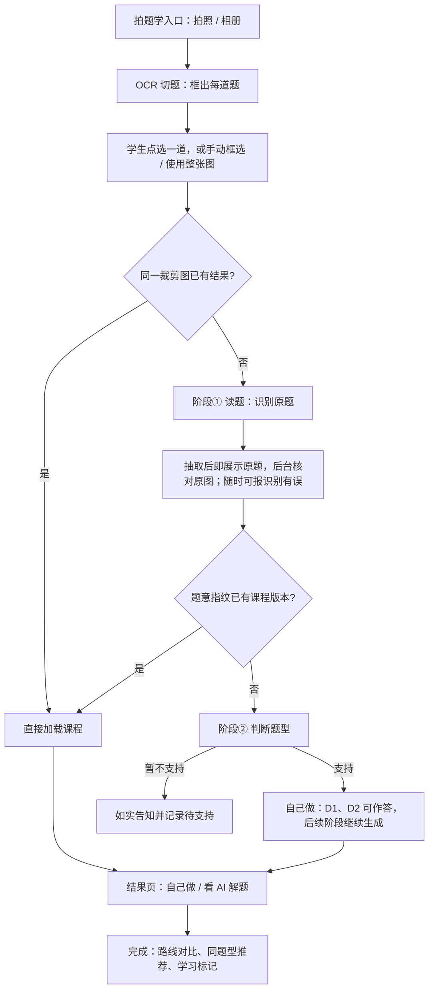

# 学生拍题学页面设计

> 状态：产品设计与分期验收依据；阶段③批次 1c 已在本机开发拍题入口实现并验收 Q01 双路线、持久事件、D1–D4、逐步阅读及构造问答附加，新增 LLM 调用为 0（3.8 节）。阶段④真实生成、学生账号授权／额度及完整上线验收尚未完成。编写日期：2026-10-17；分工与逐步交付更新：2026-10-19。
> 定位：[四阶段交互课程生成设计](graph-guided-interactive-lesson-design.md)的学生产品层。生成链路的数学与契约以四阶段文档为准，本文只定义学生从拍题到做完一道题看到什么、页面如何随生成阶段分期开发。
> 已确定的产品决策：数学步骤通过局部检查即可逐步展示，最终答案与路线完成态须等完整验证和目标收束；阶段④只给已验证路线的固定步骤附加教学问答，题型暂不支持时如实告知；阶段①完成后先请学生选一次“自己做／看 AI 解题”，进入后沿用 Demo 的标签页切换，不另设答案开关；首版按**题型**开放（含参一元二次不等式的恒成立与存在成立 `type-quantified-quadratic`），不限于恒成立专题的 Q01–Q09；生成链路每完成一个阶段，页面同步开发对应功能，不等整条链路完成；S1 到 S5 全部完成后才对学生上线；拍照可拍整页，系统用 OCR 切出题目框由学生点选，只识别选中的一道；产品对外命名为“拍题学”（不叫“拍照搜题”：结果不是从题库搜出的答案，而是 AI 陪学生把这道题学会），代码路径与接口沿用 `search`。

## 1. 定位：对标作业帮

作业帮的核心流程是“拍照 → 题库匹配 → 答案与解析 → 相似题”，优势是速度、覆盖面和手机端体验；学生拿到的是一份看完即止的讲解，家长担心直接抄答案。

本产品不在“更快给答案”上竞争，而是“拍完之后陪学生把题做会”：

| 环节 | 作业帮 | 本产品 |
| --- | --- | --- |
| 结果 | 答案和解析文字／视频 | 可交互课程：读题、判断题型、选方法、分步作答 |
| 学生角色 | 看 | 默认自己做；也可切到“看 AI 解题”的回放 |
| 错误 | 无反馈 | 每一步错答都有基于已验证数学的“再想一想” |
| 结构 | 单题 | 知识图谱同步显示用到的题型、方法、技能和依据 |
| 之后 | 相似题列表 | 同题型、同方法题目推荐，个人图谱掌握度，学习标记 |
| 可信度 | 依赖题库与人工解析 | 数学由程序验证；不能验证的题如实说暂不支持 |

覆盖面和首次出题速度是本产品的短板，本文第 4、5 节分别给出首版的处理方式。

## 2. 与现有页面的关系

| 页面 | 用户 | 职责 | 本文是否修改 |
| --- | --- | --- | --- |
| Studio 工作台 `studio.shuxueshuo.com` | 内部创作与调试 | 上传题图、查看九阶段进度、Review 诊断与重建 | 否。之后可增加“学生拍题记录”和“待支持题型”两个查看入口 |
| 图谱 Demo `/lab/graph-walk/quadratic-always-q01/` | 学生（演示） | 人工原稿的完整交互、AI 回放 | 否，作为拍题学结果页的运行时 |
| 主站题库 `/1/`、`/2/` | 学生 | 人工课程、登录、学习标记 | 否，提供登录与推荐目标 |
| **拍题学页面（新增）** | 学生 | 拍照选题、等待生成、在结果页作答 | 新增 |

拍题学页面放在主站，不放在 Studio：

- 主站已有手机号登录、学习标记和 `site/assets/graph-walk/` 运行时，同源 Cookie 可直接用于受保护接口。
- Studio 是 Next.js 桌面三栏工作台，面向创作和诊断；学生页需要手机优先、单栏、无内部状态。
- 产品 API 与主站 `/api/` 在同一个 P2 `api` 容器，新增学生接口不需要新服务。

## 3. 页面流程

### 3.1 入口

- 首版支持拍照和从相册选图。文字输入列为后续（阶段①目前从题图提取）。
- 拍题学需要登录：每次未命中的拍题都会调用模型。游客可以看 Demo 和题库，点“拍一道题”时弹出现有登录框。
- 每日拍题额度可配置。只有识别成功的那一道计一次；切题、识别失败、暂不支持、标记识别有误和命中已有课程都不计。

### 3.2 拍照与选题

参照作业帮的“整页拍、点选一道”，原型见 `site/lab/search/camera.html`：

1. **取景。** 页面内全屏取景（`getUserMedia`，后置摄像头），叠加九宫格参考线和“纸面放平，文字对齐参考线；可以拍整页，拍完再选题”。拿不到相机权限或浏览器不支持时，退回系统相机（`<input capture>`）和相册。
2. **转正与切题。** 拍照或选图后立即加载本地照片预览，同时上传整页；等待时已有图片，但不显示题目框、不可提交。服务端先按照片 EXIF 修正，再由本地页面方向模型判定 0°／90°／180°／270°。高置信度时自动转正，再用 OCR 切出题目框；返回长边不超过 1600 像素的 JPEG 预览，前端等它解码后一起切换图片与题目框，无须下载全分辨率 PNG。默认选中最靠近照片中部的一题，其余框变暗，底部有题号条和选中题的裁剪预览。
3. **点选。** 学生点框或题号切换，点“学这道题”后只把这道题的裁剪图交给阶段①。整页上的其他题不预先识别，避免为不支持的题消耗模型调用和额度。
4. **兜底。** “顺时针 90°”旋转当前图片并重新切题；自动转正后的图片显示时短暂提示“已自动转正”，方向判断不确定时保留图片、提示检查朝向。手动旋转和失败回滚不提示自动转正。“没框对？手动框选”从当前框开始拖动四角调整；“使用整张图”跳过选区；没切出任何题时直接进入手动框选。旋转或图片加载失败时不会把旧框套到新图上；旋转失败保留上次图片与选区。已拿到切题结果而仅预览图下载失败时，“重试加载照片”只重载该预览，不重新上传、识别或创建页面。

开发原型仅在上传请求本身因网络失败而无法取得响应时进入带明确标识的离线模拟。HTTP 400／413／503 等错误保留本地照片，显示格式不支持、照片过大或识别服务不可用等具体原因，不生成模拟题目框，也不允许提交；“重试识别”重新上传同一张照片。成功响应的数据解析失败同样显示错误并允许重试，不进入模拟。

切题用本地 OCR，不调用 LLM（决策见下）：

- 方向判断使用 [Paddle 的 `PP-LCNet_x1_0_doc_ori`](https://www.paddleocr.ai/main/version3.x/module_usage/doc_img_orientation_classification.html)，当前自动转正阈值为 0.90。分数无效、低置信度或模型不可用时不猜方向，保留手动旋转入口；它与文字检测／识别都在隔离 OCR 环境的 `search/ocr_worker.py` 中运行，不调用 LLM。该 worker 使用版面识别 `PP-DocLayout-S`、文字检测 `PP-OCRv6_medium_det` 与行首识别 `PP-OCRv6_medium_rec`，得到文字行、配图和公式块。
- 所有公共旋转角度统一为顺时针；Paddle 的逆时针校正角在 worker 边界转换。`rotation_reference=upload_after_exif` 表示相对去除 EXIF 方向后的上传图片；`parent_page` 表示相对 `parent_page_id` 的转正图片，不能把手动角度当成相对最初上传的累计角度。旋转使用无插值的整 90° 转置。
- 服务端保留 `source.png` 与全分辨率 `page.png`，另从 `page.png` 等比例生成长边不超过 1600、质量 85 的 `preview.jpg`。前端展示、选区预览和手动选框用 JPEG；提交仍使用归一化坐标，后台从全分辨率 PNG 裁题，不降低送题图片的精度。上传解码、EXIF、旋转、图像编码与存盘都在线程池执行。`page.png` 和 `preview.jpg` 保存完成后，最后原子发布 `segments.json`；没有清单的半成品目录不可访问、不可裁题。
- 手动旋转生成新的页面 ID，保留 `parent_page_id`，不覆盖旧页面和已生成的题目。旋转后的图片关闭自动方向判断，以免把手动调整转回去；必须重新切题并等待新图解码完成，才可提交新选区。更换照片或重拍后，迟到的旧请求不能覆盖当前页面。开发接口每条连续旋转链最多 8 次，次数写入 `rotation_count`（旧清单缺省为 0）；第 9 次返回 `page.rotation_limit`，不再创建目录或调用 OCR。此限制控制连续操作，不等同于上传总额度或存储生命周期；上线前仍需按保留期清理无题目引用的页面，不能直接删除被旧题目引用的父页面。
- 规则拼题：行首题号（`10.`、`11、`、`14．`）开始一道题，延续到下一个题号；“（1）（2）”小问并入上一题；配图并入离它最近的上方那道题；先按文字行横坐标判断单栏或双栏，再按栏切。
- 行首筛选在 OCR 识别前和拼题时共用纠偏后的坐标及大块正文区域；正文区域外的邻页残字不能遮挡正文行首，小段落与公式框不作为独立正文栏。版面模型只框出一个段落时，左右边界与它对齐的宽行也沿用这一栏的行首判断；短片段、不对齐行及同栏真实前文仍不能放行。识别行首时按检测四边形校正倾斜，避免水平裁剪带入上一行。若 OCR 把来源标签 `10.[2026上海…` 识别成 `10.2026上海…`，仅作为弱题号：必须位于同栏两端已确认题号之间、靠近题号左边距，且整段缺号数量和顺序完全吻合，才恢复；普通小数、公式数字及只有单侧题号的情况不恢复。
- 每道题两个框：**点选框**画在照片上，相邻题互不重叠，一次点击只对应一道题；**裁剪框**送给阶段①，必须包含本题完整的最后一行，因此可以和相邻题重叠，但只允许露出邻行的边缘（最多进入下一题题号行框的四分之一，上沿同理避开上一题和大题标题）。实测露出邻题半行可读文字时，模型会把它报成“内容被截断”的不确定项，导致需要确认。选中后底部预览显示的是裁剪框，学生看到的就是送去识别的图。
- 栏的右边界取印刷正文右沿（从栏左缘起头的行的右端 90 分位数），从它右侧才开始的文字（页边演算、旁边的草稿纸）不计入；同栏框统一延伸到正文右沿。框的上沿由题号行决定，题号行上方的手写不把框拉高。
- 切题结果写成 `SelectionRegion`（多边形、`mode="user_confirmed"`），学生选中或手动框选后作为阶段①的选区；现有整图上传对应 `whole-image` 一个区域，阶段①接口不变。
- 选择 OCR 而非多模态 LLM 定位：本地运行、几乎零成本、结果确定可调试，满足拍完即出框的时延。代价是题目边界靠规则，题号缺失、手写多或版面混乱时切不准，这些情况由手动框选和“使用整张图”兜底。后续若漏框率不达标，再评估 LLM 定位作为兜底。

### 3.3 等待

阶段①最新实测耗时中位数 6.5 秒、最长 16.7 秒（[阶段①实现计划](graph-guided-stage-one-implementation-plan.md)）；阶段②正常为纯程序计算，只有多个题型同时命中时调用一次 LLM。学生从拍照到可作答，目标在 20 秒内。

- 等待区显示题图和真实阶段进度：读题 → 判断题型 → 选方法 → 解答，只显示构建快照中的真实状态，不模拟百分比。
- 阶段①自动进入结果，不需要学生确认：显示原题转录、裁剪图缩略图（可放大）和小问切换。“题意整理”与原题同时展开，题干和每个小问各一行：条件用分号连在一起，要解的量用“求”带出。原题和题意里的小问都完整显示，不因当前小问置灰；切换条只标出正在准备的小问，答案出来后用作跳转锚点（2026-10-17 起不再等 D1 读题后才展开）。
- 先展示、后核对：抽取结果通过结构与编译检查、进入原图复核时就展示原题，标“正在核对原图”；复核通过改为“已核对原图”，复核后修正则更新原题并标“已按原图修正”，复核发现缺图、看不清等问题则收回结果、转为对应失败说明。只展示正在复核的那一版候选（与复核调用的 `base_revision` 一致）。复核完成前不开始 D1、不计额度。实测（裁剪图压缩后）原题约 4.5 秒出现，复核约 9.5 秒完成。
- 送入阶段①的裁剪图先压缩：灰度、纸面阴影压白、16 级灰度、长边不超过 1600 像素（`search/question_image.py`）。上传到模型文件接口的耗时随字节数增长，压缩后一道题约 10–30 KB。
- 原题下方始终提供“识别有误”：学生勾选错误类型（文字或公式、漏条件或小问、小问拆分、其他），记录后回到入口重新拍照，这次不计额度；不提供在线修改题面。
- 阶段①没有成功时按终止状态分别说明，均不计额度：缺配图（`missing_figure`）提示连图一起拍；看不清（`unreadable`、`ambiguous`）引用审查给出的原图片段，提示拍正、避开反光；暂不支持的写法（`code_gap`）走 3.4 节；系统失败（`workflow.internal_error` 等）说明“是我们这边的问题”，提供重试和重新拍照。
- 关闭页面不取消任务；“我拍过的题”列出历史题目和各自状态，回来可继续。

### 3.4 暂不支持

题型检查没有命中（四阶段文档 5.2 节第 5 条）时：

- 页面说明“这道题的题型暂不支持”，列出当前已支持的题型，并链接到同题型的人工课程。
- 未命中题型不生成解析或答案；已支持路线按第 5 节区分通过局部检查的步骤与经过完整验证的最终答案。
- 写入待支持记录（题意、特征、检查报告、拍题 ID），在 Studio 可查看，用于补识别契约和图谱节点。阶段②计划中“本地文件待处理”在本页 S2 开发时改为数据库记录。
- 多问题中某一小问不支持时，只有该小问显示暂不支持，其他小问照常作答。

### 3.5 结果页

手机单栏，沿用 Demo 的两种布局：

- 顶部：原题卡片（可折叠）、生成状态条（生成完成后隐藏）。
- 开场选择：阶段①复核通过后，原题卡片下方请学生选 **自己做** 或 **看 AI 解题**，选定后进入图谱解题；进入后仍有与 Demo 相同的标签页，可随时切换，两边各自保留进度。
- 主体：Demo 的图谱运行时。自己做时步骤卡片在页面上，手机顶部固定小图谱；看 AI 解题时手机是图谱播放器。
- 多问题：小问切换条，每个小问一份课程，切换时各自保留进度与状态。
- 完成后：路线对比、同题型人工课程与已生成课程的推荐、学习标记（已练习、自评）。

阶段③的数学步骤逐步到达，页面显示该步的条件、数学推导和依据，路线尚未通过完整验证时保持“计算中／验证中”。阶段④只在本路线 `verified` 后补充各步骤的可能问题、引导问题、提示和 AI 反馈；问答就绪时为原步骤增加入口，不替换正文或重置作答进度。“看 AI 解题”可随计算展示推导；“自己做”按学生当前进度展示，提前收到的后续步骤和答案留在数据中，不自动揭示。问答仍在生成或补充失败时，已验证的数学解答仍可阅读。

答案只通过两条途径出现：学生自己完成路线后的完成态；或切到“看 AI 解题”观看回放。不另设“直接看答案”按钮。

### 3.6 秒开的范围

“秒开”只在以下情况成立，文案和验收不夸大：

1. 同一张裁剪图（文件哈希相同）已有成功结果。
2. 阶段①完成后，规范化题意的指纹与已有课程版本一致，跳过阶段②到④。指纹由现有记法规范化（`notation_normalization.py`）后的题意计算；数字或条件不同即为不同题目。

同一道题换一张照片仍需等待阶段①。之后可以考虑更快的转录前置调用，首版不做。

### 3.7 读题与判断题型（S2）

否定命题采用“读原题 → 命题转化 → 判断题型”的顺序。D1 保留原文的量词、关系以及“原命题为假”的语境，不提前把原文的 `∀`、`>` 称为 `∃`、`≤`。只有阶段②已精确核对的 `quantifier_negation` 转换，才在 D1 与 D2 之间增加独立的 `D1-transform` 选择题；普通题没有这个步骤。目前支持单量词、单关系且定义域一致的否定，包含全称／存在、四种不等号及原关系两边互换的写法；复合命题不猜测转化规则。

该步骤由代码生成，不新增 LLM 调用。`search/proposition.py` 对照阶段②的转换出处与已验证特征，保留同一变量、定义域和求解目标，生成原命题、转化后的条件、规则选项与反馈。量词和关系必须同时取反；已标记的转换若与规范化特征不一致，记录 `d1.transformation_invalid` 并停止生成该小问的课程包，不能悄悄跳过转换后继续。

学生确认前，题意摘要显示“原命题与目标”；确认后显示“转化后的条件与目标”，吸顶提示也切换到转化后的条件。摘要保留祖先题干与本小问的完整原文，只替换经过核对的否定命题片段；例如命题外的 $m>20$ 不会被省略，也不混入兄弟小问的条件。服务端传入同版本 `candidate` 确定作用域，原文或范围不一致时给出诊断。后续 D2、D3、计算、图形和反馈统一使用服务端验证过的规范化条件，不从学生所选文字反向构造数学输入。答错不切换；后退或回放到转换之前恢复原语境，切换解题路线保留这一小问已确认的转换。原题文字、原图和独立验证使用的出处始终保留。转换内容参与课程版本和进度身份，不沿用旧版本的作答。

阶段①复核通过后，服务端立即对该题运行阶段②（[阶段②实现计划](graph-guided-stage-two-implementation-plan.md)）。阶段②通常是纯程序计算；只有多个题型同时成立时调用一次 LLM，实测约 2 秒。D1、D2 的数学判断全部来自阶段②结果，页面和模板只负责措辞。

**页面结构**

- 原题卡片保持原文；题意整理保持展开。有命题转化时按上述确认状态切换摘要。
- 原题卡片下方是开场选择：**自己做**（逐句读题、判断题型，每一步都有反馈）或 **看 AI 解题**（AI 一步步点选，图谱同步点亮）。阶段②还在运行时也可以先选，进入后显示“正在判断题型…”，结果到达即开始。
- 选定后页面换成 Demo 的图谱解题布局，由 Demo 引擎（`site/assets/graph-walk/walk.mjs`）渲染：原题卡片移到左栏顶部，下面是与 Demo 相同的“自己做｜看 AI 解题”标签页和按“步骤 1、步骤 2……”编号的步骤卡片。看 AI 解题时，引擎按回放自动点选步骤 1、步骤 2。
- 图谱在步骤 1 确认后出现：电脑上左栏从居中单栏变为左右两栏，右侧是与 Demo 相同的知识图谱，随步骤同步点亮；手机“自己做”此时出现吸顶小图谱，手机“看 AI 解题”沿用 Demo 的全屏播放器。
- 多问题时，小问切换条放在解题区顶部，并标出暂不支持或判断失败的小问。每个小问是一份独立课程，切换时加载那一问，回到前一问时恢复它的进度（自己做的作答和 AI 回放的位置都保留）。单问题没有切换条。
- 完成 D2 后，若尚未收到阶段③选法结果，显示“选方法”的等待卡片；收到后追加选法步骤，保留已完成的读题、可选转换和题型作答。页面序号按实际步骤顺延，具体见 3.8 节。

**D1 读题：逐句理解**

沿用 Demo 的“逐句读题”清单：每行引用原题中的一句，给出 2 到 3 种理解，学生为每一行选一种，全部选完后提交。与 Demo 不同的是，引文和选项都由程序生成：

- **引文**来自阶段② D1 片段的原文区间。同一句里相邻的量词片段和定义域片段合并成一行，例如“任意”“实数 $x$”“恒成立”合并为“对任意实数 $x$ 恒成立”；关系式、目标各成一行。
- **选项**按行的片段类别和本小问的已知特征值套用模板生成。正确项描述特征的实际取值；每个干扰项对应一个与已知特征值相反的取值，并记下它违背的是哪条特征。首批模板：

| 行 | 依据的特征 | 正确项（举例） | 干扰项（举例） |
| --- | --- | --- | --- |
| 量词（含定义域） | `quantifier`、`domain` | ∀ 且 $x\in\mathbb R$：“所有实数 $x$ 都要满足” | “找到一个 $x$ 满足就行”；“只要 $x=0$ 时成立” |
| 量词（含定义域） | 同上 | ∃ 且 $x\in[1,2]$：“在 $[1,2]$ 里能找到一个 $x$ 满足就行” | “$[1,2]$ 里所有 $x$ 都要满足”；“$x$ 取全体实数” |
| 关系式 | `relation`、`degree_in_bound`、`degree_in_goal` | 关于 $x$ 恰为二次：“关于 $x$ 的一元二次不等式，$a$ 看作常数”；二次项系数含参：“关于 $x$ 的不等式，二次项系数含 $a$，可能不是二次”；更换主元：“关于 $x$ 是一次、关于 $m$ 是二次” | “关于 $a$ 的方程”；“一元一次不等式”（与实际次数不同时才出现） |
| 目标 | `goal`、`free_vars` | 求参数：“求参数 $a$ 能取哪些值” | “解出 $x$ 的取值范围” |

- 模板所需的特征不是 `known`、或阶段②没有定位到对应片段时，省略这一行；一行都没有时跳过 D1，直接进入 D2。
- 提交后有选错的行时，提示那一行选项自带的反馈，即它违背的那条知识（例如“‘任意’是每一个 $x$ 都要满足”）；学生改选后再提交，不计分、不锁定。
- 全部选对后，显示一句“合起来：……”，由各行正确项拼成；图谱点亮各行片段挂接的知识点（片段的 `knowledge_refs`），并按 Demo 做法从这些知识点反查涉及它们的题型，作为候选显示。
- 每个小问各走一遍 D1，即使与前一个小问共用题干。服务端仍在行上标出 `same_as`，留作以后沿用答案。

**D2 判断题型**

问题沿用 Demo：“哪一个题型最直接描述本题的条件与求解目标？” 选项是阶段② `d2.options`，只包括得到支持的题型，以及已判定冲突的易混题型。

| 选项角色 | 选中后 |
| --- | --- |
| 主要题型（`primary`） | 判对；图谱画出知识点到该题型的高亮连线（阶段② `knowledge.links`）；展示判断依据，取该题型已通过分支的学生线索，去重 |
| 替代思路（`alternative`） | 不算错，按 Demo 的“有效思路”提示：“这条思路也能做，但不是最直接的；这节课先按主要题型学”，学生改选主要题型 |
| 易混错项（`conflict`） | 判错；显示阶段②给出的区别反馈（如“没有‘对所有’，只要求出 $x$ 的解集”）；学生重选 |

判对后进入 D3；若选法片段仍未到达，先显示“选方法（生成中）”。新片段到达不重新提交 D1/D2，也不把阶段②重跑一次。

**看 AI 解题（S2 范围）**

AI 回放由服务端从阶段②结果合成，与学生被判对的答案完全相同：先逐句读题，可选的命题转化紧随其后，再选择主要题型。回放包含转换的等价式与规则解释，摘要随回放位置切换；不调用模型，也不声称超出阶段②的内容。

**其他小问状态**

- 暂不支持（`unsupported`）：切到这一问时，解题区只显示一张简短卡片“这一问暂不支持 · 已记下”，不出步骤和图谱；其他小问照常作答。所有小问都不支持时不出开场选择，直接显示这张卡片。
- 判断失败（`selection_failed`）：显示“这一问没判断出题型”和重试按钮。重试只重新运行阶段②，不重新识图，不计额度。
- 阶段②输入不合格（`input_error`）：整题按系统失败处理，提供重试和重新拍照。

**接口**

`GET /api/search/problems/{search_id}` 在阶段①复核通过后增加 `lesson` 字段：阶段②运行中为 `{"status": "running"}`；完成后按小问列出状态、D1 行（引文区间、选项、正确项、干扰项违背的特征、知识点、`same_as`）、“合起来”一句、D2 选项及反馈与判断依据、点亮的知识与连线。D1 行由服务端按模板生成（`search/lesson.py`），页面不自行推断数学含义。

每个判型成功的小问还带 `walk`：一份 Demo 引擎格式的阶段②基础课程包 `bundle` 和对应的 AI 回放 `replay`（`search/walk.py`）。基础包的 `intro` 是 D1（逐句读题清单，选项自带反馈）、可选的 `D1-transform`（命题转化）和 D2（题型选择，`alternatives` 对应替代思路）；其 `routes` 为空，后续由阶段③持久片段扩展。转换题额外携带 `d1.transformation`（出处、规范化上下文、等价式、选项、签名）以及 `bundle.problem` 的 `source_meaning`、`normalized_text`、`normalization_decision`，前端只选择应展示的版本。图谱是公共图谱 `site/knowledge/graph.json` 的子图，包含点亮的知识点、涉及它们的题型（按覆盖数排序）以及主要题型通向的选法判断和方法。服务端只选节点和边，分层布局由浏览器用公共图谱的 `lanesLayout` 按 `graph.lanes` 计算。`POST /api/search/problems/{search_id}/lesson` 从已保存题意重新判型，结果写入新的 `stage-two-<n>` 目录，再为该批次启动阶段③；不重新识图，也不覆盖之前的记录。

引文取阶段② D1 片段的原文区间，并保证不截断 `$…$` 公式：片段跨公式边界时扩到整个公式；片段整个在一个公式内部时（如 `$∀x<0，x^2+ax+2≥0$` 里的量词和关系式），只引片段本身并单独加 `$`，两行引文不会重复。

**生产准入**

阶段②的验收准入（`admission="acceptance"`）要求阶段①的 `evaluation`、`passed` 为真，这两项是录制集对照金标的验收结果。学生上传的题没有金标，改用 `admission="student_upload"`：阶段①结果必须显式标明 `statuses.admission = "student_upload"`，只检查 `reviewed_candidate`、原图复核和特征完整，不写也不检查 `evaluation`、`passed`，不伪造验收成功。同一份输入在验收准入下仍然被拒。结果的 `options.admission` 记录用的是哪一种，离线回放沿用原准入。

### 3.8 当前阶段③接线（批次 1c，本机开发入口已验收）

当前实现落在本机开发入口 `search/dev_api.py` 与 `/lab/search/problem.html`。它读取已有阶段①／②结果，通过原阶段③ runner 求解，HTTP 和 WebSocket 共同读取同一 SQLite 提交库；没有第二套数学求解流程。此入口不提供正式学生登录、账号归属或额度管理，不能把本批通过等同于产品上线。

- **D1–D4。** D1 引文、逐行选项及错误反馈、D2 主要题型／替代思路保持现有行为。阶段③ D3 使用已计算的坐标格、方法覆盖与判断说明，D4 确认路线；数学上适用但执行有缺口的方法可以进入 D4 查看“详细步骤暂不支持”，不会伪装为已解完。Q01 可分别选择判别式法和分离参数法。选法片段纳入同水位快照，事件被裁剪后仍可恢复。
- **逐步阅读。** 数学片段使用独立 DOM 追加，包含已校验的条件、式子与说明，不伪造成学生已回答的问题；最终答案仍由路线完整验证与目标发布门槛控制。自己做按当前小问、路线保存阅读位置；后台新增步骤不替学生前进。看 AI 解题使用程序合成的 D1–D4 回放，新增数学片段不重置或跳过已暂停的回放位置。切换小问或路线分别恢复进度。
- **状态监控与继续计算。** 数学流已可读后，页面在执行状态为 `starting/running` 时仍每 3 秒只读查询题目状态，初次打开已有流也采用同样行为。求解中断或异常且流身份可读时显示“继续计算”，不要求再有数学事件到达；恢复请求成功即后台监控并刷新快照，不等路线结束才解禁按钮。状态请求失败继续重试，保留已到达的数学卡片、流身份和阅读位置。
- **图谱。** 公共方法与知识节点可以随真实片段到达补入图，但只有当前已阅读的数学片段才点亮对应调用及依据。调用从 `source_refs` 指向的已提交轨迹读取，依据取 `used_basis`；不能把方法的全部潜在技能都当作已经使用。
- **问答附加。** 本批只用构造或固定录制的合法问答测试接口，真实 LLM 调用为 0。问答必须匹配课程、运行、小问、路线、步骤及数学步骤／已验证路线两份哈希，只修改原数学卡片的附加区域。目标后来不可用时保留数学前缀与证据，停止展示旧最终答案和问答，并拒绝迟到问答。

审查前验收：Python 相关回归合计 **923 passed、1 skipped**（其中学生拍题后端 82 passed、阶段③ 405 passed），前端 **93 passed**；修改文件的 Ruff 检查通过。[真实浏览器报告](../internal/solver-runs/graph-guided-stage-three/browser-1c-20261019-05/index.html)记录完整验证前 4 张卡片、首条路线单独交接、最终 10 张数学卡片与 2 份交接、5 张问答附加；学生阅读 2 张后刷新恢复，问答保持数学 DOM，目标冲突撤销旧完成态与问答，浏览器错误为空。WebSocket 与游标过期后的快照恢复均有证据，新增 LLM 调用为 0。

1c 审查的状态轮询 P2 已修复：相关前端 **102 passed**（拍题流程 18 passed），[浏览器复核报告](../internal/solver-runs/graph-guided-stage-three/browser-1c-review-20261019-04/index.html)确认无新增事件时仍显示“继续计算”，显式恢复保留数学 DOM，并通过原双路线、问答和刷新恢复流程。中断探针仅构造执行状态和恢复回执；实际进程恢复由后端测试覆盖。浏览器还复现了裁剪与导出竞争导致路线误记 `execution_error`，已将导出和路线收尾的快照／事件读取合并到同一读事务并补并发回归；详见阶段③计划 12.3。

本次后端针对性回归 **61 passed**（事件存储 31、路线执行与阶段③ API 30）；修改文件 Ruff、JS 语法及差异格式检查通过。未重跑此前全部 Python 用例，历史验收数与本次针对性结果分别记录。

本轮剩余 P3 记录在阶段③计划 12.3：快照／导出仍全量扫描提交，开发 WebSocket 仍先接受连接再校验运行；正式服务接入前须校验运行并检查登录与归属。入口准入、上下文与 D3 仍在父进程，路线隔离不能扩大表述为全部数学已隔离。正式登录／归属／额度和真实阶段④生成继续作为后续工作。

完整验收及录制报告归档在[阶段③计划 12.3 节](graph-guided-stage-three-implementation-plan.md#123-批次-1cq01-网页逐步展示与问答附加接口)。该批接线不扩大方法能力；Q02–Q09 及其他输入仍按阶段③当前执行与验证能力报告缺口，S3 最终覆盖目标保持第 8 节要求。Demo 移项步骤例外仍待人工确认，后续批次放宽支持类别前仍须完成分支合并与关系方向门槛。

## 4. 范围：按题型开放

首版开放的是题型 `type-quantified-quadratic` 的全部分支（量词变量的二次式、更换主元），不是 Q01–Q09 九道题：学生拍任意一道属于该题型的题，判型命中即进入课程生成。

实际能否走完取决于阶段③的能力覆盖：

- 选法评估（D3、D4）对该题型的全部选法分支计算适用性，与能力是否实现无关。
- 某条路线缺少能力时，D4 标注“详细步骤暂不支持”，学生改走其他可用路线；全部路线都不可用时，结果页停在 D4 之后并如实说明，同时写入待支持记录（缺口类型为能力缺口）。
- Q01–Q09 是验收集，不是白名单。

其他已登记题型（`type-parameter-quadratic-solve`、`type-amgm-quantified`）判型命中时，首版也按暂不支持处理，直到对应的阶段③能力就绪。

## 5. 开发分期：页面随生成阶段同步开发

S1 到 S5 是开发顺序，不是上线顺序。S1 到 S4 对应生成链路的四个阶段：该阶段验收通过，页面同期实现它解锁的功能，并在本地和测试环境用真实生成结果验收。S3 即包含最小逐步交付接线，数学步骤完成并通过局部检查后即可发布；S4 等本路线完整验证通过后，生成并附加各步骤的教学问答。S5 扩展可靠性与调度，不再承担首次打通逐步展示的工作。S5 完成后整体对学生上线，此前不对外开放。

| 期 | 依赖的生成阶段 | 页面新增功能 | 本期结束时页面可走到 |
| --- | --- | --- | --- |
| S1 | ① 题意与特征（已实现） | 拍题学入口、取景、OCR 切题与点选、手动框选、上传与登录、等待区、原题、识别失败各状态、识别有误、我拍过的题、图片哈希命中 | 拍整页、点选一道后看到识别出的题目 |
| S2 | ② 判型，D1、D2 | 开场选择；自己做：D1 读题、D2 判断题型（3.7 节）；看 AI 解题：由阶段②结果合成的回放；图谱点亮知识线索和题型；暂不支持页与待支持记录；题意指纹记录；小问切换 | 读题并判断题型，或看 AI 走完这两步 |
| S3 | ③ 选法、求解与数学步骤发布 | D3、D4、路线状态；逐步保存并展示程序生成的数学步骤，具备稳定步骤 ID、WebSocket／游标轮询最小接线及刷新恢复；完整验证后发布答案和路线完成态 | 选方法，在路线计算期间看到已通过局部检查的推导，验证通过后得到完整解答 |
| S4 | ④ 固定步骤的教学问答补充 | 对已验证路线附加可能问题、引导问题、提示、常见错误与 AI 反馈，不改变数学步骤；路线对比、AI 作答者录制的完整回放、完整课程版本缓存、题意指纹命中秒开与学习标记 | 数学解答可先阅读，问答补齐后成为完整交互课程 |
| S5 | 传输可靠性与调度优化 | 扩展 WebSocket 推送与轮询补偿、选定路线优先、并发与断线恢复、等待态优化 | 多路线生成与不稳定网络下仍能恢复并继续，不丢失已有步骤和进度 |

说明：

- **S3 的数学步骤。** 推导由能力输出和通用展示模板生成，不经 LLM 润色，每步带条件、表达式、依据及来源。`math_step.local_check=passed` 只说明该步的局部检查通过；只有完整约束校验、可行集完备验证及目标收束均通过，才将本路线标为 `verified` 并发布最终答案和完成态。已发布数学步骤在本课程版本内固定，阶段④不得拆分、合并、删除、重排或替换正文。后续计算失败或验证未通过时，更新路线状态并停止该路线问答生成；已有步骤保留来源，明确该路线未完成或未通过，不把它作为完整正确解答。
- **S4 的问答补充。** 每条路线独立等待自己的 `verified` 状态，不等待其他路线。LLM 读取固定数学步骤与证据，为各步补充教学问答，程序校验后按步骤 ID 附加。数学状态 `route_status` 与问答状态 `enrichment_status` 分开保存：问答超时、失败或尚未完成不撤销 `verified`，也不清空解答；重试只处理缺失或失败的问答。新问答不能使学生已完成的步骤重新变成未完成，也不重置作答记录、阅读位置与小问／路线选择。
- **S4 的 AI 回放。** S2、S3 的回放由服务端从已验证结果合成；S4 起课程生成后由 AI 作答者按回放协议走一遍（四阶段文档 8、10.3 节），回放绑定课程版本。回放生成失败不影响“自己做”。
- **S3 起的交付粒度。** 数学步骤、问答补充、路线完成态是不同片段；状态机不等待浏览器收取结果，先持久化步骤与事件，再通知前端。当前批次 1c 为阶段③持久流提供同源 WebSocket 与游标轮询适配，开发入口先完成两者的最小接线；正式产品库与学生授权接入另行验收，S5 扩展调度和可靠性。轮询不等待整条路线结束；数学计算、问答生成和传输各自推进，页面按真实就绪状态显示。

## 6. 接口与数据

正式学生接口规划挂在主站 `/api/search/`，全部要求登录（现有 `require_user`），写入检查 Origin；这是上线要求，当前本机开发入口不具备这些产品授权能力：

部署前须同步上传大小限制：服务端 `MAX_UPLOAD` 为 20 MiB，当前 `deploy/nginx/shuxueshuo.conf` 的 `/api/` 没有显式配置上传上限。搜索接口上线时，应在 HTTP 回源与 HTTPS 两处为 `/api/search/pages` 配置专用上传规则（`client_max_body_size 25m`，保留现有反代头），并在真实入口验证手机照片上传；当前批次仅在本地运行，不修改生产配置。前端按 HTTP 413 状态码提示“照片太大，请压缩后重试”，也适用于代理返回 HTML 错误页的情况。

| 接口 | 期 | 用途 |
| --- | --- | --- |
| `POST /api/search/pages` | S1 | 上传整页照片，自动转正后返回页面 ID、`preview_url`、`image_url`、全分辨率尺寸、方向状态及 OCR 题目框；不计额度 |
| `POST /api/search/pages/{page_id}/rotate` | S1 | 接收严格整数 `degrees=90/180/270`，顺时针旋转并重新切题，返回新页面 ID 与同一结构；不调用 LLM、不计额度 |
| `GET /api/search/pages/{page_id}/image` | S1 | 返回与题目框、后续裁图一致的全分辨率图片 |
| `GET /api/search/pages/{page_id}/preview` | S1 | 返回同一朝向的轻量 JPEG，用于相机页面展示；旧页面可从 PNG 按需生成，不重跑 OCR |
| `POST /api/search/problems` | S1 | 提交页面 ID 与选区（切题框、手动框或整图），返回拍题 ID；同裁剪图命中直接返回已有结果；识别成功时扣减额度 |
| `GET /api/search/problems/{search_id}` | S1 | 拍题状态快照：阶段进度、原题、题意整理、已就绪片段、失败或暂不支持原因 |
| `GET /api/search/problems/{search_id}/events?after_seq=…` | S3 | 按当前运行的事件游标增量读取已持久化事件；返回运行身份、事件列表与下一游标，具体分页上限见实施契约 |
| `GET /api/search/problems` | S1 | 我拍过的题列表 |
| `POST /api/search/problems/{search_id}/misread` | S1 | 标记识别有误 |
| `GET /api/search/lessons/{lesson_version}` | S4 | 加载完整课程版本（命中秒开） |

当前 1c 的开发接口以运行身份限定地址，页面从 `lesson.stream` 获取地址，不自行猜测最新运行：

| 接口后缀（均在 `/api/search/problems/{search_id}` 下） | 当前用途 |
| --- | --- |
| `POST /lesson/start` | 为已保存的最新阶段②结果显式启动阶段③；已存在的运行不重算 |
| `POST /lesson/{run_id}/resume` | 核对最新判型批次和冻结版本后恢复中断运行；旧运行或版本变化拒绝原地续跑 |
| `GET /lesson/{run_id}/snapshot` | 返回同一事务中的片段、选法、状态、交接与 `last_seq` |
| `GET /lesson/{run_id}/events?after_seq=…` | 读取同一运行已提交事件；过期游标返回 409 并要求重新取快照 |
| `WS /lesson/{run_id}/ws?after=…` | 从相同事件水位持续读取；与 HTTP 事件接口共用同一 `EventStore` |

每个阶段②批次只关联一个阶段③运行目录。只读 GET、重连、刷新不会重新识图、判型或求解；阶段②重试新建批次与运行身份。启动与恢复通过题目及批次锁防止并发重复执行。当前开发接口没有接入正式产品 build/problem/batch 数据库流，后续授权／归属接入须保留这些运行隔离和提交语义。

- S1、S2 沿用轮询快照；S3 起先加载快照及其 `last_seq` 水位，优先订阅该运行的 WebSocket，也可按 `after_seq` 轮询同一运行的增量事件。两者读取同一份持久化事件，S5 再扩展多路线调度与传输恢复。快照中的状态与游标须对应同一提交位置；断线后从已应用的游标继续，游标过期则重读快照，不从页面已显示的步骤数推测位置。
- 事件使用 `lesson.chunk_ready`、`lesson.route_status`、`lesson.goal_status`、`lesson.enrichment_status`、`lesson.failed`。`lesson.chunk_ready` 的 `payload.kind` 区分 `math_step`、`step_qa`、`route_completion`：前者可在 `local_check=passed` 时发布，后两者只引用已完整验证并收束目标、且与当前其他已验证路线一致的路线；尚未完成的路线不等待。`lesson.route_status` 记录数学执行与验证状态，`lesson.goal_status` 同步目标结论与不可用原因，`lesson.enrichment_status` 单独记录问答补充状态；问答失败不能转成数学路线失败。
- 后来其他路线发现冲突或一致性未知时，以 `lesson.goal_status` 追加目标不可用状态，保留各路线的独立验证记录，停止使用该目标旧完成态和问答，拒绝迟到问答且不影响其他小问；更正数学内容使用新版本。完成态发布和问答任务登记必须与当前目标发布门槛一致提交，避免已知不可用后仍启动补充任务。
- 事件带 `run_id`、`lesson_version`、流内单调递增的 `seq` 及内容哈希；目标／路线消息携带 `target_ref`，路线与步骤片段再带稳定 `route_id`、`step_id`，问答引用所附加数学步骤的哈希及已验证路线快照的身份与哈希。挂接、去重、路线状态和幂等任务保留完整目标身份，不同小问同名路线不能互相覆盖。同一次运行内同一步骤和片段重发沿用身份与哈希；同身份不同内容须报冲突，旧运行的晚到事件不能覆盖当前运行。修正数学正文需新课程版本。断线、刷新及问答补齐均按这些身份恢复已有内容和学生进度。
- 数学结果、执行检查点和对应待发送事件一起提交后才推送；前端确认或在线状态不影响计算继续。问答校验失败不发布片段，允许记录独立诊断并按有限重试策略补充，数学步骤和答案保持可读。
- 拍题记录复用产品库的题目、构建与产物，按学生账号归属；共享课程内容只存一份，个人拍题记录、作答和学习标记按学生分别保存（[产品服务架构](product-service-architecture.md)第 6 节）。学生登录不授予 Studio 权限。
- 新增数据：拍题记录（学生、题目、构建、状态）、题意指纹到课程版本的索引（S2 记录、S4 用于命中）、待支持记录（S2）、识别有误记录（S1）、额度计数（S1）。表结构在各期实施计划中确定。
- 生成课程的题目 ID 全站稳定，用于学习标记和个人图谱记录，与 `/1/`、`/2/` 的正式题目 ID 不冲突。

## 7. 不在首版范围

- 文字输入、语音输入、批量拍题。
- 整页预取：切题后只识别学生选中的一道。
- 题目框上标注“能学 / 暂不支持”：需要轻量题型预判，待阶段②题型检查就绪后再评估。
- LLM 定位切题：首版只用 OCR。
- 其他学科和其他题型；按题型逐个扩展，由识别契约与阶段③能力决定。
- AI 导师对话、视频讲解。
- 大规模题库检索（相似图片、模糊文本匹配）。首版只做文件哈希和题意指纹两级精确命中。
- 微信小程序与推送通知。

## 8. 验收

| 期 | 验收 |
| --- | --- |
| S1 | 30 张以上真实整页照片（试卷、练习册，单栏与双栏）的切题标注集上，题目框完整包含题目的比例达标（阈值在 S1 计划中确定），切题耗时中位数不超过 2 秒；手机真机拍照上传 Q01–Q11 题图，从拍照到显示原题的耗时中位数不超过 15 秒；同图二次上传秒开且不调用模型；识别有误可记录；关闭页面后在“我拍过的题”恢复；未登录不能发起拍题 |
| S2 | 恒成立题型的题从拍照到 D1 可作答中位数不超过 20 秒；D1、D2 与 Demo 原稿一致；非支持题型显示暂不支持、不调用 LLM，并能在 Studio 看到待支持记录；多问题按小问分别判型 |
| S3 | Q01–Q09 的 D3、D4、推导与最终答案与人工课程一致；暂停后续计算时，前端已显示此前通过局部检查的步骤，尚无路线完成态；完整验证失败不得发布最终答案或启动阶段④；刷新能从快照与游标恢复，不重复步骤；缺能力的路线标注“详细步骤暂不支持” |
| S4 | 问答只附加到已验证路线的现有步骤，补充前后数学正文、步骤 ID 和顺序不变；问答失败不影响解答阅读、不把数学路线改为失败、不重置学生进度；自己做不因后台片段到达而提前露出答案；Q01 教学问答与人工页面对照通过（四阶段文档 7.5 节）；看 AI 解题可播放；同题意二次拍题秒开且不调用模型；完成后写入学习标记 |
| S5 | 对照四阶段文档第 11 节验证多路线调度与传输恢复；WebSocket／轮询切换、重发、乱序到达、旧运行晚到、游标过期与断网重连不丢步骤或覆盖新版本；超时如实显示等待或失败，不无限等待 |
| 上线 | S1 到 S5 的验收在同一版本上全部重跑通过；生产环境真机走通 Q01–Q09 与一道暂不支持的题；额度、登录过期、断网恢复正常 |

每期另做一次真机浏览器验收，覆盖登录、拍照、等待、作答、刷新恢复与断网重试。

## 9. 参考

- [四阶段交互课程生成设计](graph-guided-interactive-lesson-design.md)：生成链路、片段与渐进交付。
- [阶段①实现计划](graph-guided-stage-one-implementation-plan.md)、[阶段②实现计划](graph-guided-stage-two-implementation-plan.md)、[阶段③实现计划](graph-guided-stage-three-implementation-plan.md)。
- [Q01 图谱 Demo 设计](graph-walk-demo-q01-design.md)第 8 节：手机布局、两种作答者与回放。
- [全站手机号登录与学习标记](site-login-and-learning-marks-plan.md)、[个人知识图谱数据设计](student-knowledge-graph-data-design.md)。
- [产品服务架构](product-service-architecture.md)、[工作台首版](workspace-product-design.md)。
